# User's manual: the line-scan hyperspectral rig

This manual is for building the rig and using its software. It starts with what the instrument is and what each part of the repo does, then gives two quick starts: one that runs the whole software chain on simulated data on a PC, and one that lists the order of work for the real build. Part I is the setup: parts, measuring, printing, the electronics, the computers, the arm and the assembly of the scanner head. Part II is how to use the software, from calibrating the spectrograph to looking at a trained splat in the browser. The appendices collect the everyday commands, troubleshooting, the mirror's serial protocol, a glossary and what isn't tested yet.

> [!IMPORTANT]
> **Nothing here has run on real hardware yet.** Every step was checked against the code at the time of writing, and the software ones were run on the simulator, but the rig itself is still being built. Where the manual says what to expect, the numbers come from the simulator, the CAD model or the optics model unless it says otherwise. Values marked *estimate* still need measuring.

**How to read the commands.** Each command block says where it runs:

| Label | Means |
|---|---|
| **PC** | Your Windows desktop (TheRig) in a command prompt, from the repo folder unless the step says otherwise. Linux and macOS work too: use `python3`, `/` paths and `export` in place of `set`. |
| **Nano** | A terminal on the Jetson Nano itself (the host, JetPack 4.6). |
| **ROS** | A command inside the ROS 2 container on the Nano. Type it after `jetson/ros.sh`, for example `jetson/ros.sh ros2 run ...`, or run `jetson/ros.sh` once for a shell and type it there. |
| **Monitor** | A line typed into the ESP32's serial monitor (`pio device monitor -e esp32dev`). |

Links to files in the repo open on GitHub. Folder names such as `calibration/` are relative to the top of the repo.

**Contents**

- [What this is](#what-this-is)
  - [The instrument](#the-instrument)
  - [Inside the scanner head](#inside-the-scanner-head)
  - [From a scan to a picture](#from-a-scan-to-a-picture)
  - [What's in the repo](#whats-in-the-repo)
  - [Which computer does what](#which-computer-does-what)
  - [Safety rules](#safety-rules)
- [Quick start](#quick-start)
  - [Quick start A: the whole chain on simulated data](#quick-start-a-the-whole-chain-on-simulated-data)
  - [Quick start B: building the rig](#quick-start-b-building-the-rig)
- [Part I: Setup](#part-i-setup)
  - [Parts and arrival checks](#parts-and-arrival-checks)
  - [Measure before you print](#measure-before-you-print)
  - [Print the parts](#print-the-parts)
  - [Mirror electronics](#mirror-electronics)
  - [The PC](#the-pc)
  - [The Jetson Nano](#the-jetson-nano)
  - [Cameras on the Nano](#cameras-on-the-nano)
  - [The arm, gripper still on](#the-arm-gripper-still-on)
  - [Assemble the scanner head](#assemble-the-scanner-head)
  - [Mount the head on the arm](#mount-the-head-on-the-arm)
- [Part II: Using the software](#part-ii-using-the-software)
  - [Spectral calibration](#spectral-calibration)
  - [Scanning](#scanning)
  - [From a scan to a dataset](#from-a-scan-to-a-dataset)
  - [Training a splat](#training-a-splat)
  - [Material maps](#material-maps)
  - [Viewing a splat](#viewing-a-splat)
  - [Running first light](#running-first-light)
  - [Head calibration](#head-calibration)
  - [The simulator](#the-simulator)
  - [Changing the design](#changing-the-design)
- [Appendices](#appendices)
  - [Everyday commands](#everyday-commands)
  - [Troubleshooting](#troubleshooting)
  - [Mirror serial protocol](#mirror-serial-protocol)
  - [Glossary](#glossary)
  - [What isn't tested yet](#what-isnt-tested-yet)

# What this is

## The instrument

<p align="center">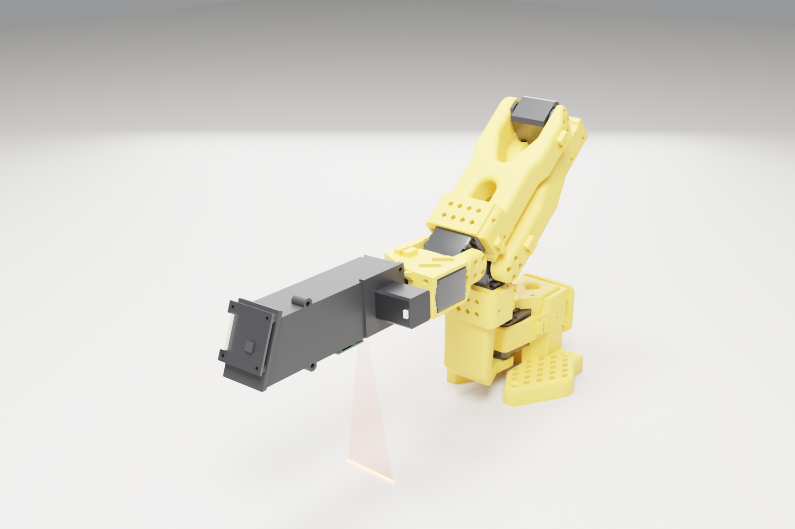</p>

*The rig as the CAD draws it: the SO-101 arm holds the scanner head over the table and the scan line falls on the object below.*

The rig is a **line-scan (pushbroom) hyperspectral camera** on a **LeRobot SO-101 arm**. A normal camera records three colours per pixel. This one records a whole spectrum, from about 500 to 950 nm, which shows things RGB can't, such as the sharp rise in a leaf's reflectance just past red.

It works one line at a time:

1. **A slit picks one line of the scene.** The objective images the object onto a 50 µm slit made from two blade pieces. At 150 mm from the objective that line is about 43 mm long and 0.4 mm thick.
2. **A grating spreads that line by wavelength.** Behind the slit, a collimator makes the light parallel, a 500 lines/mm grating film fans it out by wavelength, and a camera lens focuses the fan onto an IMX219 sensor. Each camera frame is one line of the object (down the sensor) by its spectrum (across the sensor).
3. **A mirror sweeps the line across the object.** A front-surface mirror on a small NEMA 8 stepper sits in front of the objective. Each microstep moves the line about 0.3 mm. The shipped plans step it two microsteps a frame, so a sweep of 107 lines covers a strip about 64 mm long.
4. **The arm sets the viewpoint.** The SO-101 carries the head to a pose and holds still while the mirror sweeps. Each line's pose comes from the arm's joint angles through the robot model. Several viewpoints give a 3D scan.
5. **A 3D Gaussian splat is trained from the lines.** Each Gaussian stores a spectrum (46 bands from 500 to 950 nm) instead of an RGB colour. The trainer renders the splat through a model of the line camera at each line's pose, compares it with the measured line, and also refines the poses.
6. **The browser viewer shows it.** You can look at the splat at any single wavelength, in true colour, in colour infrared, as a band index such as NDVI, or as a map of materials, and click a point to plot its spectrum.

Halogen lamps light the scene, because white LEDs give almost no light past 700 nm. A second camera on the head (a Pi NoIR v2, the *pose camera*) is used by the head calibration, after assembly and whenever the head is moved on the wrist, to measure where the head really sits.

| Quantity | Value | Source |
|---|---|---|
| Band | about 500 to 950 nm (the dataset keeps 46 bands, 10 nm apart) | optics model, converter |
| Spectral resolution | 4.1 nm with ideal lenses; expect 5 to 8 nm with real M12 lenses | optics model |
| Scan line at 150 mm | 43 mm long, about 0.4 mm thick, 256 pixels along it in the dataset | optics model, converter |
| One sweep | 107 lines, about 64 mm long, at 30 frames per second | the shipped plans |
| Head | 187 g, 64 × 53 × 136 mm | CAD |

<p align="center"></p>

*The idea. The drawing's 3.7 nm is an older estimate; the bought parts trace to 4.1 nm.*

## Inside the scanner head

<p align="center">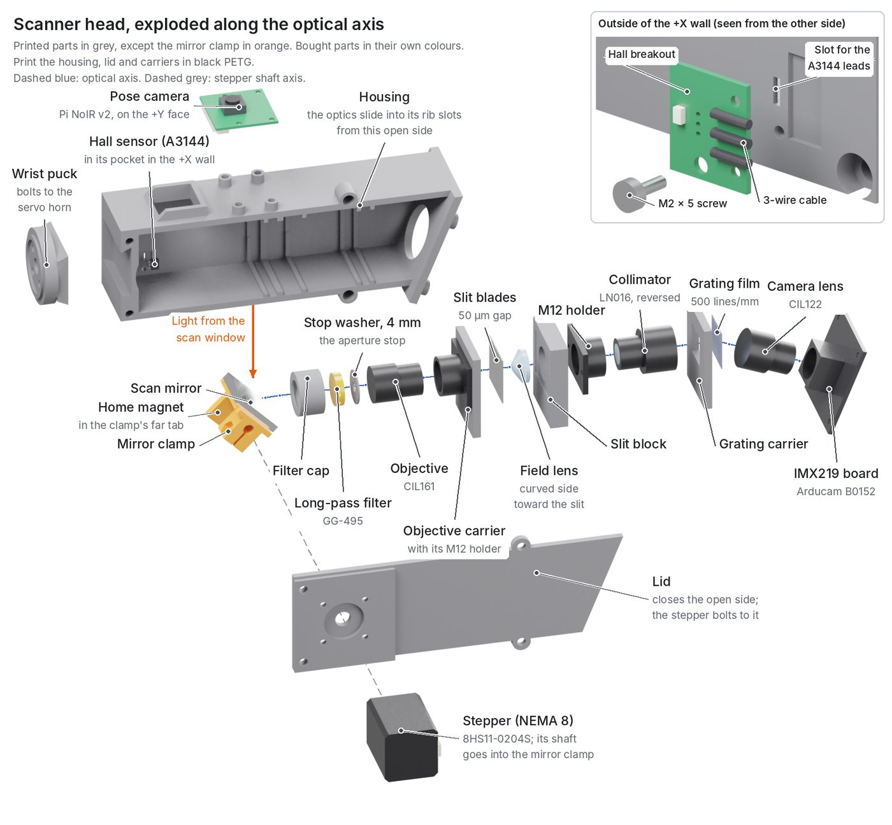</p>

*The scanner head pulled apart along its light path. Printed parts are grey and the mirror clamp orange; print them in black PETG.*

Light comes in through the scan window and meets the parts in this order. This is also the order you stack them in.

| Part | What it does |
|---|---|
| Scan mirror (20 × 20 mm front-surface glass on the stepper) | Folds the view 90° into the head and sweeps the line across the object |
| Filter cap: GG-495 long-pass filter, then a 4 mm stop washer | The filter blocks light below 495 nm, which would otherwise land on the near-infrared end in second order. The washer's hole is the aperture stop (f/3.9) |
| Objective (Commonlands CIL161, 15.6 mm) | Images the object 150 mm away onto the slit |
| Slit (two snap-off blade pieces 50 µm apart) | Lets through one line of the image |
| Field lens (Edmund #49-840), curved side toward the slit | Steers the light from the ends of the slit into the camera lens. The other way round costs resolution and cuts off the ends of the line |
| Collimator (Arducam LN016 25 mm lens, used backwards) | Makes the light from the slit parallel. Its distance from the slit is set by the slit block's thickness |
| Grating film (500 lines/mm, grooves along the slit) | Spreads the light by wavelength |
| Camera lens (Commonlands CIL122, 12 mm) on the Arducam B0152 IMX219 board | Focuses the spectrum onto the sensor. The board is tilted 22° to follow the bent light |
| Hall sensor (A3144) and a magnet in the mirror clamp | Give the mirror a repeatable home angle |
| Pose camera (Pi NoIR v2) on the +Y face | Used by the head calibration |
| Wrist puck | Replaces the gripper on the wrist-roll servo's horn; the housing slides onto its dovetail |

The head frame used everywhere in the repo has its origin on the face of the wrist-roll servo horn, +Z out along the roll axis, +Y toward the scene (out of the scan window) and X along the slit and the mirror shaft.

## From a scan to a picture

<p align="center">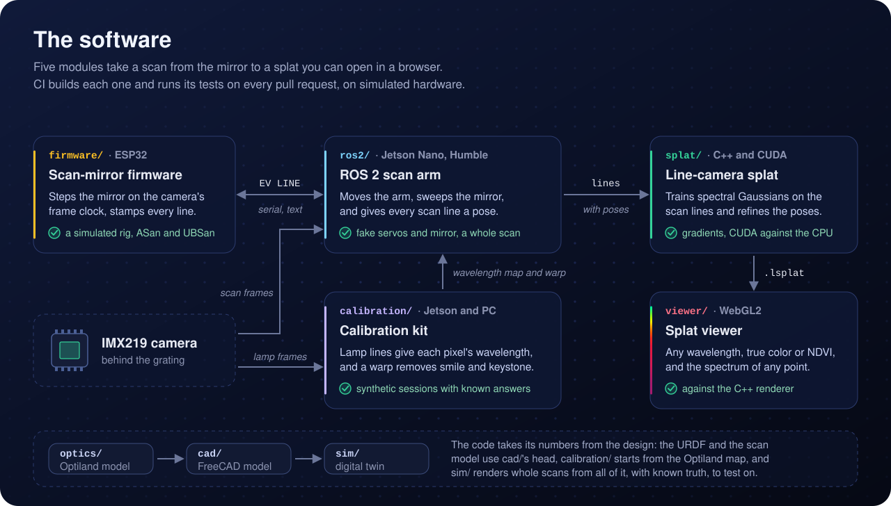</p>

| Step | Runs on | What happens | What it writes |
|---|---|---|---|
| Spectral calibration | Nano captures, PC fits | `hsical` takes frames of lamps with known lines and fits the wavelength of every pixel, the slit's curvature and the spectral response | `cal/` with `calibration.json`, `maps.npz` and `report.md` |
| Scan | Nano, ROS 2 in Docker, with the ESP32 | `scan_sweep` moves the arm to each viewpoint and asks the mirror for a sweep; `line_camera` records the frames and bins them with the calibration; every line gets its time, mirror angle and arm pose | A scan folder in `~/so101_scan/scans/` |
| References | Nano | `capture_reference` records a white (PTFE) and a dark frame at the scan's exposure | `~/so101_scan/references/` |
| Convert | Nano or PC | `scan_to_dataset` turns a scan into reflectance against the white, 46 bands by 256 pixels per line, with a pose per sweep | A dataset folder |
| Train | PC GPU (or the Nano, slowly) | `splat_train` fits spectral Gaussians and refines the poses | The splat, refined poses, previews |
| Materials (optional) | PC | `splat_materials` matches each Gaussian's spectrum to a library and clusters them | Material labels in the splat |
| Export | PC | `splat_export` packs the splat | A `.lsplat` file |
| View | Any browser with WebGL2 | `viewer/index.html` opens the `.lsplat` | Images at any wavelength, spectra |
| Head calibration (once) | Nano and PC | `headcal` measures where the head's cameras and mirror really sit from one scan of a printed board | `head_calibration.yaml`, used by the robot model |

`pipeline/first_light.py` runs the convert, train, export and viewer steps in one command, on a real scan or on a simulated one (see [Quick start A](#quick-start-a-the-whole-chain-on-simulated-data)).

## What's in the repo

| Folder | What it holds | Start with |
|---|---|---|
| [`docs/`](../) | Parts list and first-order design, drawings, this manual, the GitHub Pages front page | [`parts_list_and_design.md`](../parts_list_and_design.md) |
| [`optics/`](../../optics/) | Optiland model of the spectrograph, layouts A to E; E is the bought parts as the head holds them | `python optics/spectrograph_model.py` |
| [`cad/`](../../cad/README.md) | Parametric FreeCAD model of the arm and head: builds the STLs, checks clashes, the mirror's sweep, wrist clearance and servo load | `freecadcmd cad/build_rig.py` |
| [`pcb/`](../../pcb/README.md) | KiCad boards: the scan-mirror controller and the hall-sensor breakout, with JLCPCB files | `pcb/*/fab/` |
| [`firmware/`](../../firmware/README.md) | ESP32 firmware for the mirror, its serial protocol and a command tool | `firmware/tools/mirrorctl.py` |
| [`ros2/`](../../ros2/README.md) | ROS 2 Humble packages: servo driver, robot model with the head, safety, scan sweeps, line camera; the Docker image | `scan_arm.launch.py` |
| [`jetson/`](../../jetson/README.md) | Setup and build scripts for the Nano on JetPack 4.6 | `jetson/nano_setup.sh`, `jetson/build_all.sh` |
| [`calibration/`](../../calibration/README.md) | `hsical` (spectral calibration) and [`headcal`](../../calibration/headcal/README.md) (where the head sits) | `python -m hsical selftest` |
| [`sim/`](../../sim/README.md) | `hsisim`, a digital twin that renders whole scan sessions in the rig's own format | `python -m hsisim` |
| [`splat/`](../../splat/README.md) | C++17/CUDA line-camera Gaussian splat trainer and renderer, and its tools | `splat_train` |
| [`viewer/`](../../viewer/README.md) | The browser viewer, plain HTML and WebGL2 with no build step | `viewer/index.html` |
| [`pipeline/`](../../pipeline/README.md) | Virtual first light: simulator to viewer in one command, or a real scan through the same chain | `pipeline/first_light.py` |
| `.github/` | CI: one workflow per module, and helper scripts | `.github/workflows/` |

Each module's README goes deeper than this manual. Where a README and this manual disagree, this manual has the corrected step; the READMEs are being brought in line.

## Which computer does what

| Machine | Does |
|---|---|
| **PC (TheRig)**, Windows with an NVIDIA GPU | Fits the calibrations, trains splats with CUDA, runs first light and the viewer, flashes the ESP32, rebuilds the CAD and the boards |
| **Jetson Nano** (JetPack 4.6, ROS 2 in Docker) | Runs both cameras, the arm and the mirror during a scan, takes the lamp frames for calibration, can convert scans and train small splats |
| **ESP32** on the scan-mirror controller | Steps the mirror on a clock that follows the camera, homes it, and reports every line over USB serial to the Nano |
| **SO-101 arm** | Carries the head; its STS3215 servos run on their own supply through the Waveshare adapter on the Nano's USB |
| **Any browser** | Opens the viewer, locally or on GitHub Pages once Pages is switched on |

## Safety rules

> [!CAUTION]
> **Four things that break hardware**
> 1. **Never plug the 12 V ALITOVE supply into the Nano.** It has the same 5.5 × 2.1 mm plug as the Nano's barrel jack, which takes 5 V only.
> 2. **Never connect the stepper before VREF is turned down to 0.28 V.** The driver ships at about 0.85 A, four times this motor's 0.2 A.
> 3. **Never plug or unplug the motor while 12 V is on.** The spike can kill the TMC2209.
> 4. **Never power the arm's servos from the ALITOVE.** It is for the stepper only.

> [!WARNING]
> - **The arm's collision model of the head is too short at the camera end** (by 12.5 mm), so the planner can call a pose safe that puts the camera end into the table. The plans that ship with the repo are fine: the scan plans keep 56 mm or more, and the head calibration's plan comes down to 20 mm at a pose where the box and the head agree. For any new plan, add `--clearance 0.025` to `make_plan` and the dry run, run `check_plan`, keep `arm_estop` open and watch the camera end. See [Safety with the head on](#safety-with-the-head-on).
> - **Lasers:** never point one into the optics or anyone's eyes, and mind reflections off the scan mirror.
> - **Mains:** the neon outlet tester plugs into the wall. Hold it by its plastic body and plug it in only while capturing.
> - **Lamps:** a 250 W halogen gets very hot; keep it a few centimetres from the PTFE and away from printed parts. A CFL holds a little mercury; if one breaks, air the room before cleaning up.
> - **The arm:** keep a hand on the servo power switch for every first move, and don't park the arm stretched out level with the head on (the shoulder is then at 75% of its stall torque).

# Quick start

## Quick start A: the whole chain on simulated data

This runs everything after the hardware on your PC: the simulator renders a scan of a relief target in the rig's own format, `hsical` calibrates the simulated spectrograph, the scan becomes a dataset, the trainer fits a splat with CUDA, and the viewer opens it. It needs no parts and takes a few minutes, and the report it writes looks like the one a real scan will give.

**You need** on the PC: Git, Python 3.10 or newer, Visual Studio 2022 or newer with the C++ workload, and the CUDA toolkit. Node 18 or newer is optional (first light skips its viewer check without it).

1. Open an **x64 Native Tools Command Prompt for VS** (it puts Visual Studio's compiler and CMake on the PATH), go to where you keep your clones, and get the repo:

   ```bat
   git clone https://github.com/CoraBeanz/linescan-hyperspectral-splatting.git
   cd linescan-hyperspectral-splatting
   ```

2. Make a Python environment for the repo and install the simulator's packages. They include everything the calibration kit needs.

   ```bat
   python -m venv .venv
   .venv\Scripts\activate
   pip install -r sim/requirements.txt
   ```

3. Build the splat tools with CUDA and run their tests. Do this yourself first: first light only builds them if they are missing, and if it does the build it may not find CUDA and will quietly train on the CPU.

   ```bat
   cmake -S splat -B build\splat
   cmake --build build\splat --config Release
   build\splat\Release\splat_tests.exe
   ```

   The configure step should print `linesplat: CUDA <version>`. If it says `no CUDA compiler found`, CMake didn't find `nvcc`: check the CUDA toolkit is installed and open a new prompt.

4. Run virtual first light on the quick config:

   ```bat
   set PYTHONUTF8=1
   python pipeline/first_light.py pipeline/configs/sim-quick.yaml
   ```

   `set PYTHONUTF8=1` matters on Windows: without it Python writes `report.md` in the old Windows encoding and crashes on its ≤ and ≥ signs. In PowerShell the line is `$env:PYTHONUTF8=1`.

   **Expect** it to exit with no error after about two minutes and to write `build\first_light\sim-quick\report.md` starting with **Passed**. On a 4-core machine without a GPU it took 121 s; the rows to look at:

   | Check | On the run for this manual |
   |---|---|
   | Reflectance against the simulator's truth, median ratio off 1 | 0.002% |
   | RMSE of the splat against the measured lines | 0.021 |
   | Pose error before and after training | 1.21 px, then 0.89 px |
   | Viewer's reading of the file against the C++ renderer, worst band | 5 × 10⁻⁵ |
   | Splat size | 6,874 Gaussians, 392 KB |

5. Start a local web server for the viewer and open it:

   ```bat
   python -m http.server -d viewer 8000
   ```

   Open <http://localhost:8000>, click **Open file…** (or drop the file on the page) and choose `build\first_light\sim-quick\splat.lsplat`. Drag to turn, scroll to zoom, click the model to plot a spectrum, and try **Wavelength**, **Color infrared** and **Band index**. [Viewing a splat](#viewing-a-splat) explains every control.

<p align="center">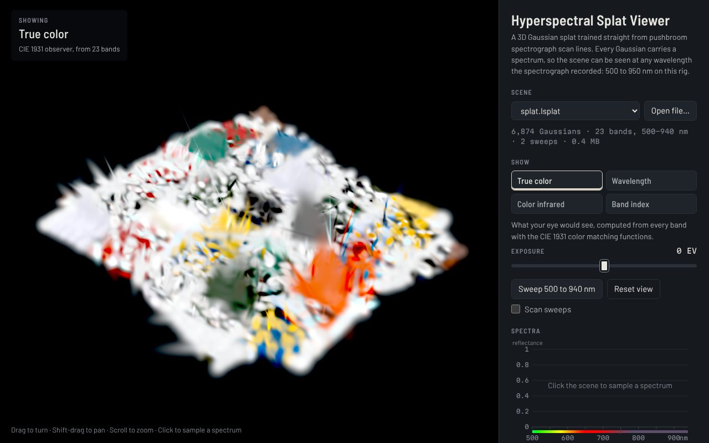</p>

*What step 5 looks like: the simulated relief target in true colour, with four clicked points and their spectra.*

The full-size simulated scan is `python pipeline/first_light.py` with no config (6 to 10 minutes on four cores; it writes `build\first_light\sim-ring\`). [Running first light](#running-first-light) covers the configs, the report and the real-scan version.

## Quick start B: building the rig

The build splits into what you can do now, what you measure as parts arrive, and what waits on those measurements. The one rule: **don't print the head yet.** The housing, slit block, lid and filter cap are drawn around estimated lens and board sizes, and a wrong number means a reprint. Everything else can be built and tested as it arrives.

<p align="center">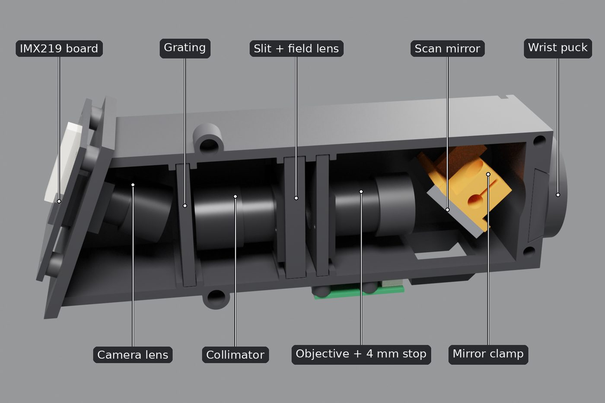</p>

*Where each measurement lands in the head. The tags are the rows of the measurement sheet in [Measure before you print](#measure-before-you-print).*

**Now, in any order** (each line links to its chapter):

1. Order what's left, about $58: the short M3 kit, a second camera ribbon, the halogen, the CFL and the neon outlet tester. [Parts and arrival checks](#parts-and-arrival-checks)
2. On the PC: the calibration self-tests and Quick start A above. [The PC](#the-pc)
3. The ESP32 on its own: check the module, flash it, check the step timing. [Mirror electronics](#mirror-electronics)
4. The hall sensor on the bare ESP32, to find the magnet face that trips it. [Find the magnet's working face](#find-the-magnets-working-face)
5. The TMC2209 and stepper on a breadboard: set VREF, then the first moves. [Mirror electronics](#mirror-electronics)
6. The Nano: identify it, power it right, run the setup and build scripts. [The Jetson Nano](#the-jetson-nano)
7. The cameras on the Nano: the Pi NoIR first, then the B0152 when it lands. [Cameras on the Nano](#cameras-on-the-nano)
8. The ROS 2 stack with no hardware, then the real arm with its gripper still on. [The arm, gripper still on](#the-arm-gripper-still-on)
9. Print the six parts that no measurement changes, after a near-infrared check of your black PETG. [Print the parts](#print-the-parts)

**As each box opens:** do its arrival check and take its measurements (M1 to M16). The LN016's back focus (M1) matters most: it sets the slit block's thickness one for one. Then the CAD gets the numbers, rebuilds and the head STLs are ready. [Measure before you print](#measure-before-you-print)

**After the measurements:**

1. Print the head: housing, slit block, lid, filter cap. [Print the parts](#print-the-parts)
2. Build the optics and the bench spectrometer, and run a practice calibration with the GG-495 held at the slit. [Assemble the scanner head](#assemble-the-scanner-head)
3. Fit the objective, the hall sensor, the stepper and the mirror, close the lid, and set the mirror's working angle. [Stepper, magnet and mirror](#stepper-magnet-and-mirror)
4. Mount the head on the arm and redo the wrist-roll calibration. [Mount the head on the arm](#mount-the-head-on-the-arm)
5. Calibrate for scanning at 1640 × 1232 and copy the calibration to the Nano; take the white and dark references. [Spectral calibration](#spectral-calibration)
6. First real scan of an asymmetric relief target. [Scanning](#scanning)
7. First light on the PC, with the references. [Running first light](#running-first-light)
8. Head calibration, then reconvert the earlier scans. [Head calibration](#head-calibration)

# Part I: Setup

## Parts and arrival checks

The head is drawn around these exact parts. A substitute with another size changes a print, and one with a built-in IR-cut filter ruins the near-infrared half of the band. The full list with vendors, links and prices is [`docs/parts_list_and_design.md`](../parts_list_and_design.md); this is what each part is for.

| Part | As bought | Notes |
|---|---|---|
| Spectrograph camera | Arducam B0152 NoIR 8 MP IMX219, M12 mount | No IR-cut filter. Its stock lens comes off for the CIL122 |
| Camera lens | Commonlands CIL122-F2.0-M12ANIR, 12 mm | The no-filter version |
| Objective | Commonlands CIL161-F2.0-M12ANIR, 15.6 mm | The no-filter version; the 4 mm printed stop makes it f/3.9 |
| Collimator | Arducam LN016 25 mm M12 lens, no IR filter | Used backwards. Back focus not published: measure it (M1) |
| M12 holders | uxcell 10-pack, 20 mm screw spacing | Two get cut down to the lens thread plus 1 mm |
| Field lens | Edmund Optics #49-840, 12.7 mm, f = 15 mm, plano-convex | Curved side toward the slit |
| Slit | 9 mm snap-off blades, set with the 0.05 mm leaf of a Spurtar feeler set | Two 20 mm pieces |
| Grating | Your own 500 lines/mm film (pitch to confirm, M14) | Fallback: Rainbow Symphony 500 lines/mm slides |
| Long-pass filter | Edmund Optics #54-652, SCHOTT GG-495, 12.5 × 3 mm | |
| Scan mirror | RUEHALF 100 × 100 × 3 mm front-surface mirror | Cut to 20 × 20 mm |
| Mirror stepper | StepperOnline 8HS11-0204S NEMA 8, 0.2 A | |
| Stepper driver | BIGTREETECH TMC2209 V1.3 | Ships at about 0.85 A: turn VREF down before the first run |
| Microcontroller | Your ESP32 dev board | Must be a WROOM-32; a 38-pin DevKitC for the controller board |
| Stepper supply | ALITOVE 12 V 3 A with a screw-terminal adapter | For the stepper only |
| Home switch | Gikfun A3144 hall sensors and your 5 × 1.6 mm disc magnets | The A3144 switches on one pole only |
| Controller boards | The scan-mirror controller and the hall breakout, from `pcb/` | Not ordered yet; a breadboard works meanwhile |
| Light | HDX 250 W halogen work light LG351-250W | A second one evens out shadows |
| Wavelength lamps | EcoSmart 13 W daylight CFL; Sperry GFI6302N outlet tester | The tester's lamps must be neon (orange) |
| White reference | Sasylvia virgin PTFE sheet, 1/16 in | Cut in half: one single sheet for the bench, one backed with white card |
| Screws and inserts | M2 × 5; M3 kits (25 to 45 mm, and 6 to 30 mm); Pofsnnx heat-set inserts | |
| Glue and tape | Loctite Super Glue Gel Control; polyimide (Kapton) tape | Cure CA in open air: its fumes can haze the mirror |
| Compute | Your Jetson Nano 4 GB, JetPack 4.6 | A B01 (two camera ports) is needed for the head calibration |
| Cables | Two Arducam 100 cm 15-pin camera ribbons | One per camera |
| Pose camera | Your Raspberry Pi NoIR camera v2 | |
| Arm | Your LeRobot SO-101 follower | The head replaces the gripper |

**Things on no list that you'll need:** black PETG; a multimeter (the Analog Discovery 3 can stand in for setting VREF); a glass scorer; a soldering iron with a heat-set insert tip; a 3-wire cable for the hall sensor and a 4-wire extension for the motor, long enough to run up the arm; a laser printer (or a print shop) and foam board for the head-calibration board; the Pi camera's focus tool; a colour card or similar for test scans; and, only for the Nano's 10 W mode, a 5 V 4 A barrel supply. A 1/4"-20 hex nut is needed only if you put the bench puck on a tripod.

**Don't use:** the Arducam B0183 (fixed IR-cut filter), the Arducam LN001 (650 nm IR-cut), single-edge razor blades (they don't fit the slit block), rear-surface mirrors (ghost lines), cool-beam GU10 or MR16 halogen bulbs (they send the near infrared out the back), or a Pi Camera Module 3 as the pose camera (the Nano needs extra drivers for it).

### Arrival checks

Each takes a minute and needs no tools.

| Part | Check | If it's wrong |
|---|---|---|
| CIL122, CIL161, LN016 | Look through from the thread end at a white sheet. Neutral is right; a pink, red or blue-green tint means an IR-cut filter. Faint coloured reflections off the coatings are fine. | Send it back: an IR-cut filter blocks 650 to 1000 nm, half the band |
| Arducam B0152 | The board says B0152, not B0183, and the stock lens unscrews. Later, a TV remote's flash shows in the live view. | Return a B0183 |
| Edmund #49-840 field lens | Find the curved side by its edge and mark the box. | The curved side goes toward the slit |
| BTT TMC2209 V1.3 | Pot side up, pot at the top: the left header reads EN, MS1, MS2, RX, TX, CLK, STEP, DIR. | A V1.2 reads PDN, PDN in place of RX, TX; the UART still goes to the 4th pin. Another make: the firmware sets the current from BTT's 0.11 Ω sense resistors, so put yours in `kTmcRSense` in `firmware/include/board_pins.h` before flashing |
| Your ESP32 | The metal can says ESP32-WROOM-32 (any suffix); 38 pins; rows 25.4 mm apart. | A WROVER module won't work at all (its PSRAM uses GPIO 16 and 17). 30 pins or 22.9 mm rows work on a breadboard but need a new socket and symbol for the controller board |
| Jetson Nano | Two camera connectors (B01) or one (A02). | An A02 can't run the head calibration as written |
| Outlet tester | It glows orange (neon). | An LED tester gives no neon lines |
| Heat-set inserts | Knurl diameter: M2 about 3.0 mm, M3 about 5.0 mm. | The holes are drawn 2.85 and 4.5 mm; they change for other inserts |

## Measure before you print

Several sizes in the CAD are estimates or come from listings, and the housing, slit block, lid and filter cap are cut around them. Measure each part as it arrives, to 0.05 mm, and take the mean of two or three readings. Then the numbers go into [`cad/rig/params.py`](../../cad/rig/params.py), the model is rebuilt and the head's STLs are ready to print ([Changing the design](#changing-the-design) has the commands).

| # | Part: what to measure | CAD now (mm) | How | What it holds up |
|---|---|---|---|---|
| M1 | **LN016 collimator: back focus** | `coll_bfl` 6.0 | Card method (B2) on the view out of a window; with a lamp 3 m away subtract 0.21. Three to five tries, take the mean | **The most important number.** The slit block's thickness follows it one for one; also the housing and lid. A sibling lens lists 5.2; below about 5.5 the slit block needs a design change |
| M2 | LN016: overall length, thread length | `coll_len` 21, `coll_thread` 9 | Calipers on the metal (B1) | Housing grating slot, lid; where to cut its holder |
| M3 | CIL161 objective: OD of the front 5 mm, overall length, thread length, back focus | `obj_od` 14, `obj_len` 18.5, `obj_thread` 9, `obj_bfl` 5 | Calipers; back focus by card, subtract 0.08 at 3 m. Note if the front face is a flat ring | Filter cap (OD), housing objective slot. Length plus back focus sets the filter cap's 1.4 mm clearance to the turning mirror |
| M4 | CIL122 camera lens: widest OD, overall length | `cam_od` 15, `cam_len` 19 | Calipers | Camera end of the housing and lid |
| M5 | B0152 + CIL122: focused stack height X | 1 + 5 + 19 = 25.0 | CIL122 in the board's own holder, focused on something far in a live view, then PCB face to the lens's front rim (B4). Don't touch the sensor | Camera end of the housing and lid |
| M6 | CIL122 aperture | 6 (f/2.0) | White screen right behind the lens; read the bright disc (B3). About 6 means f/2.0, about 5 means f/2.4 | No print; the light estimate only |
| M7 | B0152 board: hole spacing both ways, and which edge has the connector | `brd_hole` 29 × 29 | (A + B) / 2, see B4 | Housing camera standoffs |
| M8 | B0152 holder: width across flats and across corners 3 to 6 mm above the PCB; base or ear thickness | 14 across flats | Calipers. Across corners must stay under about 20.3, the base under 3 | Housing end-wall hole (20.8 mm) |
| M9 | uxcell M12 holders: ear thickness, hole spacing, footprint | ear 2, holes 20, 24 × 17 | Calipers; hole spacing as M7 | Screw length; the carriers if the holes aren't 20 mm apart |
| M10 | Snap-off blades: thickness | `blade_t` 0.38 | Calipers on the flat back, away from the bevel; two blades | Slit block blade recess |
| M11 | NEMA 8: pilot boss diameter and height; shaft diameter and length | 15 × 1.5; shaft 4 × 10 | Calipers (B5) | Lid motor pocket (fits up to 15.5 × 1.8 as drawn); clamp bore |
| M12 | NEMA 8: M2 thread depth, two holes | 2.5 | One M2 × 5 screwed in by hand; depth ≈ 5 − gap (B5) | 3.2 or more: use M2 × 5 as they are. Less: file 1 mm off four |
| M13 | Mirror sheet: thickness; front-surface check | `mirror_t` 3.0 | Calipers. A pencil tip on the coated face touches its own reflection | Mirror clamp and the housing's axis, only if not 3 mm |
| M14 | Your grating: lines/mm; one row of spots? | 500 (camera tilt 22.0°) | Laser through it onto a wall 1.00 m away (B6). A grid of spots means a crossed grating: unusable | Housing and lid camera tilt; whether to buy the $15.60 film |
| M15 | A3144: body size | pocket 4.5 × 3.3 × 1.71 | Calipers; the CAD draws the body 4.1 × 3.0 × 1.5 | Housing hall pocket |
| M16 | GG-495 filter: diameter, thickness | 12.5 ± 0.38 × 3.0 ± 0.2 | Calipers | Filter cap seat |

**What each print waits on:** the housing on M1 to M5, M7, M8 and M14, plus a look at M9, M13 and M15; the slit block on M1 and M10; the filter cap on M3 and M16; the lid on M1, M4, M5, M11 and M14.

> [!WARNING]
> The filter cap clears the turning mirror by only 1.41 mm as drawn. An objective 1 mm longer than the estimate (or with 1 mm more back focus) leaves 0.41 mm, and 2 mm longer makes the cap touch the mirror. After entering M3, rebuild and read the filter cap's gap in `cad/build_report.json` before printing the housing.

### How to measure

<p align="center">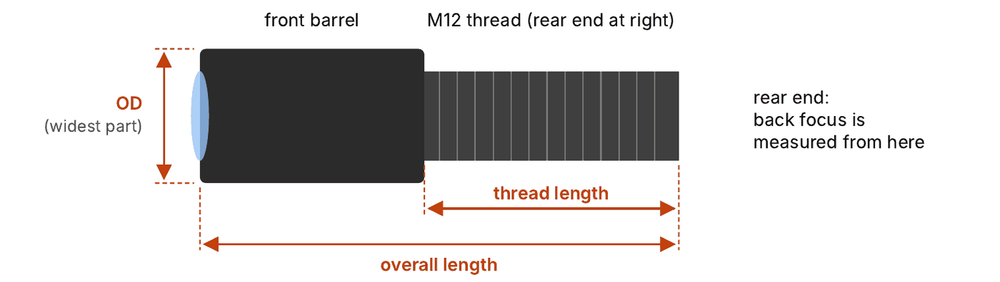</p>

*B1. Lens barrel: outside diameter (the widest part), overall length, and thread length (the overall length minus the front part).*

<p align="center">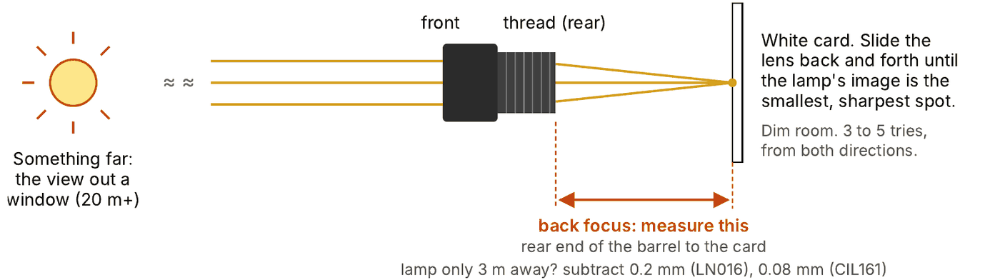</p>

*B2. Back focus. Point the lens's front at something far (the view out of a window, 20 m or more) and slide a white card behind its rear end until the image is smallest and sharpest. Measure from the rear end of the barrel to the card. Dim the room and do it three to five times, from both directions. With a lamp only 3 m away, subtract 0.2 mm (LN016) or 0.08 mm (CIL161). The card shows the visible focus; the 750 nm focus is a hair longer, which the lens takes up by unscrewing slightly.*

<p align="center">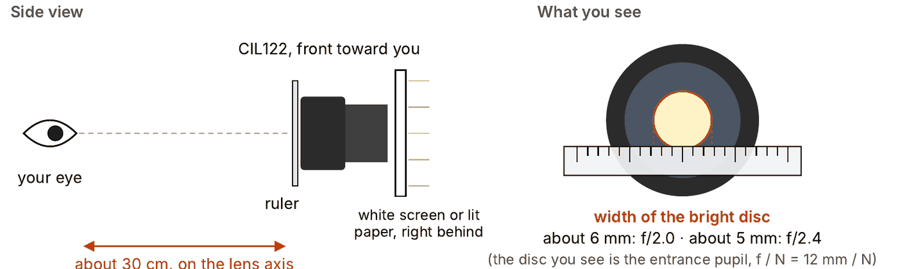</p>

*B3. CIL122 aperture. Light it from right behind with something big and even, such as a white phone or laptop screen; a lamp or a distant window lights only part of the pupil and reads small. 5 mm against 6 mm is easy to tell; 5.5 isn't.*

<p align="center">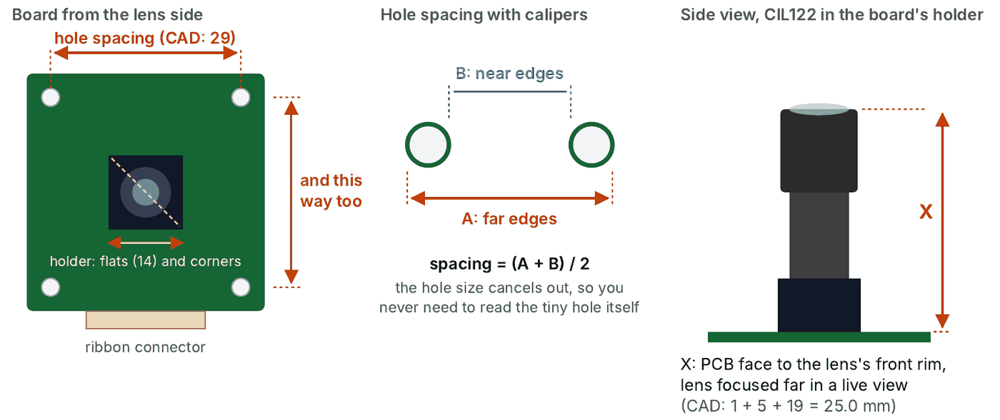</p>

*B4. Camera board. Hole spacing = (A + B) / 2, where A is across the far edges and B across the near edges of two holes, so the hole size cancels out. Measuring the focused stack X replaces two awkward numbers (the sensor's height and the CIL122's back focus) with one easy one.*

<p align="center">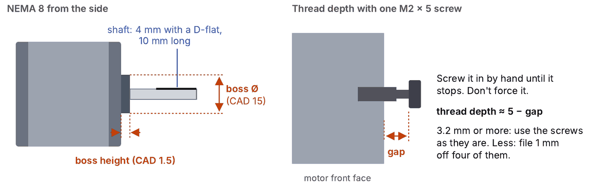</p>

*B5. Stepper. A caliper's depth rod is usually too wide for an M2 hole, so screw an M2 × 5 in by hand until it stops (don't force it): the thread depth is about 5 minus the gap under its head.*

<p align="center">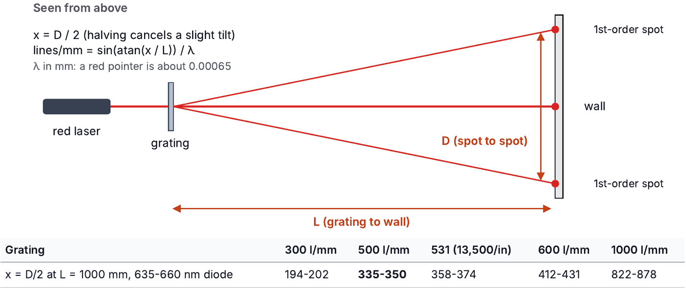</p>

*B6. Grating pitch. Shine a red laser through the film onto a wall L = 1.00 m away and measure D between the two first-order spots. Lines/mm = sin(atan(D / 2L)) / λ, with λ ≈ 0.00065 mm for a red pointer; the table's ranges don't overlap, so an uncalibrated diode still decides it. The grooves run at right angles to the row of spots; mark that direction, because the grooves go along X in the carrier. Never look into the beam. A 600 lines/mm film would need the camera at 26.7° (a new housing and lid) and would cover only 516 to 967 nm; 1000 lines/mm can't work; 300 lines/mm fits but gives about 6.9 nm.*

To post the numbers, copy this and fill in what you have:

```text
M1 coll_bfl = __ (tries __, spread __, window view / lamp at __ m)
M2 coll_len = __    coll_thread = __
M3 obj_od = __    obj_len = __   obj_thread = __   obj_bfl = __
M4 cam_od = __    cam_len = __
M5 X = __         (or cam_bfl = __ by card)
M6 CIL122 pupil about __ mm
M7 brd_hole = __ along the connector edge, __ across it
M8 holder: flats __ corners __ base/ears __
M9 ear __    hole spacing __   footprint __ x __
M10 blade_t = __
M11 boss __ x __   shaft __ x __
M12 thread depth __ / __
M13 mirror_t = __   front surface: yes/no
M14 D = __ at L = __   one row of spots: yes/no
M15 A3144 __ x __ x __
M16 GG-495 __ x __
Checks: lens tints / field lens side marked / ESP32 module, pins, rows / Nano B01 or A02
```

## Print the parts

Print the parts in the light path in **black PETG**: it copes with the stepper's warmth, which PLA may not, and black keeps stray light down. Some black filaments look grey in near infrared, so check yours first.

1. **Check the filament.** Print the grating carrier and photograph it in sunlight with the Pi NoIR next to the white PTFE, with the exposure short enough that the PTFE isn't clipped (LED room light has almost no near infrared). It should look as dark as it does to your eye. If it looks grey, change filament or line the inside with flocking.
2. **Print the parts no measurement changes**, while you measure: both stop washers, the objective carrier, the grating carrier, the wrist puck, and the mirror clamp once the stepper's shaft measures 4 mm (M11). The bench puck and the controller tray are safe too, but have nothing to hold yet.
3. **After the measurements and a rebuild**, print the housing, slit block, lid and filter cap. The housing prints standing up, 129.4 mm tall: check your printer's build height.
4. **Clean up:** clear any stringing from the stop washer's hole (its edge is the aperture stop) and check the filter cap is a snug push fit on the objective.

<p align="center">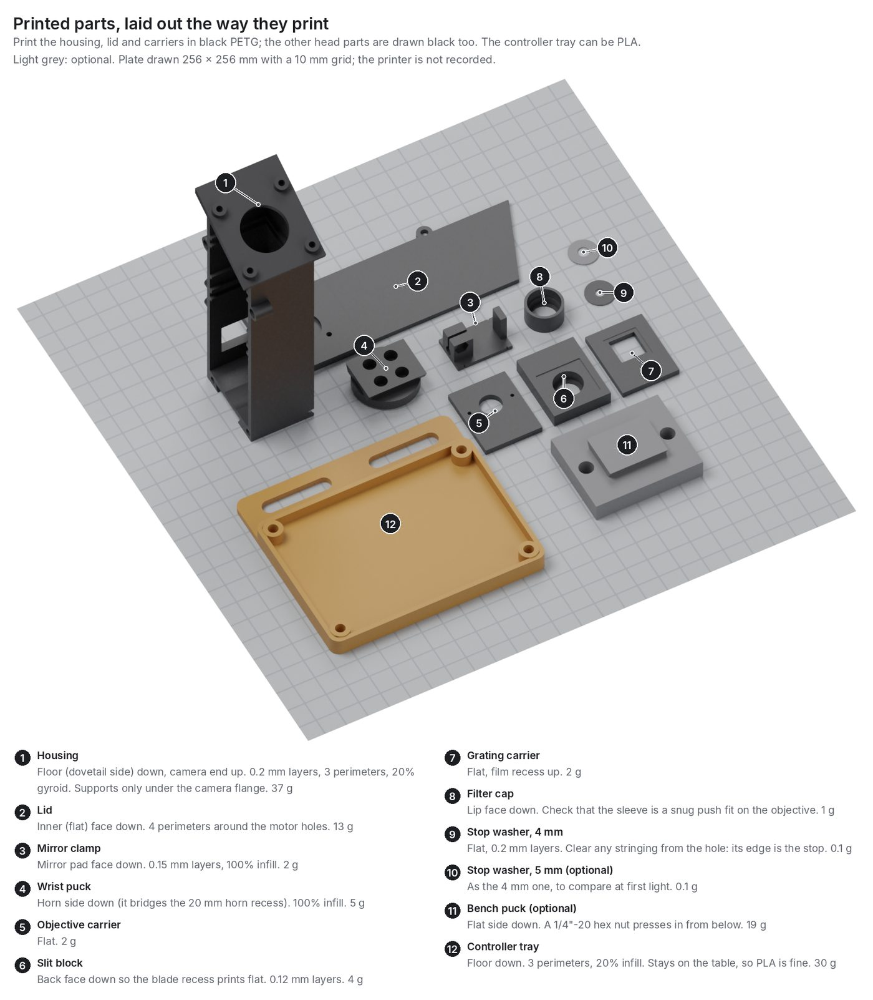</p>

*Every printed part in its print orientation. The STLs in `cad/stl/` are already turned this way. The masses in the picture are older and rounded; the table has the current ones.*

| Part | File | How to print | Size (mm) | Mass |
|---|---|---|---|---|
| Housing | `housing.stl` | Floor (dovetail side) on the bed, camera end up. 0.2 mm layers, 3 perimeters, 20% gyroid, supports only under the camera flange | 38.0 × 48.3 × 129.4 | 37 g |
| Lid | `lid.stl` | Inner (flat) face on the bed. 0.2 mm layers, 4 perimeters around the motor holes | 125.9 × 47.7 × 4.0 | 13.5 g |
| Slit block | `slit_block.stl` | Back face down so the blade recess prints flat. 0.12 mm layers | 26.5 × 33.2 × 6.8 | 5.1 g |
| Filter cap | `filter_cap.stl` | Lip face down | 16.7 × 16.7 × 9.5 | 0.7 g |
| Mirror clamp | `mirror_clamp.stl` | Mirror pad face down. 0.15 mm layers, 100% infill | 25.5 × 17.0 × 15.1 | 1.7 g |
| Wrist puck | `wrist_puck.stl` | Horn side down (it bridges the 20 mm horn recess). 100% infill | 29.0 × 29.0 × 10.0 | 4.8 g |
| Objective carrier | `objective_carrier.stl` | Flat | 26.5 × 33.2 × 3.0 | 2.4 g |
| Grating carrier | `grating_carrier.stl` | Flat, film recess up | 26.5 × 33.2 × 3.0 | 2.2 g |
| Stop washer, 4 mm | `stop_washer.stl` | Flat, 0.2 mm layers | 13.0 × 13.0 × 0.6 | 0.1 g |
| Stop washer, 5 mm (optional) | `stop_washer_5mm.stl` | As the 4 mm one | 13.0 × 13.0 × 0.6 | 0.1 g |
| Bench puck (optional) | `bench_puck.stl` | Flat side down | 50.0 × 40.0 × 13.0 | 19 g |
| Controller tray | `controller_tray.stl` | Floor on the bed. 0.2 mm layers, 3 perimeters, 20% infill. PLA is fine: it stays on the table | 100.0 × 89.0 × 9.0 | 30 g |

The head's nine parts take about 68 g of PETG, and the tray 30 g. The 5 mm stop washer is for a comparison at first light: in the model it gives 14% more light at the centre of the line and 40% more at its ends at the same resolution, with more stray light. The bench puck holds the housing on the optics table for bench work: one 1/4"-20 or M6 screw through its −X hole into the table (the nut is only for a tripod).

## Mirror electronics

The scan mirror sits on a NEMA 8 stepper (1.8° per step, 0.2 A). A TMC2209 driver runs it at 1/32 microstepping, so one turn is 6400 microsteps and one microstep turns the view 0.11°. An ESP32 runs the firmware: it steps the motor on a clock that follows the camera's frames, homes the mirror with an A3144 hall sensor and a magnet, and takes plain-text commands over its USB cable at 921600 baud.

The ESP32 and the driver's logic run only from USB. The 12 V supply powers only the motor, so with USB unplugged the motor can't move even with 12 V on.

You can build the whole circuit on a breadboard now and move to the controller board when it arrives; the pins are the same and the firmware can't tell the difference.

### Flash the ESP32

Flash it before anything else is connected, so no old program can drive the motor. **On the PC**, with the ESP32 on a USB data cable and nothing else plugged in:

1. Install PlatformIO and pyserial, and go to the firmware folder:

   ```bat
   pip install platformio pyserial
   cd firmware
   ```

2. Find the board's port: Device Manager, under *Ports (COM & LPT)*, for example COM5. (On Linux it's `/dev/ttyUSB0`.) Use your port wherever this manual says COM5.

3. Optionally run the firmware's 58 unit tests on the PC against a simulated rig. On Windows this needs gcc on the PATH (MSYS2's `mingw-w64-ucrt-x86_64-gcc`); CI runs them on every push anyway.

   ```bat
   pio test -e native
   ```

4. Build and flash:

   ```bat
   pio run -e esp32dev -t upload --upload-port COM5
   ```

   The first run downloads the pinned ESP32 platform and the TMCStepper library, then builds, uploads and ends with `SUCCESS`. If it stops at `Connecting...`, hold the board's BOOT button until the upload starts.

5. Open the serial monitor and type `INFO`, `PING` and `STATUS`, each followed by Enter. Leave with Ctrl+C.

   ```bat
   pio device monitor -e esp32dev
   ```

   **Expect** `OK INFO fw=0.1.0 proto=1 usteps=32 full_steps=200 tick_us=50 max_rate=10000`. The monitor doesn't reset the board, so the boot line (`EV BOOT ...`) only shows after you press the board's EN button or type `REBOOT`. A few garbage characters after a reset are the boot ROM talking at another baud rate; ignore them.

Only one program can hold the port. Close the monitor before you run `mirrorctl.py`, and stop any ROS launch that uses the mirror before you open the monitor. Use the PlatformIO monitor or `mirrorctl.py`; other terminal programs may reset the ESP32 when they open the port.

### Check the step timing (optional)

The timing is the one part of the firmware you can't see by eye. With no driver connected, put the Analog Discovery 3's logic analyser on GPIO 26 (STEP), 25 (DIR), 18 (MOVING), 19 (TRIG) and GND. Close the monitor, then **on the PC, in `firmware/`**:

```bat
python tools/mirrorctl.py -p COM5 "ENABLE force=1" "SCAN start=0 step=2 lines=10 period=33333.333"
```

**Expect** ten `EV LINE` lines 33.3 ms apart and `EV SCAN_DONE lines=10 ... aborted=0`. On the analyser, each line shows two STEP pulses about 0.65 ms apart at its tick, MOVING high until 3 ms after the last step, and a 100 µs TRIG pulse as MOVING falls. Send `DISABLE` when you're done.

> [!NOTE]
> `ENABLE force=1` runs without talking to the driver. Use it only for this test: with a real driver it would run at whatever current VREF sets and at the microstepping the MS1 and MS2 pins select, not the firmware's 1/32.

### Find the magnet's working face

The A3144 switches on one pole only, so one face of the magnet has to face it. Wire it to the bare ESP32: pin 1 (VCC) to the ESP32's 5V pin, pin 2 to GND, pin 3 (OUT) to GPIO 33, and a 10 kΩ resistor from OUT to 3.3 V. Pin 1 is on the left with the printed face toward you and the leads down.

In the monitor, pass each face of a 5 × 1.6 mm magnet over the sensor's printed face. For one face only, an `EV HALL on=1` line appears and `STATUS` shows `hall=1`. Mark that face: it faces **out** when you glue the magnet into the mirror clamp.

> [!WARNING]
> Never pull OUT up to 5 V: GPIO 33 takes 3.3 V at most. The sensor's output only pulls low, so the 10 kΩ to 3.3 V keeps it safe.

### Wire the driver and motor on a breadboard

<p align="center">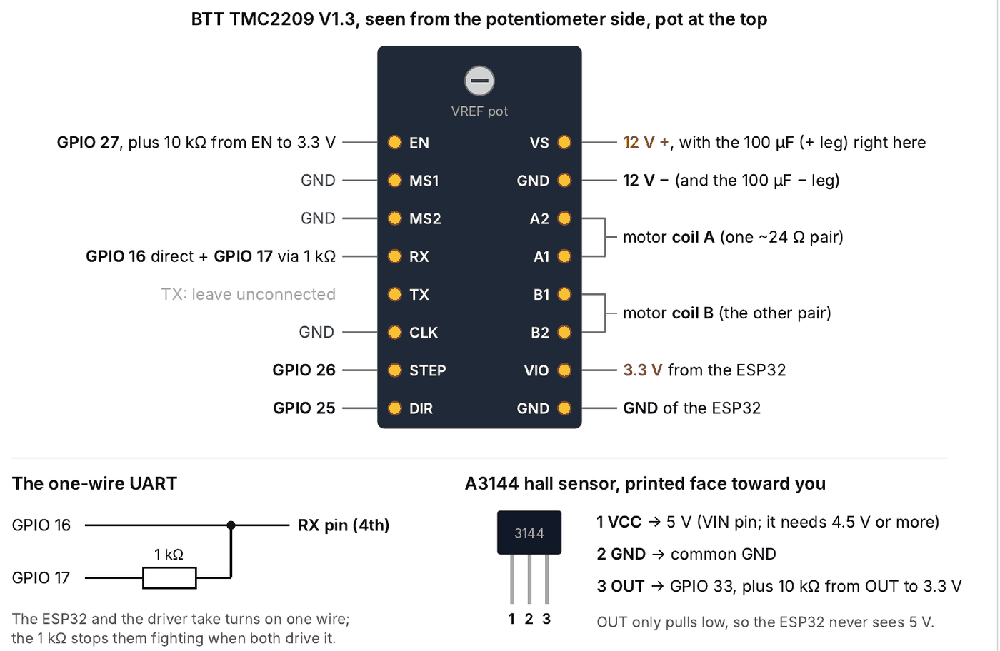</p>

*The breadboard wiring for the BTT TMC2209 V1.3, seen from the potentiometer side with the pot at the top. On this version the UART pin is the one printed **RX**; older guides and the V1.2 call it PDN_UART. Use one common ground for everything.*

| ESP32 | Goes to | Notes |
|---|---|---|
| GPIO 26 | STEP | |
| GPIO 25 | DIR | |
| GPIO 27 | EN | Plus 10 kΩ from EN to 3.3 V, so the motor stays off while the ESP32 boots |
| GPIO 16 | RX (the 4th pin) | Straight to it |
| GPIO 17 | RX (the same pin) | Through 1 kΩ. The ESP32 and the driver take turns on the one wire, and the resistor stops them fighting |
| 3.3 V | VIO | The driver's logic supply |
| GND | GND (both), the 12 V supply's −, the A3144's GND | One common ground |
| none | MS1, MS2, CLK | All to GND: UART address 0 and the driver's own clock |
| none | TX | Leave unconnected |
| none | VS and GND | The 12 V supply, with the 100 µF capacitor right at the module (its striped − lead to GND) |
| GPIO 33 | A3144 OUT | Plus 10 kΩ to 3.3 V, as above |
| 5V (VIN) | A3144 VCC | It needs 4.5 V or more |
| GPIO 2 | Status LED, through 1 kΩ to GND (optional) | Many clone boards already have one. Keep GPIO 2 low or floating at boot |

Leave the motor unplugged and the 12 V off while you wire. The breadboard has none of the controller board's fuse, reverse-polarity diode or spike clamp, so check the 12 V polarity twice before switching on.

Find the motor's two coils with a multimeter, not by wire colour: about 24 Ω across a pair, open between pairs. (With no meter, twist two leads together and turn the shaft by hand: if it drags, that's a pair.) One coil goes to A1/A2, the other to B1/B2. A coil the wrong way round only reverses the direction, which a setting undoes.

### Set the motor current

> [!CAUTION]
> BTT ships the TMC2209 at about 1.2 V VREF (0.85 A), over four times what the NEMA 8 is rated for. Set it to 0.28 V **before the motor is ever connected.** The firmware sets the current itself once it talks to the driver, but VREF is what the driver uses before that and whenever the link fails.

1. Motor unplugged. ESP32 on USB, then the 12 V on.
2. Measure from GND to the driver's potentiometer and turn it in small steps until it reads **0.28 V**. The current is I = VREF / √2, so 0.28 V gives 0.2 A.
3. While you're there, hold the ESP32's EN button (it stays in reset) and measure the driver's EN pin: it should read 3.3 V, so the pull-up holds the motor off at boot.

### First moves

1. Switch the 12 V off and wait until the supply has drained (on the controller board, until the green MOTOR PWR LED is dark). Plug in the motor. Switch the 12 V on.
2. Type `REBOOT` in the monitor (or press the EN button). The ESP32 checks the driver at boot, and `STATUS` reports that check, so it shows `drv=noresp` if the 12 V came on after the ESP32 started. `ENABLE` checks again anyway.
3. In the monitor:

   | Type | Expect |
   |---|---|
   | `STATUS` | `state=disabled ... drv=ok` |
   | `DRV` | `ver=0x21 enn=1` (a TMC2209, motor off) |
   | `ENABLE` | `OK ENABLE drv=ok`; the motor holds and the status LED lights |
   | `MOVE rel=32` | `EV MOVED pos=32`: one full step, 1.8° |
   | `MOVE rel=-32` | `EV MOVED pos=0` |
   | `SCAN lines=20 step=8 period=100000` | 20 `EV LINE` lines 100 ms apart, then `EV SCAN_DONE lines=20 ... aborted=0` |
   | `DISABLE` | `OK DISABLE`; the motor goes slack. It's also the quickest stop from the terminal |

4. After a few minutes enabled, feel the motor. At 0.2 A it turns 1 to 2 W into heat: warm, not too hot to hold.

`HOME` waits until the mirror clamp with its magnet is on the shaft: on the bare shaft nothing carries the magnet past the sensor, so it ends in `HOME_FAILED`. Homing is in [Home the mirror and set the working angle](#home-the-mirror-and-set-the-working-angle). A positive move should turn the view from the head's +Y (out of the scan window) toward +Z; if it turns the other way, send `CFG dir_inv=1`, `SAVE`, `ENABLE` and `HOME`.

### The controller board

The controller board carries the ESP32 DevKitC and the TMC2209 in sockets, adds a fuse, reverse-polarity and spike protection, a status LED and keyed connectors, and sits on a printed tray behind the arm. The hall breakout holds the A3144's leads on the outside of the head.

<p align="center">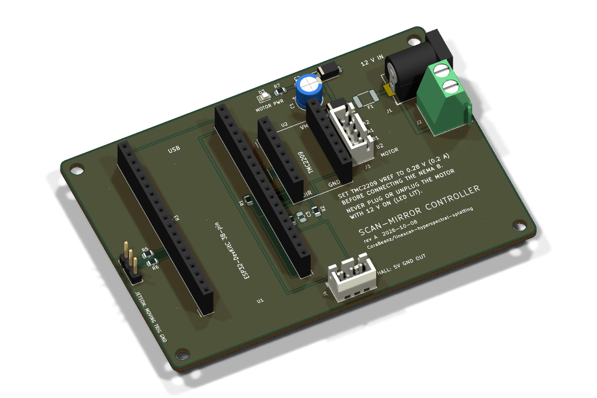</p>

**Before you order**, confirm the ESP32 is a 38-pin DevKitC with rows 25.4 mm apart and a WROOM-32 module, and the driver is the BTT V1.3 pinout ([Arrival checks](#arrival-checks)). A 30-pin board, or a 38-pin one with rows 22.9 mm apart, needs a new socket in `pcb/tools/` before ordering. Also check your barrel jack matches a DC-005 5.5 × 2.1 mm footprint and the ALITOVE plug's centre hole is 2.1 mm; if it's 2.5 mm, feed the 12 V into the screw terminal J2 instead.

**Order from JLCPCB:**

1. Upload `pcb/scan_controller/fab/scan_controller_gerbers.zip`. Keep the defaults: 2 layers, FR-4, 1.6 mm, 1 oz.
2. Turn on PCB assembly, economic, top side, with `bom_jlc.csv` as the BOM and `cpl_jlc.csv` as the placement file from the same folder. JLCPCB fits 14 small parts.
3. In the placement preview, check the four parts with a direction: D1 and D2 with the cathode stripe toward the left (toward the TMC2209), and the LEDs D3 and D4 with the cathode mark on the left. A reversed D1 blocks the 12 V; a reversed D2 shorts it through the fuse.
4. Add the hall breakout as a second board from `pcb/hall_breakout/fab/hall_breakout_gerbers.zip`, **0.8 mm thick** (the CAD and the M2 × 5's 2.5 mm of thread in the wall assume 0.8 mm). Its one 100 nF capacitor is easy to hand-solder.

**Solder** the low parts first: J5 (1×3 header), J3 (4-pin JST XH) and J4 (3-pin JST XH), then C1 (100 µF, long lead in the + hole), then the four female headers with their modules plugged in so the rows stay straight, then J2 and the jack J1. Leave the solder jumper JP1 bridged 1-2 for a stock BTT module. Before any power, with no modules fitted, measure for shorts from J2 + to J2 −, and from the DevKit socket's 3V3 and 5V pins to GND.

| Connector | Pins | Goes to |
|---|---|---|
| J1 | 5.5 × 2.1 mm jack, centre +12 V | The ALITOVE supply |
| J2 | Screw terminal, + and − | A bench supply or the ALITOVE's screw adapter, instead of J1 (never both) |
| J3 | JST XH 4-pin: 1 A2, 2 A1, 3 B1, 4 B2 | The NEMA 8, one coil on pins 1-2 and the other on 3-4 |
| J4 | JST XH 3-pin: 1 +5 V, 2 GND, 3 OUT | The hall breakout's cable |
| J5 | 1×3 header: 1 MOVING, 2 TRIG, 3 GND | Free Nano GPIO inputs or a scope (no code reads them yet) |
| DevKit USB | | The Nano: power and serial |

| LED | Means |
|---|---|
| Green, MOTOR PWR (D3) | 12 V is on the driver. Never plug or unplug the motor while it's lit |
| Red, STATUS (D4) | Off: motor disabled. On: enabled. Blinking: driver fault (`state=fault` until the next `ENABLE`) |

Seat or remove the ESP32 and the driver only with USB and 12 V both off, the DevKit's USB end toward the board's top edge and the driver's EN pin at the EN mark. A driver plugged in backwards is destroyed at power-up. Then set VREF and run the first moves exactly as on the breadboard.

### Connect the controller to the Nano

1. Plug the DevKit's USB into the Nano with a data cable.
2. Once the Nano is set up ([The Jetson Nano](#the-jetson-nano)), check that the port got its fixed name (**Nano**):

   ```bash
   ls -l /dev/scan_mirror
   ```

   **Expect** a link to the ESP32's tty. If it's missing, the board's USB chip isn't one the rules know: see [USB names for the arm and the mirror](#usb-names-for-the-arm-and-the-mirror).

3. Talk to it from the ROS container (the Nano's own Python is too old for `mirrorctl.py`'s `--sync`):

   ```bash
   jetson/ros.sh python3 /ws/src/linescan-hyperspectral-splatting/firmware/tools/mirrorctl.py -p /dev/scan_mirror INFO STATUS
   ```

From here ROS drives the mirror; [Scanning](#scanning) covers it.

## The PC

The PC fits the calibrations, trains the splats, runs first light and hosts the viewer. If you ran [Quick start A](#quick-start-a-the-whole-chain-on-simulated-data), it's already set up for most of this.

### What to install

| For | Install |
|---|---|
| Everything | Git; Python 3.10 or newer |
| Training with the GPU | Visual Studio 2022 or newer with the C++ workload (it brings CMake); the CUDA toolkit |
| The viewer check in first light (optional) | Node 18 or newer |
| Flashing the ESP32 | `pip install platformio pyserial` |
| Changing the CAD (optional) | FreeCAD 1.0 or newer (tested with 1.1.3); `pip install "optiland==0.6.2"` for the optics checks |
| Changing the boards (optional) | KiCad 10 |
| Watching the arm and camera live | Foxglove (desktop app or the web app), connecting to the Nano |

### One Python environment for the repo

From the repo folder in a command prompt:

```bat
python -m venv .venv
.venv\Scripts\activate
pip install -r sim/requirements.txt
```

`sim/requirements.txt` covers the calibration kit, the head calibration, the simulator and first light (numpy, scipy, matplotlib, OpenCV, PyYAML, xacro, pytest). Activate the environment (`.venv\Scripts\activate`) in every new prompt before running the repo's Python tools.

### Self-tests

These prove the PC side works and show you full calibration reports on synthetic data before any real frame exists. **On the PC**, from `calibration/` with the environment active:

```bat
cd calibration
python -m hsical selftest
python -m headcal selftest --keep headcal_selftest
python -m pytest
```

| Test | Expect | On the run for this manual |
|---|---|---|
| `hsical selftest` | `Self-test passed.` in under a minute | every pixel's wavelength 0.012 nm rms from the truth (limit 0.1 nm); 25 s |
| `headcal selftest` | `PASS in N s`, one to three minutes | the line camera's rays 0.165 mm from the truth (median), 0.26 mm worst; the pose camera 0.13 mm and 0.03° off |
| `python -m pytest` | all pass | 46 passed in about 2 minutes |

Use `python -m pytest`, not bare `pytest`: the bare command can't import `hsical`. `--keep <folder>` keeps a self-test's output; read its `report.md` (here in `headcal_selftest\`), because the real one will look the same.

### Build the splat tools

From the repo folder in an **x64 Native Tools Command Prompt for VS**:

```bat
cmake -S splat -B build\splat
cmake --build build\splat --config Release
build\splat\Release\splat_tests.exe
```

The tools land in `build\splat\Release\`: `splat_train`, `splat_export`, `splat_materials`, `splat_render` and `splat_synth`. First light finds them there. Rebuild after pulling changes to `splat/`.

### Windows notes

- **`set PYTHONUTF8=1`** before `pipeline/first_light.py` (PowerShell: `$env:PYTHONUTF8=1`). Without it the report crashes on its ≤ and ≥ signs. Setting it once for your user account (System Properties, Environment Variables) saves typing it.
- Use forward slashes in paths you pass to the pipeline's `--set` options and YAML files, for example `C:/scans/ring_20261012`.
- `cmd` doesn't expand `~`. Where a README writes `~/headcal`, use a plain folder name such as `headcal`.
- To copy folders from the Nano, Windows has `scp` built in: `scp -r <user>@<nano-ip>:so101_scan/scans/<scan> .`

## The Jetson Nano

The Nano runs the rig during a scan: the arm's servo driver, the mirror bridge, both cameras and the safety checks. NVIDIA's last software for it is JetPack 4.6 (Ubuntu 18.04, CUDA 10.2), which is too old for ROS 2 Humble, so ROS 2 and the splat build each run in a Docker container on top of it. Three scripts in [`jetson/`](../../jetson/README.md) do the setup.

**You need:** the Nano 4 GB Developer Kit with JetPack 4.6.1 or newer on a microSD card (64 GB), its power supply, a network shared with the PC, and internet for the first build.

### Identify it and power it

1. **Count the camera (CSI) connectors** on the board. Two means a **B01**, one means an **A02**. The head calibration's pose camera needs the B01's second connector; everything else works on either.
2. **Power.** The Nano runs on 5 V only.

   | Supply | Then (**Nano**) |
   |---|---|
   | Micro-USB, 5 V 2 A | `sudo nvpmodel -m 1` (5 W mode) before building |
   | Barrel jack, 5 V 4 A, with the J48 jumper fitted | `sudo nvpmodel -m 0` (10 W, MAXN) |

   `sudo nvpmodel -q` prints the mode now.

   > [!CAUTION]
   > **Never plug the 12 V ALITOVE supply into the barrel jack.** It has the same 5.5 × 2.1 mm plug and destroys the board. Label it.

3. **Check the software and space** (**Nano**):

   ```bash
   head -n1 /etc/nv_tegra_release
   free -h
   df -h /
   ```

   The first line should start `# R32 (release), REVISION: 7.` (JetPack 4.6.1 or later). Plain JetPack 4.6 says revision 6.1; it will probably work, but the splat container is built from the r32.7.1 image.

### Set it up and build everything

1. **Clone and set up** (**Nano**, home folder). `nano_setup.sh` checks for JetPack 4 and Docker's NVIDIA runtime, lets you run Docker without `sudo`, adds a 4 GB swap file and installs the USB port names. It asks for `sudo` where it needs it and skips whatever is done.

   ```bash
   git clone https://github.com/CoraBeanz/linescan-hyperspectral-splatting.git
   cd linescan-hyperspectral-splatting
   jetson/nano_setup.sh
   ```

   **Expect** lines for L4T, Docker with the NVIDIA runtime, the docker group, the swap file, the USB names and the power mode, ending `Done. Next: jetson/build_all.sh`. **Then log out and back in** so the docker group applies.

   If it says `Docker or its NVIDIA runtime is missing` but `sudo docker info | grep Runtimes` lists `nvidia`, it's a known false alarm: run it again. If it repeats, do its remaining steps by hand: `sudo usermod -aG docker $USER`, a swap file, and the udev rules (`sudo cp ros2/udev/99-so101-scan.rules /etc/udev/rules.d/ && sudo udevadm control --reload-rules && sudo udevadm trigger`).

2. **Check** that Docker works without `sudo` and the swap is on:

   ```bash
   docker info | grep -i runtimes
   free -h
   ```

   The runtimes line includes `nvidia`; swap is at least 4 GB.

3. **Build and test everything** (**Nano**, repo folder):

   ```bash
   jetson/build_all.sh
   ```

   It builds splat for the Nano's GPU and runs its tests, renders a small synthetic scene on the GPU and the CPU to compare them, trains it for 300 steps on the GPU, then builds the ROS 2 image and runs `colcon build` and `colcon test`. It stops at the first failure, and it fails rather than skips if the container can't see the GPU, so a pass means CUDA works. **Expect** `=== All built and tested` at the end. The first run downloads the images and compiles everything, which takes a long time; later runs redo only what changed.

### What runs where on the Nano

| Place | What runs there | How you get there |
|---|---|---|
| The Nano itself (the host) | `nano_setup.sh`, `nvpmodel`, the `hsical` and `headcal` capture commands, `jetson/*.sh` | SSH or the Nano's desktop |
| The **ROS 2 container** (Ubuntu 22.04, ROS 2 Humble) | Every `ros2 run`, `ros2 launch` and `colcon` command | `jetson/ros.sh` |
| The **splat container** (L4T r32.7.1 with JetPack's CUDA) | Building splat, its tests and tools | `jetson/splat.sh` |

| On the Nano | In the ROS 2 container | Holds |
|---|---|---|
| `~/so101_scan` | `/data` | `calibration.yaml` (the arm), `head_calibration.yaml`, `hsical/cal/` (the spectral calibration), `scans/`, `references/`, `plans/`, `datasets/` |
| `~/so101_ws` | `/ws` | colcon's `build/`, `install/` and `log/` |
| The repo | `/ws/src/linescan-hyperspectral-splatting` | The sources and the example plans |
| `~/linesplat` | (`/data` in the splat container) | splat's build and the datasets you train there |

- The ROS 2 container runs as root, so files it writes under `~/so101_scan` and `~/so101_ws` belong to root. Delete them with `sudo` on the host.
- `/tmp` inside a container disappears when it exits.
- On the Nano, use `jetson/ros.sh` wherever [`ros2/README.md`](../../ros2/README.md) says `ros2/docker/run.sh`: the Nano's Docker (20.10.7) can't build the image the plain way.

### The ROS 2 container

`jetson/ros.sh` with no arguments opens a root shell in `/ws` with ROS 2 sourced. Every call starts a new container, and they all share the Nano's network, so a second terminal running `jetson/ros.sh` sees the same topics. With arguments it runs one command and exits:

```bash
jetson/ros.sh ros2 launch so101_scan_bringup scan_arm.launch.py --show-args
```

In this manual a **ROS** command is typed in such a shell, or after `jetson/ros.sh`. Paths such as `src/linescan-hyperspectral-splatting/ros2/so101_scan_sweep/plans/ring.yaml` are relative to `/ws`.

- **After pulling changes to `ros2/`**, rebuild in a container shell: `colcon build && source install/setup.bash`. **Expect** `Summary: 7 packages finished`.
- **After the Dockerfile changes**, rebuild the image: `jetson/ros.sh image`. If `apt-get update` fails during a build, force the BuildKit route: `SO101_BUILD_WITH=buildkit jetson/ros.sh image`.
- **RViz is not in the image.** Use Foxglove (below).
- If another ROS 2 system on your network uses domain 0, set `ROS_DOMAIN_ID` to another number before `jetson/ros.sh`.

### Watch it from the PC with Foxglove

1. On the Nano, `hostname -I` gives its address.
2. Start a launch with `foxglove:=true` (every launch in this manual has it).
3. In Foxglove on the PC: **Open connection**, **Foxglove WebSocket**, `ws://<nano-ip>:8765`.
4. Add a **3D** panel and turn on `/scan/markers` to see the arm, the head and the scan lines. Add **Image** panels for `/line_camera/preview` (the raw frame), `/line_camera/scan_preview_true_color`, `/line_camera/scan_preview_cir` and `/line_camera/scan_preview` (the sweep as it fills in).

### USB names for the arm and the mirror

The setup installs udev rules that give the two USB serial devices fixed names, so it doesn't matter which one became `ttyACM0`. With both plugged in (**Nano**):

```bash
ls -l /dev/so101 /dev/scan_mirror
```

**Expect** two links: `/dev/so101` for the arm's servo adapter and `/dev/scan_mirror` for the ESP32. If one is missing, `lsusb` shows its id while you plug it in:

| Device | Id | In the rules |
|---|---|---|
| Waveshare servo adapter (CH343, in the SO-101 kit) | `1a86:55d3` | Yes, as `/dev/so101` |
| Feetech FE-URT-1 servo adapter | `1a86:7523` | Commented out: uncomment it if that's your adapter |
| ESP32 DevKit with a CP2102 | `10c4:ea60` | Yes, as `/dev/scan_mirror` |
| ESP32 DevKit with a CH340 (`1a86:7523`) or CH9102 (`1a86:55d4`) | | No: copy the CP2102 line and put in your ids |

Fix or uncomment the device's line in [`ros2/udev/99-so101-scan.rules`](../../ros2/udev/99-so101-scan.rules) and run `jetson/nano_setup.sh` again; it reinstalls rules that changed. If both devices use the same chip, tell them apart with `ATTRS{serial}=="..."` (from `udevadm info -a -n /dev/ttyACM0 | grep -m1 'ATTRS{serial}'`), or for a CH340, which has no serial number, by its USB port (`KERNELS=="1-2.1"`).

### splat on the Nano

Training is much faster on the PC, but the Nano can train small scenes. `jetson/splat.sh` builds and runs splat in its container and only sees `~/linesplat` (**Nano**, repo folder):

```bash
jetson/splat.sh build
jetson/splat.sh test
cp -r ~/so101_scan/datasets/ring ~/linesplat/ring
jetson/splat.sh splat_train ring ring/train
```

`build` after changing `splat/`; `test` must pass without `the CUDA tests were skipped`. A dataset made in the ROS 2 container lands in `~/so101_scan/datasets/`, so copy it into `~/linesplat` first, as above. If the compiler is killed for lack of memory, `LINESPLAT_JOBS=1 jetson/splat.sh build` builds one file at a time. The tools link CUDA statically, so `~/linesplat/build/splat_train` also runs outside the container.

How much time and memory training takes on the Nano is worked out in [`splat/docs/nano_budget.md`](../../splat/docs/nano_budget.md), with a script to measure it; the measured columns are still empty. Before its background `sudo tegrastats` step, run `sudo -v`, or it dies silently when the `sudo` password has timed out.

## Cameras on the Nano

Both cameras are IMX219 sensors on the Nano's CSI ports: the **Arducam B0152** behind the spectrograph and the **Pi NoIR v2** as the head calibration's pose camera. The rig reads the sensor's raw 10-bit values, not the processed picture, because demosaicing, white balance and tone curves would bend the numbers. You can try the Pi NoIR now and repeat with the B0152 when it lands.

1. **Connect with the Nano off.** Lift the connector's latch, push the ribbon fully in with its metal contacts facing the heatsink, and press the latch down. On a B01 the spectrograph goes on CAM0, so it becomes `/dev/video0`, the device `line_camera` opens; the pose camera on CAM1 becomes `/dev/video1`, the one `headcal record` is given. With two cameras on, which one gets which number hasn't been checked yet: if they come out swapped, set `device` in a copied `line_camera` config ([line_camera settings](#line_camera-settings)).
2. **Check the Nano sees it** (**Nano**, repo folder):

   ```bash
   ls /dev/video*
   sudo apt install v4l-utils python3-numpy
   cd calibration
   python3 -m hsical probe
   ```

   **Expect** the `RG10` format at 3264 × 2464 and at 1640 × 1232, and the controls `exposure`, `gain` and `frame_rate`. If your driver names a control differently, the capture commands take the real name with `--ctrl`.

3. **See a live picture.** Start the ROS stack with no arm or mirror and the real camera (**Nano**, repo folder):

   ```bash
   jetson/ros.sh ros2 launch so101_scan_bringup scan_arm.launch.py use_mock_hardware:=true mirror:=fake camera:=v4l2 foxglove:=true
   ```

   In Foxglove add an Image panel on `/line_camera/preview`: the latest frame, shrunk four times, twice a second. The warning `no calibration: lines can't be binned, so every line's raw frame is kept` is expected here. Ctrl+C stops it.

   > [!NOTE]
   > Don't run a scan without a spectral calibration: every line then keeps its 4 MB raw frame.

4. **Check it sees near infrared.** Press a TV remote's button in front of the lens: its IR LED should flash bright on the NoIR sensor. If it doesn't on the B0152 with its stock lens, try another lens before blaming the board; some lenses block infrared.
5. **B0152 only:** with the CIL122 in the board's own holder, focus it on something far away in this live view, then take measurement M5 ([Measure before you print](#measure-before-you-print)).

What a frame looks like once the camera sits behind the spectrograph: the spectrum runs across, blue on the left, and the slit runs down. The kit finds a camera mounted on its side or flipped from the frames and turns them.

<p align="center">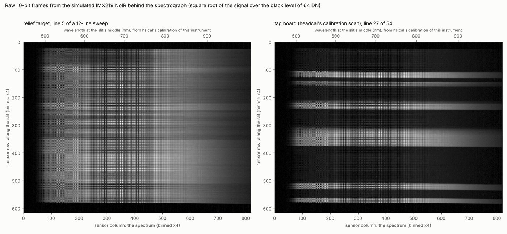</p>

*Raw frames from the simulated spectrograph: a line across the relief target (left) and across the head calibration's board (right). Each column is a wavelength, each row a point along the slit. The fine grid is the sensor's colour filter pattern, which the calibration measures and removes.*

> [!NOTE]
> Not yet tried on the real B0152: capture inside the ROS container, the driver's control names, the bit shift of the raw values, frame lock with its 30 fps clock, and whether the Nano's Python keeps up with 1640 × 1232 at 30 fps.

## The arm, gripper still on

The SO-101's five STS3215 servos are driven by the repo's own ROS 2 driver, which also runs every safety check. This chapter gets the arm calibrated and moving safely before the head exists: first the whole ROS chain with a pretend arm, then the real arm with its gripper still on. All **ROS** commands run in container shells (`jetson/ros.sh`); a step that needs several at once says so.

### Practise with no hardware

A mock arm, a simulated mirror ESP32 and a simulated camera run a whole scan and write a scan folder, so you learn the commands before anything can move.

1. **Start the stack** (**ROS**, first shell):

   ```bash
   ros2 launch so101_scan_bringup scan_arm.launch.py use_mock_hardware:=true mirror:=fake camera:=fake foxglove:=true
   ```

   **Expect** `scanner head: the CAD numbers`, the controllers starting, and the Foxglove bridge on port 8765. Connect Foxglove ([Watch it from the PC with Foxglove](#watch-it-from-the-pc-with-foxglove)).

2. **Dry-run the example ring plan** (**ROS**, second shell). It plays the plan on the running stack without moving anything and prints a report:

   ```bash
   ros2 run so101_scan_sweep scan_sweep --plan src/linescan-hyperspectral-splatting/ros2/so101_scan_sweep/plans/ring.yaml --dry-run
   ```

   **Expect** `dry run of ring: 4 viewpoints`, a line per viewpoint such as `1 down move ... lowest 106 mm above the table; mirror -6.0..+5.9 deg, 107 lines in 3.6 s` (the others come down to 77, 57 and 57 mm), and `0 problems: nothing found; the plan is good to run`.

3. **Run it**, same shell, without `--dry-run`. The arm's model visits four viewpoints and the simulated mirror sweeps 107 lines at each. In Foxglove each scan line lands on the table and the waterfalls fill in row by row. **Expect** `wrote 428 lines to /data/scans/ring_<date>-<time>`.
4. **Make a dataset** from it:

   ```bash
   ros2 run so101_scan_camera scan_to_dataset /data/scans/ring_<date>-<time> /data/datasets/ring
   ```

   **Expect** `wrote /data/datasets/ring: ... 64 px x 46 bands of radiance`: the fake camera bins 64 slit positions, and the values are radiance because no white reference was taken.

5. Ctrl+C in the first shell stops everything.

The mock arm has no safety layer: tools say `no safety state (mock hardware has none)`, but the plan check against the soft limits still runs.

### Find the servos

Power the servos from their own supply and plug the servo adapter into the Nano's USB. Check `ls -l /dev/so101` ([USB names](#usb-names-for-the-arm-and-the-mirror)), then list the servos (**ROS**). This only reads, so nothing moves:

```bash
ros2 run so101_scan_hardware sts_scan --port /dev/so101
```

**Expect** a table with ids 1 to 5 (shoulder_pan, shoulder_lift, elbow_flex, wrist_flex, wrist_roll), model 777 and volts near your supply's. With the gripper on, id 6 also appears, as joint `?`. The driver and the tools can't share the port, so stop any launch first.

### Calibrate the servos

The driver needs to know, for each servo, which tick count is the robot model's zero, which way is positive and how far the joint can go. `sts_calibrate` measures it with the motors off (**ROS**):

```bash
ros2 run so101_scan_hardware sts_calibrate --port /dev/so101
```

> [!WARNING]
> The motors switch off and the arm goes limp. **Hold the arm** before you press Enter.

It asks three things, with a live readout of the ticks:

1. **Put the arm in the zero pose** (table below).
2. **Move every joint slowly through its whole range.**
3. **Nudge each joint the way it names**, by a few degrees (at least 25 ticks, about 2°). It answers `matches the URDF` or `turns the other way: sign -1`.

**Expect** `wrote /data/calibration.yaml` and a line per joint such as `shoulder_pan   zero 2047  sign +1  range  795..3311`. It warns if a joint moved less than 200 ticks in step 2, or if a range runs into the encoder's wrap-around (then rerun with `--write-homing-offset`).

| Joint | Servo id | At zero (standing behind the arm) | Positive turns it to |
|---|---|---|---|
| shoulder_pan | 1 | Base turned straight ahead | Swing the whole arm to the right |
| shoulder_lift | 2 | Upper arm straight up | Tip the upper arm forward |
| elbow_flex | 3 | Forearm level, pointing forward | Tip the forearm down |
| wrist_flex | 4 | Wrist in line with the forearm | Tip the head down |
| wrist_roll | 5 | Scan window facing right | Roll the window from facing right toward facing up |

- **The wrist roll gets redone later.** Its zero is defined by the head's window, which doesn't exist yet. With the gripper on, pick a repeatable reference (the gripper's jaws level, say) and redo that joint once the head is on ([Mount the head on the arm](#mount-the-head-on-the-arm)).
- **Already calibrated with LeRobot?** Convert that file instead of moving the arm. The container only sees `~/so101_scan`, so copy the JSON there first, then `ros2 run so101_scan_hardware sts_calibrate --from-lerobot /data/<file>.json`.
- `sts_calibrate` leaves the servos' homing offsets alone unless you add `--write-homing-offset`, so a LeRobot calibration on the same arm keeps working.
- To redo one joint: `--joints <name>`. The others are kept.

### Check with the motors off

Launch with the motors off and the simulated mirror, and move the arm by hand. The model in Foxglove should follow joint for joint (**ROS**):

```bash
ros2 launch so101_scan_bringup scan_arm.launch.py torque:=false mirror:=fake foxglove:=true
```

**Expect** `Torque off (torque:=false): the arm is limp and can be moved by hand; positions are only read`. Hold the arm before you start it. If a joint turns the wrong way in Foxglove, stop the launch and redo that joint with `--joints <name>`.

### The first move

Keep a hand on the servo power switch for everything that moves. The switch is the e-stop that always works; everything else here is software.

1. **Launch with the motors on** (**ROS**, first shell). They switch on holding the arm where it is:

   ```bash
   ros2 launch so101_scan_bringup scan_arm.launch.py mirror:=fake foxglove:=true
   ```

   If a joint is more than 57 ticks (about 5°) outside its calibrated range, the driver leaves the motors off and says which: recalibrate that joint, or launch with `torque:=false` and move it into range by hand.

2. **Open the e-stop and test it** (**ROS**, second shell). Leave it open whenever the motors are on.

   ```bash
   ros2 run so101_scan_safety arm_estop
   ```

   **Expect** `now: ok`. Press **Enter**: `now: holding: e-stop (/arm_safety/estop)`. Press **r**: `now: ok` again. (Space also stops, **l** goes limp, **q** quits.)

3. **Check the first plan** (**ROS**, third shell). It looks straight down at the table 26 cm in front of the base:

   ```bash
   ros2 run so101_scan_safety check_plan --plan src/linescan-hyperspectral-splatting/ros2/so101_scan_sweep/plans/one_view.yaml
   ```

   **Expect** a row `down  96 mm ...` and `ok: the driver will let this plan through`.

4. **Move there, slowly.** `move_arm` goes at 20°/s; Ctrl+C stops the arm where it is.

   ```bash
   ros2 run so101_scan_sweep move_arm --plan src/linescan-hyperspectral-splatting/ros2/so101_scan_sweep/plans/one_view.yaml
   ```

   **Expect** `arrived in <t> s; now at 0.0 -9.0 60.8 -51.8 -87.2 deg` or close to it.

5. **Dry-run a sweep there, then run it:**

   ```bash
   ros2 run so101_scan_sweep scan_sweep --plan src/linescan-hyperspectral-splatting/ros2/so101_scan_sweep/plans/one_view.yaml --dry-run
   ros2 run so101_scan_sweep scan_sweep --plan src/linescan-hyperspectral-splatting/ros2/so101_scan_sweep/plans/one_view.yaml
   ```

   **Expect** `0 problems` from the dry run, then `viewpoint down: 107 of 107 lines logged` and `wrote 107 lines to /data/scans/one_view_<date>-<time>`. How still the arm held during the sweep: `grep arm_motion_max_rad /data/scans/<folder>/scan.json` (the fake-bus tests require under 0.002 rad; the real arm's number is the first thing to learn).

To go to any pose, give the five joints in degrees, shoulder_pan first: `ros2 run so101_scan_sweep move_arm --joints-deg 0 0 50 -50 -87 --speed-deg 10`.

> [!NOTE]
> `move_arm`'s own joint-limit check never runs (a bug, being fixed). The driver's soft limits and its clamp to the calibrated range still apply, so a bad goal is held back, not reached.

### What stops the arm

Every check runs in the servo driver. **Stopping means holding**: each servo's goal becomes where it is and the driver ignores the controller until a reset. If a measured cause (load, heat, voltage) is still there 5 s into the hold, the motors switch off. An e-stop on its own holds until you reset it.

| Check | Warns at | Stops at |
|---|---|---|
| Load, as a share of the servo's maximum torque | 60% | 90% for 1 s |
| Temperature | 55 °C | 65 °C for 1 s (the STS3215 cuts out at 70 °C on its own) |
| Supply voltage | 90% of the reading at start | 80% for 0.5 s |
| Stall | | A joint 0.2 rad (11.5°) short of its goal and slower than 0.1 rad/s for 0.5 s |
| The servo's own alarms | | Two reads in a row |
| An e-stop | | At once |

**Soft limits** hold the arm back rather than stop it: a step that would cross one isn't taken, the arm waits at the edge, and any move back is allowed.

| Limit | Keeps |
|---|---|
| Table | The arm's wrist, elbow and shoulder joints and the corners of the head's collision box 10 mm above the table top |
| Base keep-out | The head out of a cylinder 80 mm in radius around the shoulder's turning axis, up to 140 mm high (the base, the shoulder servo and the electronics) |
| Gravity | No joint holding more than 60% of the STS3215's stall torque against gravity (warning at 50%) |
| Calibrated range | Commands clamped to each joint's range from `sts_calibrate` |

The driver never turns a joint faster than 2 rad/s, whatever a controller asks. `check_plan`, `scan_sweep` and `move_arm` all use the driver's own model and numbers, so a plan `check_plan` passes is one the driver lets through. **The table check uses the head's collision box, which is too short at the camera end:** see [Safety with the head on](#safety-with-the-head-on) before planning anything new.

| To | Run (**ROS**) |
|---|---|
| Stop from a script, or without `arm_estop` open | `ros2 run so101_scan_safety arm_estop --stop` or `ros2 service call /arm_safety/estop std_srvs/srv/Trigger` |
| Switch the motors off (hold the arm) | `ros2 run so101_scan_safety arm_estop --torque-off` |
| Read the state and warnings | `ros2 run so101_scan_safety arm_estop --status` |
| Let it move again | `ros2 run so101_scan_safety arm_estop --reset` (refused while the cause is still there) |

Reset with `arm_estop`, not by calling `/arm_safety/reset` yourself: it also restarts the arm controller, so the arm starts from where it is instead of jumping to its old goal. A stop also stops the mirror, and `scan_sweep` or `move_arm` cancels its move, writes what it logged and exits saying why. Every threshold is untested on real servos, and the voltage baseline is whatever the supply reads when the driver starts.

### Practise faults on a pretend servo bus (optional)

`sts_fake_bus` answers like five STS3215s, so the real driver, its checks and the e-stop can be tried, and faults played, with nothing at risk. **ROS**, first shell:

```bash
mkdir -p /data/fake
cat > /data/fake/calibration.yaml <<'EOF'
joints:
  shoulder_pan: {id: 1, zero_ticks: 2048, sign: 1, min_ticks: 200, max_ticks: 3900}
  shoulder_lift: {id: 2, zero_ticks: 2048, sign: 1, min_ticks: 200, max_ticks: 3900}
  elbow_flex: {id: 3, zero_ticks: 2048, sign: 1, min_ticks: 200, max_ticks: 3900}
  wrist_flex: {id: 4, zero_ticks: 2048, sign: 1, min_ticks: 200, max_ticks: 3900}
  wrist_roll: {id: 5, zero_ticks: 2048, sign: 1, min_ticks: 200, max_ticks: 3900}
EOF
ros2 run so101_scan_hardware sts_fake_bus --link /data/fake/so101 &
ros2 launch so101_scan_bringup scan_arm.launch.py port:=/data/fake/so101 calibration_file:=/data/fake/calibration.yaml mirror:=fake foxglove:=true
```

Open `arm_estop` in a second shell and move with `move_arm` in a third, as above. Then overheat the shoulder from the third shell:

```bash
python3 -c "from so101_scan_hardware.fake_bus import control; control('/data/fake/so101.ctl', 2, temperature=66)"
```

**Expect** `now: holding: shoulder_lift at 66 C (limit 65 C)` in `arm_estop`, and about 5 s later a `torque off` line. Cool it with `temperature=31`, then press **r**: `now: resuming`, then `now: ok`. The control socket also takes `voltage=4.5`, `extra_load=950` (95% load) and `obstacle=[0, 2300]` (the servo can't pass those ticks, so a move past them stalls; `obstacle=None` removes it). This sequence follows the stack's own tests but hasn't been typed in as written.

## Assemble the scanner head

This chapter waits on the measurements and the printed head. The order builds a bench spectrometer first (slit, collimator, grating and camera, with no objective), focuses and calibrates it on a lamp, and only then adds the objective, the hall sensor, the stepper and the mirror. The camera lens is easiest to reach while the lid is off.

<p align="center">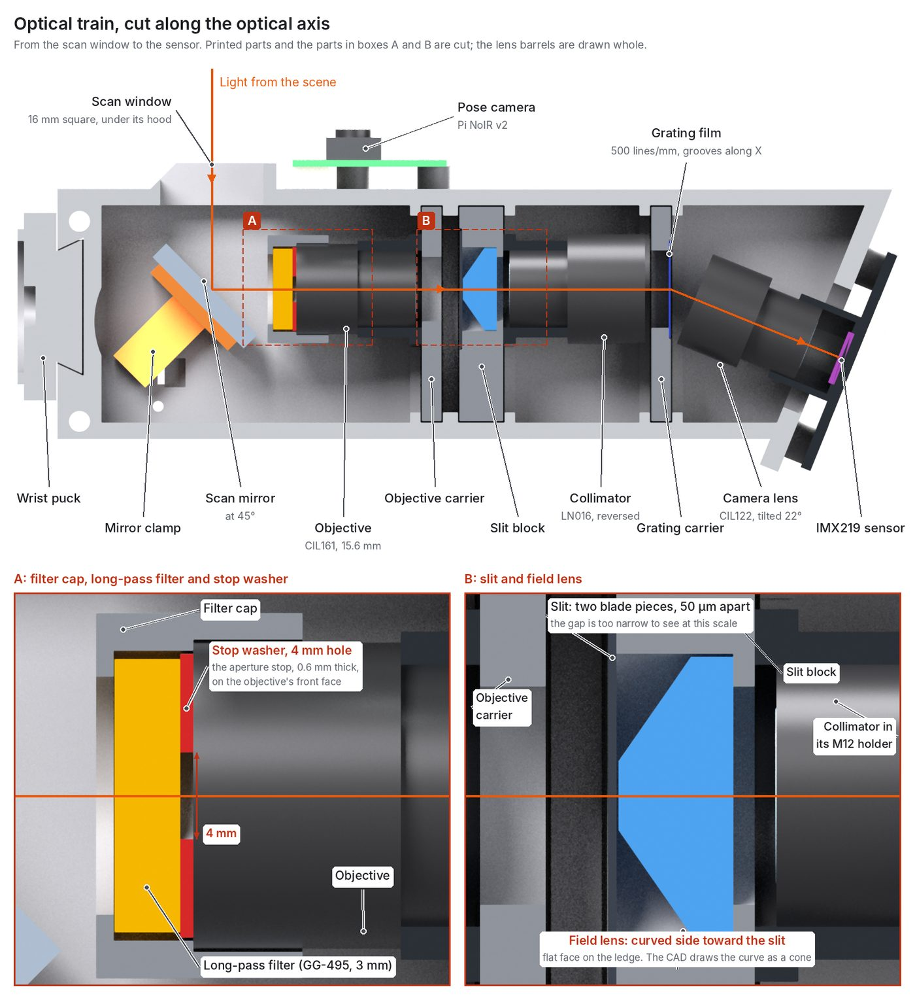</p>

*The optics in section, in light order. Detail A: the filter cap holds the GG-495 and then the 4 mm stop washer against the objective's front. Detail B: the field lens sits curved side up, right under the slit blades, with the collimator's holder on the back of the slit block.*

### Prepare the bought parts

1. **Cut two M12 holders** down to the lens thread plus 1 mm (10 mm for the 9 mm threads the CAD assumes). Cut from the end the lens screws into, not the ear end, and square the cut on sandpaper. A lens screwed in until its barrel stops against the cut end then sits where the model puts it. With 13 mm of thread or more, leave the holder whole. The objective's holder can be cut once M3 is known; the collimator's after the rebuild.
2. **Cut the mirror.** Score and snap a 20 × 20 mm piece from the mirror sheet, scoring the bare back so the coated face isn't scratched. Across the shaft keep it at 20 mm or a hair under: its corners pass 0.9 mm from the housing as it turns. To find the coated face, touch a pencil tip to the glass: on the coated face the tip meets its reflection; on the back there's a 3 mm gap. Wear eye protection when snapping glass.
3. **Swap the camera's lens.** Unscrew the B0152's stock lens from the board's M12 holder and screw the CIL122 in its place, a few turns short of the bottom. You focus it later. Keep dust off the bare sensor.
4. **Press in the heat-set inserts** with the soldering iron: two M3 in the lid bosses on the housing, four M2 in the camera standoffs on the end wall and four M2 in the pose-camera standoffs on the +Y face. Each insert flush and square to its boss.

### Slit block and grating

1. **Field lens.** Drop it into the slit block's pocket from the front, **curved side up** toward the blades, so its flat face sits on the ledge at the bottom of the pocket. A dot of glue on its rim stops it rattling.
2. **Slit.** Snap two 20 mm pieces from a snap-off blade. Lay them in the recess over the field lens with their sharp edges facing each other on the axis and the 0.05 mm feeler leaf between them. Glue the blades by their backs and pull the leaf out once the glue has set. That gives a 50 µm slit, straight along X. (The 0.04 mm leaf gives 40 µm: 3.3 nm for 20% less light.) Keep glue off the edges and the lens, handle blades by the back edge, and cure the glue in open air.
3. **Collimator.** Screw the second cut holder to the back of the slit block with two M2 × 5 (they tap their own thread in the plastic). Screw the LN016 into it rear end first (the end that would face a sensor) until its barrel stops against the cut end. The lens works backwards, with the slit where its sensor would be.
4. **Grating.** Cut a 15 × 15 mm piece of the film and tape it into the grating carrier's recess with Kapton tape, **grooves along X** (parallel to the slit). The laser spots from M14 fan out across the grooves, so in the carrier they should fan along Y. Don't touch the film's face.
5. **Slide them in** from the open −X side: the slit block (blades toward the objective end), then the grating carrier (film toward the camera end). Each plate drops into its rib slots with 0.25 mm of play per side.

> [!WARNING]
> The field lens the wrong way round makes the slit look 1.35 times as wide: the resolution drops from 4.1 to 5.4 nm and 15% of the line falls off the sensor.

### Cameras

1. **Spectrograph camera.** Fit the B0152 outside the end wall on its four standoffs, with the CIL122 reaching in through the 21 mm hole, and fix it with four M2 × 5 into the inserts. Turn the board so the **sensor's long side runs across the slit**: the spectrum is 3.27 mm long and only fits on the 3.68 mm side. Run black tape around the board's edge where it meets the end wall.
2. **Pose camera.** Fit the Pi NoIR v2 on the four standoffs on the +Y face, next to the scan window, lens facing out, with four M2 × 5.
3. **Ribbons.** With the Nano powered off, plug a 100 cm ribbon into each camera: the spectrograph camera on the Nano's first camera port (`/dev/video0`, the calibration kit's default) and the pose camera on the second (`/dev/video1`, the head calibration's default).

The camera end wall is printed at the 22° camera tilt. Each degree of tilt error moves the band about 33 nm, which is why the tilt is printed rather than adjusted.

### Bench spectrometer: focus and a practice calibration

1. **Hold the housing.** On the optics table, screw the bench puck down with one 1/4"-20 or M6 screw through its −X hole, and slide the housing onto its rail from the −X side. Without the lid nothing locks it to the rail, so tape it in place.
2. **Light the slit.** Warm the CFL for 2 to 3 minutes, darken the room and shine it straight at the slit's front face through the open side. Drape black cloth over the open side.
3. **Focus. On the Nano**, from the repo's `calibration/` folder, run the focus aid and turn the CIL122 slowly through the open side until the printed width is smallest. Change `--exposure-ms` to keep the printed peak between 40% and 90%. Ctrl+C stops it.

   ```bash
   python3 -m hsical focus --exposure-ms 20
   ```

   **Expect** lines like `width 31.20 px at 480 (best 30.95) peak 62%`. The slit's own image is 23 to 24 px, so the width can't go lower; real M12 lenses will probably bottom out at 30 to 45 px (5 to 8 nm).

4. **Check the line pattern.** The spectrum runs along the sensor's long side. The CFL's brightest line is mercury at 546.1 nm, near column 480 in the design, and the next is europium at 611.4 nm, about 370 px further along. A real build may sit 100 px or so away from those columns; the spacing is what should match. A camera on its side or flipped is fine for the calibration.
5. **If the width stays broad**, check the collimator first: the camera lens can only fix its own focus. The LN016 must be screwed fully into its cut holder, and the slit block's thickness must match its real back focus (M1).
6. **Practice calibration.** Take a full lamp session and calibrate it as in [Spectral calibration](#spectral-calibration), with two differences for the bench: there is nowhere to seat the GG-495 without the objective, so **hold it between the lamp and the slit** for every capture (without it, mercury's 404.7 and 435.8 nm lines land in second order at 809 and 872 nm, on top of the argon lines); and the white is the single PTFE sheet with the halogen shining through it. This session checks the wavelength map. The one you scan with is retaken later with the objective in.

### Objective and filter cap

1. Screw the CIL161 into its cut holder until its barrel stops against the cut end. Screw the holder to the objective carrier, on the face toward the mirror, with two M2 × 5.
2. Drop the GG-495 into the filter cap onto its lip, then lay the 4 mm stop washer on top of it. Push the cap onto the front of the objective until the lens presses washer and filter together. From the outside the order is: cap lip, GG-495, stop washer, lens.
3. Slide the objective carrier into the slots nearest the mirror end, filter cap toward the mirror.

### Hall sensor

<p align="center">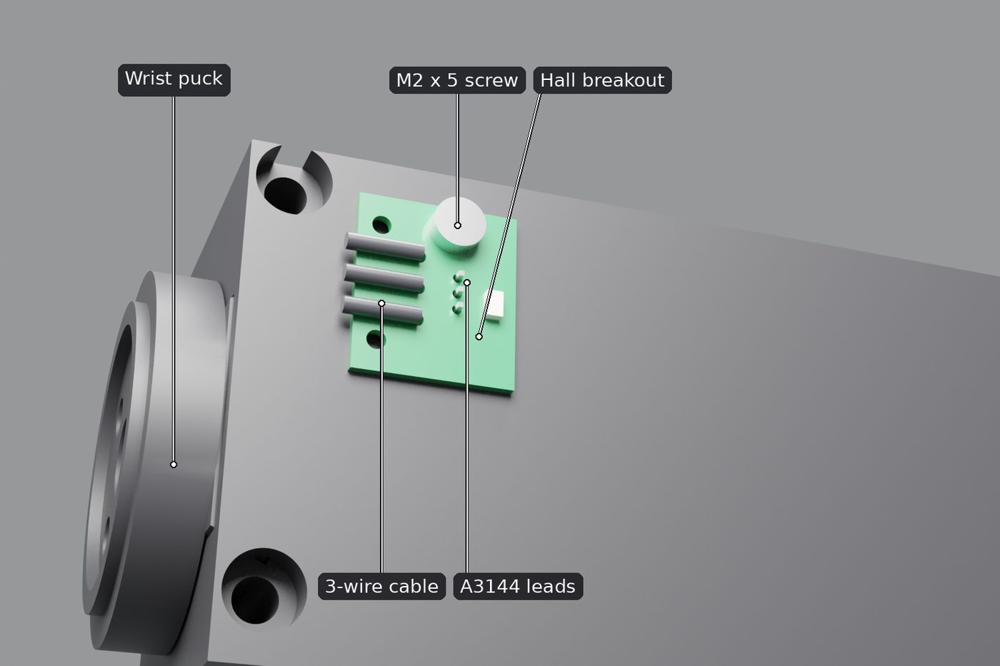</p>

*The hall breakout on the outside of the +X wall.*

1. Solder the 3-wire cable into the breakout's S, G and + pads from the front (S is the output, G ground, + is 5 V at the square pad). Don't fit a pin header: it would stand 9 mm off the head. Pass a thread through the two tie holes below the pads so it runs across the back of the board; even miniature cable ties don't fit.
2. Bend the A3144's three leads 90° toward its back (away from the printed face), about 0.5 mm below the body.
3. Push the sensor into its pocket in the +X wall **from inside**, printed face toward the magnet, so the leads come out through the slot under the pocket.
4. Feed the leads through the breakout's three holes from behind. Seen from outside, they run OUT, GND, VCC from left to right, with VCC at the square pad. A sensor fitted the other way round puts 5 V on its output.
5. Press the board flat on the wall and fix it with **one M2 × 5** through its M2 hole. Solder and trim the leads, and tie the thread round the cable for strain relief.
6. At the controller end, fit a 3-pin JST XH plug in J4's order: pin 1 to the + pad, pin 2 to G, pin 3 to S. Check each wire end to end with the meter.

> [!WARNING]
> Use no screw longer than M2 × 5 in the breakout: its tip comes 1.7 mm through the wall and passes about 1 mm from the turning mirror clamp.

Without the breakout board you can solder the cable straight to the bent leads, insulate each joint with heat-shrink and tie the cable to the head; keep the joints flat against the wall.

### Stepper, magnet and mirror

1. **Stepper.** If M12 came in under 3.2 mm, file 1 mm off four M2 × 5. Screw the stepper to the outside of the lid with them from inside: heads flush in the counterbores, the pilot boss in its pocket and the motor flat on its pad.
2. **Magnet.** Glue it into the mirror clamp's tab with the **working face out** (the face that tripped the sensor in [Find the magnet's working face](#find-the-magnets-working-face)).
3. **Mirror.** Glue it onto the clamp's pad between the edge notches, coated face out. Let the glue cure in open air before the mirror goes into the closed head: CA fumes haze the coating.
4. **Clamp on the shaft.** Put an M3 nut in the clamp's nut trap, slide the clamp onto the shaft and tighten the M3 × 8 pinch screw. In the model the hub sits 0.5 mm off the lid's inner face. Turn it by hand: it should clear the lid all the way round. The clamp's angle on the shaft doesn't matter, because homing finds the magnet.
5. **Close the head.** Fit the lid so the mirror goes in through the open side, and screw the two M3 × 8 through the lid ears into the housing's inserts. On the arm, two M3 × 35 also go through; see [Mount the head on the arm](#mount-the-head-on-the-arm).

### Home the mirror and set the working angle

`HOME` gives every scan the same start angle. It finds both edges of the hall sensor's window at a slow speed, takes the middle, calls that `home_pos` and moves the mirror to `home_park`. The defaults are `home_pos=-711` (the CAD puts the magnet at the sensor with the mirror 40° back from its 45° working angle) and `home_park=0`, so after homing, position 0 is the working angle.

Wire the head to the controller (or the breadboard) first, with USB unplugged and the 12 V off: the motor to J3 and the hall cable to J4. VREF must already be at 0.28 V ([Set the motor current](#set-the-motor-current)). Then plug in USB, switch the 12 V on, and close the serial monitor before using `mirrorctl.py`.

1. Check the sensor: with the motor disabled, `STATUS` shows `hall=1` when the magnet is at the sensor and `hall=0` when it's away.
2. Home, then home again to check it repeats. **On the PC, in `firmware/`** (or in the monitor, one command per line):

   ```bat
   python tools/mirrorctl.py -p COM5 ENABLE HOME
   python tools/mirrorctl.py -p COM5 HOME
   ```

   **Expect** `EV HOMED pos=0 ... width=<w> shift=<s>`, and on the second run the same width and `shift=0` (give or take a microstep). During the search the mirror can turn a little over one full turn; the CAD checked that everything clears.

3. Check the full sweep for rubbing:

   ```bat
   python tools/mirrorctl.py -p COM5 ENABLE HOME "MOVE pos=-3200" "MOVE pos=3200" DISABLE
   ```

   No scraping through the whole sweep. The closest parts in the model are the lid (0.5 mm), the housing (0.9 mm), the hall sensor (1.1 mm) and the filter cap (1.4 mm).

4. **Set the working angle.** Find the position P that centres the view (with the pose camera or the spectrograph's live view on a target), then set `home_pos` to its current value minus P (from the default, −711 minus P), save, and home again. For P = 40 from the default:

   ```bat
   python tools/mirrorctl.py -p COM5 "CFG home_pos=-751" SAVE ENABLE HOME
   ```

   After `HOME`, position 0 now centres the view. **Do this before the head calibration**, which measures the home angle and expects it to stay put.

Home again whenever the ESP32 restarts, and after `DISABLE`, a fault, or a change to `usteps`, `dir_inv` or `home_pos`: all of them clear `homed`. [Mirror serial protocol](#mirror-serial-protocol) lists every setting and what `HOME_FAILED` reasons mean.

## Mount the head on the arm

<p align="center">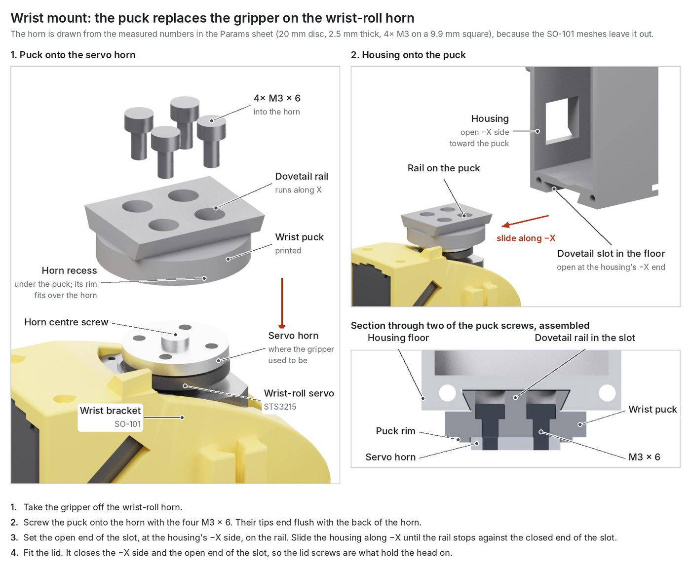</p>

*The wrist mount: the puck replaces the gripper on the wrist-roll horn, the housing slides onto its dovetail, and the lid locks it.*

1. **Gripper off.** Switch the arm's servo power off and support the arm. Unscrew the gripper from the wrist-roll horn and unplug the gripper servo's bus cable; keep the gripper to swap back. With the head on, the ROS side expects servo ids 1 to 5 only.
2. **Puck on.** Screw the wrist puck onto the horn, horn side down, with four M3 × 6. Its rim centres on the 20 mm horn disc.
3. **Housing on.** The dovetail slot in the housing's floor is open at its −X end. Start the puck's rail there and slide the housing on until the rail stops against the slot's closed end.
4. **Lid on.** Fit the lid, then put the two M3 × 35 in from the counterbores on the +X face, through the floor and the lid, with a washer and nut on each on the lid's motor pad. Screw the two M3 × 8 through the lid ears into the housing's inserts. The lid closes the end of the dovetail slot and is what holds the head on the arm: without these screws the head can slide off the rail.
5. **Redo the wrist roll's calibration.** The wrist roll's zero is defined by the head's window ("facing right"), so with the head on run the calibration for that joint again, then check with the motors off that the model in Foxglove follows the real arm (**ROS**):

   ```bash
   ros2 run so101_scan_hardware sts_calibrate --port /dev/so101 --joints wrist_roll
   ros2 launch so101_scan_bringup scan_arm.launch.py torque:=false mirror:=esp32 foxglove:=true
   ```

6. **If any CAD number changed**, make sure the robot model has the new head ([Changing the design](#changing-the-design)); the ROS description tests fail when it's stale.

As modelled the head weighs 187 g. With the arm stretched out level the shoulder must hold 75% of the STS3215's stall torque (the stock gripper needs 53%); in the scanning pose it's 18%. The follower runs on 5 V, so the real margin is smaller: keep the arm folded while scanning and don't park it stretched out. The head clears the wrist at every roll angle and through −95 to +95° of wrist flex.

### Safety with the head on

> [!WARNING]
> The planner checks poses against a box that stands in for the head in the robot model ([`scan_head.xacro`](../../ros2/so101_scan_description/urdf/scan_head.xacro), lines 119 to 122). That box is **12.5 mm short at the camera end** (it reaches 122.9 mm along the head; the head reaches 135.4 mm), and a little short at −X and +Y. So "10 mm above the table" can really be the camera end 2.5 mm into it.
>
> - The plans that ship in `ros2/so101_scan_sweep/plans/` keep 56 mm or more and are fine.
> - For **any new plan**, add `--clearance 0.025` to `make_plan` and to the dry run, run `check_plan`, keep `arm_estop` open and watch the camera end on the first run.
> - The box gets fixed when the measurements go into the CAD. Until then, keep using the extra clearance.

### Controller tray

<p align="center">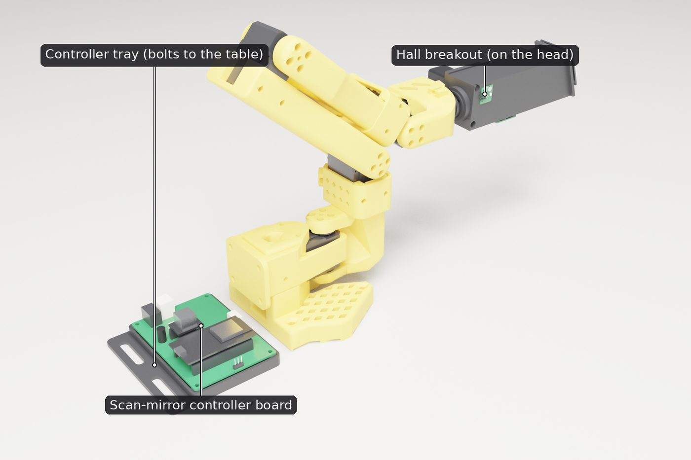</p>

1. Press four M3 heat-set inserts into the tray's posts.
2. Screw the controller board onto the posts with four M3 × 6, hall connector (J4) edge toward the arm and USB edge away from it, toward the Nano. The posts hold the board 6 mm up, clear of its trimmed leads.
3. Set the tray on the table 4 mm behind the plate on the back of the arm's base and screw it down with two 1/4"-20 or M6 table screws and washers through its slots. Each slot is a full hole pitch long, so on a 1 in or 25 mm grid both slots find a hole.

In the scanning pose the arm stays 62 mm from the tray. It reaches the tray only when it leans back over its base, which a scan of something in front of it never does. Leave air over the driver: it gets warm.

### Cables

1. **Motor.** Connect the stepper to a 4-pin JST XH pigtail for J3: one coil on pins 1 and 2, the other on pins 3 and 4. Extend the leads if they don't reach the tray, keeping each coil's pair twisted along its length.
2. **Hall.** The 3-wire cable from the breakout goes to J4 (pin 1 +5 V, pin 2 GND, pin 3 OUT).
3. **Up the arm.** Run the motor and hall cables down the arm to the tray with zip ties, kept apart: motor switching noise on the hall line can upset homing. Run both camera ribbons along the arm to the Nano, with strain relief where the arm bends and slack at the wrist so roll and flex don't pull on the connectors.
4. **Check by hand.** With the servos' torque off, move the arm through its poses and the wrist through its roll range. No cable should pull tight or catch.
5. **Power and data.** The DevKit's USB goes to the Nano; the 12 V supply to J1. Never plug or unplug the motor with the green LED lit.

Cable clips and the slack to leave at the wrist aren't designed yet; zip ties and a hand check do for now.

# Part II: Using the software

## Spectral calibration

A raw frame is only counts per pixel. `hsical` works out which wavelength and which point on the slit each pixel sees, and how sensitive it is, from about ten minutes of lamp frames. The lamps glow at wavelengths listed in the NIST atomic spectra tables, so they give fixed marks: `hsical` finds about 100 lines between 490 and 970 nm and fits the wavelength of every pixel from them. It also measures and removes two distortions every spectrograph has: each lamp line bows into an arc along the slit (*smile*), and the slit's image is longer at one end of the band than the other (*keystone*). A halogen filament glows close to a 2850 K blackbody, so its frames give each pixel's sensitivity.

The result is a lookup table that resamples a raw frame onto a regular grid: one row per point along the slit, one column per 2 nm, every lamp line straight. `line_camera` uses it to bin every scan line as it records.

<p align="center">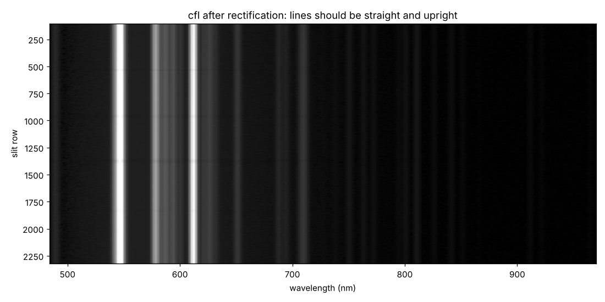</p>

*A simulated CFL frame after calibration. On the sensor these lines bow by up to 35 px; after rectification each is a straight column at its own wavelength.*

**Where things run:** capturing needs only numpy and `v4l2-ctl`, so it runs on the Nano's own Python, on the host (not in the ROS container), from the repo's `calibration/` folder. The fitting needs recent numpy and scipy and runs on the PC, from `calibration/` with the repo's environment active.

| Machine | Commands |
|---|---|
| **Nano** host | `hsical probe`, `focus`, `plan`, `capture`; `headcal record` |
| **PC** | `hsical inspect`, `calibrate`, `check`, `apply`, `selftest`; `headcal board`, `plan`, `solve` |

On the Nano, once: `sudo apt install v4l-utils python3-numpy`.

### Lamps and targets

| Item | Calibrates | Notes |
|---|---|---|
| CFL (EcoSmart daylight) | Wavelength: mercury, argon and phosphor lines, 490 to 970 nm | Warm it up 2 to 3 minutes first: its mercury lines grow and its argon lines fade as it warms |
| Neon outlet tester (Sperry GFI6302N) | Wavelength: dozens of neon lines, 533 to 967 nm | Must glow orange. Mains powered: hold it by the plastic and plug it in only while capturing |
| Halogen work light and the PTFE sheet | The slit's ends, keystone, spectral response | Keep it a few centimetres from the PTFE |
| 3 to 5 thin wires, 0.1 to 0.3 mm | Keystone along the slit | Magnet wire, a guitar string or a hair |
| Red diode laser | A check that the smile correction worked | Not a wavelength reference: a diode drifts a few nm with temperature |
| Lens cap or black cloth | Darks | |

### Capture a session

1. **Check the camera** (**Nano**, in `calibration/`):

   ```bash
   python3 -m hsical probe
   ```

   **Expect** the RG10 format at 3264 × 2464 and at 1640 × 1232, and the controls `exposure`, `gain` and `frame_rate`. If your driver names them differently, pass the names with `--ctrl` on every capture command; add `--dry-run` to see the exact `v4l2-ctl` command a capture would run.

2. **Run the guided plan in the scanning mode, 1640 × 1232:**

   ```bash
   python3 -m hsical plan ~/sessions/first_light --width 1640 --height 1232
   ```

   The size matters: `line_camera` scans at 1640 × 1232 and refuses a calibration taken at any other size. (The calibration README's command leaves the size out and captures at the full 3264 × 2464.)

   The plan walks through each set in turn. It prints what to set up and waits for Enter (`s` skips, `q` stops), sets the exposure itself with a few test shots, then shows the peak level and saturation and asks `Keep it?` (Enter keeps, `r` retakes with a new exposure). At the end it takes darks at every exposure and gain it used, and prints the command to calibrate.

3. **Set up each set** as it asks:

   | Set | Setup | What it gives |
   |---|---|---|
   | flat | Halogen on the PTFE, the sheet filling the slit's view, peak about 75% | Slit ends, keystone, spectral response, the colour pattern of the sensor |
   | wires | Same light, with the wires across the PTFE, spread along the slit | Dark notches at fixed points along the slit |
   | cfl | CFL in front of the slit, room lights off | Mercury and phosphor lines |
   | cfl_long | Same, 10 times longer (the bright lines saturate on purpose) | Faint argon lines from 700 to 970 nm |
   | neon | Neon tester right at the slit | Neon lines from 533 to 750 nm |
   | neon_long | Same, 10 times the light | Neon lines from 750 to 967 nm |
   | laser | Red laser spot on the PTFE, peak about 60% | The smile check |
   | dark | Lens capped, lamps off | Black level and hot pixels |

   **On the bench** (no objective): hold the single PTFE sheet against the slit with the halogen shining through it, lay the wires straight across the slit, and **hold the GG-495 between the lamp and the slit for every set**. Without the filter, mercury's 404.7 and 435.8 nm lines land in second order at 809 and 872 nm. Darken the room and drape black cloth over the open side.

   **With the objective in** (the session you scan with): put the PTFE (backed with white card) and the wires where the scan line falls, in focus. The GG-495 is in the filter cap.

4. To redo some sets later, name them: `--steps flat,wires`. The darks are retaken after them.

A session at 1640 × 1232 is somewhat under 1 GB; `--frames 8` halves it.

### Calibrate on the PC

**On the PC**, in `calibration/`:

```bat
scp -r <user>@<nano-ip>:sessions/first_light .
python -m hsical inspect first_light
python -m hsical calibrate first_light -o cal
```

`inspect` lists each set with its exposure, gain, peak, saturation and matching dark, and ends with `Ready to calibrate.` (exit code 0). It exits with 1 if something would stop a calibration, such as a saturated flat or sets of different sizes, and notes anything that would weaken one. `calibrate` logs each stage and ends with `Done in N s: all checks passed` and `Saved to cal` (exit code 0), or exits with 2 if a check fails.

The `cal` folder holds `calibration.json`, `maps.npz`, `report.md` and the plots.

### Read the report

Open `cal/report.md`. Every row of the Checks table should say pass.

| Check | Passes when | If it fails |
|---|---|---|
| flat exposure | Under 0.01% of the flat's pixels saturated | Retake the flat shorter: `--steps flat,wires` |
| wavelength fit | Under 0.3 nm rms, with 8 or more lines | Refocus, check the lamp exposures, and look in the line table at the end for lines with large residuals |
| lines cover the band | Lines from below 560 nm to above 850 nm | Retake the long sets: `--steps cfl,cfl_long,neon,neon_long` |
| smile fit | Residuals under 0.3 line widths, 6 or more lines followed | The lines are too faint near the slit's ends: light the whole slit evenly or expose longer |
| keystone fit | Under 0.5 px | The flat is uneven: check the slit ends in `keystone.png` and retake the flat |
| slit evenness | No dips over 3%, under 15% brighter at one end | Only a note. Dips are usually dust on the slit: blow it clean |
| laser straight along the slit | Under 0.15 nm rms | The smile correction is off: look at the traces in `smile.png` |

Then look at the plots. In `lamps.png` every green tick should sit on a peak (red ticks are lines it rejected); `rectified.png` should show every lamp line as a straight vertical stripe. Note the Numbers list for each session (wavelength range, px per nm, line width in nm, the laser's wavelength) so you can compare builds.

<p align="center">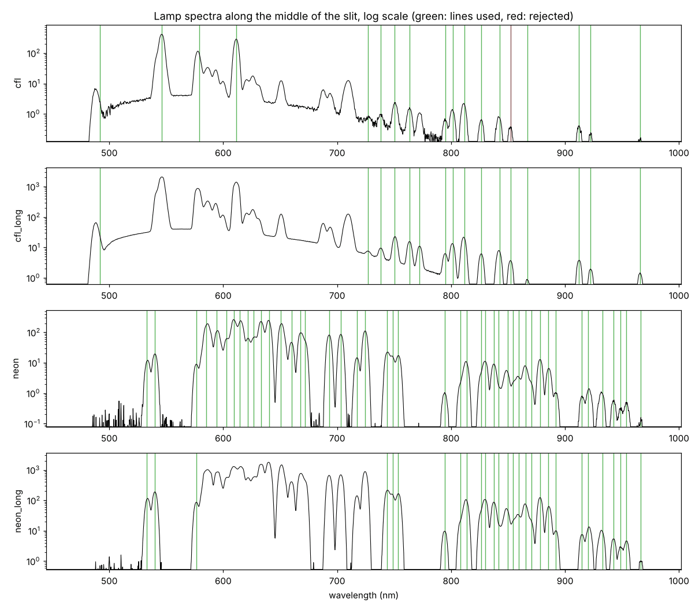</p>

*The report's lamp plot, from a simulated session. Green ticks are catalogue lines the fit used, red ones it rejected. The long sets saturate the bright lines and bring up the faint ones past 750 nm.*

If the ticks sit beside the peaks instead of on them, the line pattern matched the wrong way. Tell `hsical` where the green mercury line is by putting a `session.json` in the session folder with its column, counted with blue on the left, and calibrate again: `{"hints": {"cfl": [[546.07, 572]]}}`.

Recalibrate whenever anything in the optics moves: the slit, the focus, the camera, the grating or the filter.

### Install the calibration on the Nano

`line_camera` looks for it in the Nano's data folder (`~/so101_scan` on the host is `/data` in the ROS container). **On the PC**, in `calibration/`:

```bat
ssh <user>@<nano-ip> mkdir -p so101_scan/hsical
scp -r cal <user>@<nano-ip>:so101_scan/hsical/
```

Then launch with it (**ROS**):

```bash
ros2 launch so101_scan_bringup scan_arm.launch.py camera:=v4l2 camera_calibration:=/data/hsical/cal
```

**Expect** `line_camera` to log `calibration /data/hsical/cal: 256 slit bins x N bands, ...`. If the session was taken at full size it stops with `the calibration in /data/hsical/cal is for 3264x2464 frames, and the camera is set to 1640x1232`: capture a new session at 1640 × 1232.

### Check for drift before each scanning session

A printed housing shifts a little with temperature and handling, and a knock can move the slit or the camera. One quick CFL frame tells you whether the calibration still holds.

1. **Nano**, in `calibration/`, with the CFL warm in front of the slit, then capped and off for the dark:

   ```bash
   python3 -m hsical capture ~/checks cfl --kind lamp --source cfl --exposure-ms 60 --frames 4 --width 1640 --height 1232
   python3 -m hsical capture ~/checks dark_60ms --kind dark --exposure-ms 60 --frames 4 --width 1640 --height 1232
   ```

   Aim for a peak between 40% and 90%; change `--exposure-ms` on both lines if it's outside.

2. **PC**, in `calibration/`:

   ```bat
   scp -r <user>@<nano-ip>:checks .
   python -m hsical check cal checks/cfl
   ```

   Exit code **0**: `Still calibrated: the lines are where the calibration puts them.` Exit code **2**: the instrument has moved (more than 0.2 nm anywhere, or the slit ends by more than 0.2% of its length), so run a new session before scanning. Exit code **1**: the check couldn't run, usually because the frames and the calibration are different sizes.

<p align="center">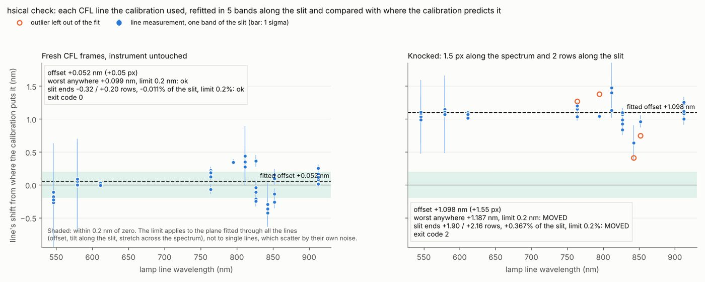</p>

*`hsical check` on a simulated instrument. Left: untouched, offset +0.05 nm, exit code 0. Right: knocked 1.5 px along the spectrum and 2 rows along the slit, offset +1.1 nm, exit code 2. The shaded band is the 0.2 nm limit.*

### Spectra from frames by hand (optional)

To look at a scene without the arm, capture it, a white and a dark at the same exposure on the Nano, copy them over, and apply the calibration on the PC:

```bash
# Nano, in calibration/
python3 -m hsical capture scans leaf --kind scene --exposure-ms 30 --width 1640 --height 1232
python3 -m hsical capture scans white --kind white --source ptfe --exposure-ms 30 --width 1640 --height 1232
python3 -m hsical capture scans dark_30ms --kind dark --exposure-ms 30 --width 1640 --height 1232
```

```bat
rem PC, in calibration/, after copying scans/ over
python -m hsical apply cal scans/leaf --dark scans/dark_30ms --white scans/white
```

It writes `spectra/leaf_reflectance.npy` (frames × slit rows × wavelengths), a `.json` with the axes and a `.png` preview. Without `--white` you get radiance.

## Scanning

A scan is a list of viewpoints. At each one the arm moves there and holds still, the mirror sweeps the scan line across the object one line per camera frame, and `line_camera` keeps each frame that was exposed while the mirror stood still and bins it with the spectral calibration. `scan_sweep` reads the arm's joints at the moment each line was taken and works out where the line camera was, which is the pose the splat trainer needs.

**You need:** the head on the arm with the wrist roll recalibrated ([Mount the head on the arm](#mount-the-head-on-the-arm)), the mirror homing with its working angle set, a spectral calibration made at 1640 × 1232 and installed on the Nano ([Install the calibration on the Nano](#install-the-calibration-on-the-nano)), the halogen, and the PTFE sheet backed with white card.

### Where things go on the table

Positions in plans and commands are in **`base_link`**, the arm's own frame, in metres: +x straight ahead, +y to the arm's left, +z up. Its origin is **38.8 mm behind the shoulder's turning axis** (the centre of the base servo), and the table top is at z = −0.0024 m.

The example plans aim at x = 0.26 m, y = 0, so **put the object's centre 260 mm in front of `base_link`: 221 mm in front of the shoulder's axis**, straight ahead. The scan line is in focus about 150 mm from the head, and one sweep of the shipped plans covers a strip about 64 mm long.

**For first light, scan something asymmetric**, so a mirrored or misplaced result is obvious. The simulator's relief target is one: a 60 × 60 × 2 mm plate with a 2 mm border of 2 mm black-and-white checks, carrying 5 × 5 square pillars 8 mm wide on a 10 mm pitch. The repo has no STL for it yet; it's quick to draw. Heights in mm, rows from −y to +y, each row from −x to +x:

| Row | Pillar heights (mm) |
|---|---|
| 1 (−y) | 3, 9, 5, 12, 2 |
| 2 | 7, 1.5, 10, 4, 8 |
| 3 | 11, 6, 2.5, 9.5, 3.5 |
| 4 | 4.5, 12, 7.5, 1, 10.5 |
| 5 (+y) | 2, 5.5, 11.5, 6.5, 4 |

The side of an object facing the base (−x) is out of the arm's reach. To cover it, turn the object round and scan it again.

### Start the rig

1. **Check the calibration still holds** if the head has been handled since it was made ([Check for drift before each scanning session](#check-for-drift-before-each-scanning-session)).
2. **Launch** (**ROS**, first shell). The real arm and the real mirror are the defaults:

   ```bash
   ros2 launch so101_scan_bringup scan_arm.launch.py camera:=v4l2 camera_calibration:=/data/hsical/cal foxglove:=true
   ```

   **Expect** `scanner head: calibrated, from /data/head_calibration.yaml` (or `the CAD numbers` before the head calibration) and `calibration /data/hsical/cal: 256 slit bins x <n> bands, <a>..<b> nm, ...`.

3. **Open the e-stop** (**ROS**, second shell) and keep it in front of you: `ros2 run so101_scan_safety arm_estop`.
4. **Home the mirror** (**ROS**, third shell). It's needed after every ESP32 restart; `scan_sweep` also does it if the plan says `home_mirror: true`, as the shipped ones do.

   ```bash
   ros2 service call /scan_mirror/home std_srvs/srv/Trigger
   ```

   **Expect** `success: True` once it has found the hall sensor and parked at 0, the 45° rest. If sweeps later run backwards, stop the launch and send the ESP32 `CFG dir_inv=1` then `SAVE` ([Mirror serial protocol](#mirror-serial-protocol)).

5. **Watch it in Foxglove**: the 3D panel with `/scan/markers` shows the arm, the head and each scan line where it lands; Image panels on `/line_camera/scan_preview_true_color` (what your eye would see), `/line_camera/scan_preview_cir` (colour infrared, 800 to 900 nm as red, so plants glow red) and `/line_camera/scan_preview` (grey) fill in row by row during a sweep.

### Exposure, white and dark

The dataset is reflectance: each line divided by a **white** (the PTFE, about 98% reflective) under the same lamp, after subtracting a **dark** (lens capped) at the same exposure. Take both at the start of each session, and again after changing the exposure or moving the lamp.

1. **Lay the PTFE** at the object's spot under the halogen, and move the head over it with the one-view plan (**ROS**, third shell):

   ```bash
   ros2 run so101_scan_sweep move_arm --plan src/linescan-hyperspectral-splatting/ros2/so101_scan_sweep/plans/one_view.yaml
   ```

2. **Set the exposure** so the white's peak is 50 to 90% of full scale. It changes while the node runs; the next three frames are skipped while the sensor takes it.

   ```bash
   ros2 param set /line_camera exposure_us 8000
   ```

3. **Take the white, then cap the lens and take the dark:**

   ```bash
   ros2 run so101_scan_camera capture_reference white
   ros2 run so101_scan_camera capture_reference dark
   ```

   Each averages 16 frames and reports `peak <p>% of full scale, <s>% saturated`, adding `it saturates: lower exposure_us` or `dim: raise exposure_us ...` when it should. Retake the white until it's in range, then the dark at that exposure.

Taken outside a scan, they go to `~/so101_scan/references/` (`/data/references` in the container), and the next scans record which ones they used, so the converter finds them on the Nano. **On the PC it doesn't**: copy that folder along with the scan ([From a scan to a dataset](#from-a-scan-to-a-dataset)).

> [!WARNING]
> The halogen gets hot enough to burn and to scorch the PTFE. Keep a few centimetres between them.

### Plan the viewpoints

A splat needs every point seen from at least two directions. Two plans ship in [`ros2/so101_scan_sweep/plans/`](../../ros2/so101_scan_sweep/plans/), both aimed at the spot above and both clear of the table by 56 mm or more:

| Plan | Viewpoints | Use |
|---|---|---|
| `one_view.yaml` | 1, straight down | The first sweep on the real arm; references |
| `ring.yaml` | 4: straight down, then tilted 25° from three sides | The first real scan; a small scene |

`make_plan` writes new ones. It never moves anything.

> [!WARNING]
> **Always add `--clearance 0.025` to `make_plan` and to the dry run** until the head's collision box is fixed: the box is 12.5 mm short at the camera end, so the default 10 mm can put the camera end into the table ([Safety with the head on](#safety-with-the-head-on)).

**Views of one spot** from several directions (**ROS**). `--target` is where the middle of the in-focus scan line goes; tilt 0 looks straight down; azimuth 0 leans the view away from the base, 90 toward the arm's left. Name the plan, or it's called `ring`:

```bash
ros2 run so101_scan_sweep make_plan --target 0.26 0 0.03 --tilts 0 20 --azimuths 90 180 270 --clearance 0.025 --name box --out /data/plans/box.yaml
```

**Expect** `wrote 4 viewpoints to /data/plans/box.yaml`. Views the arm can't reach or that come too close to the table are left out with a `skipped` note.

**Coverage of an object.** `--object` takes the middle of its bottom (x y, in metres) and `--size` its width, depth and height along x, y and z. It keeps the fewest views that see every point twice:

```bash
ros2 run so101_scan_sweep make_plan --object 0.24 0 --size 0.06 0.06 0.012 --clearance 0.025 --name relief --out /data/plans/relief.yaml
```

For the relief target this gives **8 viewpoints from 53 candidates, 83% of the surface seen and 65% by two or more** (about 13 s on a PC; the head's meshes stay 44 mm or more above the table). Put an object this big at x = 0.24, not 0.26: at 0.26 two of the tilted views need 61% of the shoulder's stall torque, over the 60% limit.

**Check every new plan both ways.** `check_plan` checks the gravity load and the keep-outs, at each viewpoint and along the moves between them. The dry run checks the joint limits, the clearance from the table and the object along each move, the mirror's range, and that the arm controller, the mirror and the camera are up. Neither does the other's job (`scan_sweep` runs `check_plan` itself before it moves, but it's better to know before you start):

```bash
ros2 run so101_scan_safety check_plan --plan /data/plans/relief.yaml
ros2 run so101_scan_sweep scan_sweep --plan /data/plans/relief.yaml --dry-run --clearance 0.025
```

`check_plan` prints a row per viewpoint with the room to spare and each joint's gravity load, and ends `ok: the driver will let this plan through` (the relief plan above has two warnings that the shoulder holds 56%: fine, the limit is 60%). The dry run plays the plan on the running stack: the arm's ghost moves through the viewpoints in Foxglove, each sweep's lines appear where they land, and a coverage plan's box turns from red to yellow to green as views see it. It ends `0 problems: nothing found; the plan is good to run`. Both exit with 1 on a problem. `--speed 4` plays the dry run four times faster.

<p align="center">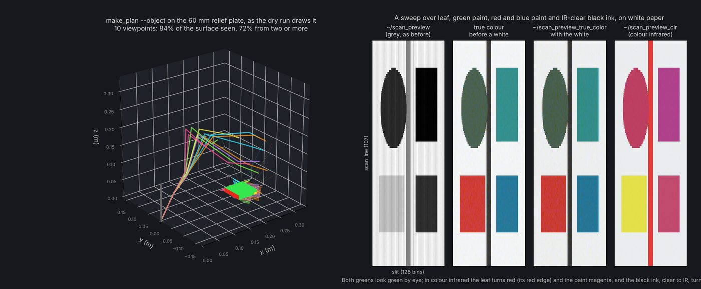</p>

*Left: a coverage plan for the relief plate as the dry run draws it (this one made with the default clearance: 10 views). Right: one simulated sweep over a leaf, green, red and blue paint and black ink, in the four previews. In colour infrared the leaf turns red and the green paint doesn't. Both from the simulator.*

A plan is a YAML file you can edit:

| Key | Default | Means |
|---|---|---|
| `name` | `scan` | Scan folders are called `<name>_<date>-<time>` |
| `home_mirror` | `true` | Home the mirror first if it hasn't been since power-up |
| `move.max_joint_speed_deg` | 30 | The joint that moves furthest sets each move's time |
| `move.settle_s` | 0.5 | Wait after a move before sweeping |
| `sweep.start_angle_deg` | −6.0 | Mirror angle of the first line; 0 is the 45° rest |
| `sweep.steps_per_line` | 2 | Microsteps between lines: 0.225° of view, about 0.6 mm at 15 cm. Negative sweeps the other way |
| `sweep.n_lines` | 107 | Lines per sweep: 24° of view, about 64 mm on the table |
| `sweep.line_period_s` | 0.0333 | One frame per line at 30 fps; the bridge rounds it to whole frames |
| `camera.record` | `auto` | `auto` records when `line_camera` runs; `required` refuses to scan without it; `off` doesn't record |
| `camera.references` | (the latest) | A folder whose `reference/` holds this scan's dark and white |
| `viewpoints[]` | | Each with a `name`, the five `joints_deg`, and optional `sweep` overrides |

Add `camera: {record: required}` to your plans, so a scan never runs with the camera off by mistake.

### Run the scan

```bash
ros2 run so101_scan_sweep scan_sweep --plan src/linescan-hyperspectral-splatting/ros2/so101_scan_sweep/plans/ring.yaml
```

Before it moves, `scan_sweep` checks the plan from where the arm is, and it won't start while the driver has the arm stopped. **Expect** `recording into /data/scans/ring_<date>-<time> (binned lines)`, then for each viewpoint `viewpoint 1/4 down: moving`, a bridge line `sweep <n>: 107 lines locked to the camera, 1 frame a line (33.3 ms)`, and at the end `wrote 428 lines to /data/scans/ring_<date>-<time>`.

- **Ctrl+C** stops the arm and the mirror and still writes what was logged; `scan.json` then says `"interrupted": true`.
- `--output /data/scans/relief_try1` names the folder yourself.
- A move that fails ends the run with the arm holding where it is.

**How the timing works.** The camera runs on its own 30 fps clock. For every frame, `line_camera` says when the rows that see the slit were exposing; the mirror bridge locks the ESP32's line clock to that, so each mirror step falls between two exposures. `line_camera` keeps a frame for a line only if its whole exposure fell while the mirror held still. The 1640 × 1232 mode reads the slit's rows in about 20 ms, which leaves time for the step; at full resolution a line would take two frames. Long exposures also eat into that time: past a point the bridge uses two frames a line, and its log says so.

**Disk:** with a calibration a sweep of 107 lines is about 8 MB of binned lines. Without one every line keeps its 4 MB raw frame, about 430 MB a sweep.

### What a scan writes

A folder `~/so101_scan/scans/<name>_<date>-<time>/` on the Nano:

| File | What it holds |
|---|---|
| `lines.csv` | One row per line: viewpoint, sweep, index, time, whether the mirror had settled, the mirror angle, the head and line-camera poses, the five joint angles |
| `scan.json` | The plan as loaded, and per viewpoint: lines expected and logged, line period and jitter, `frame_locked`, `frames_per_line`, `arm_motion_max_rad`; also `interrupted` |
| `robot.urdf` | The robot model the poses came from, head calibration included |
| `plan.yaml` | The plan as run, defaults filled in |
| `frames/camera.json` | Sensor, exposure, calibration, binning, timing and `slit_reversed` |
| `frames/frames.csv` | One row per line: status (`ok`, `no_frame`, `unsettled`, `dropped`), timing, exposure, gain, saturated pixels |
| `binned/sweep_<id>.npy` | Each sweep's lines as [lines, slit bins, bands] of mean raw counts |
| `frames/sweep_<id>/` | Raw frames: all of them without a calibration, none with one |
| `reference/` | Darks and whites taken during this scan, if any |

### Check the first real scan

Two things can only be learned from a real scan: **which end of the slit is pixel 0**, and **whether the camera driver stamps frames when the sensor starts reading out**. Either one quietly spoils every dataset if it's wrong. Scan the relief target with `ring.yaml`, then (**ROS**):

1. **Locked to the camera, one frame a line:**

   ```bash
   grep -E 'frame_locked|frames_per_line' /data/scans/<scan>/scan.json
   ```

   `"frame_locked": true` and `"frames_per_line": 1` for each viewpoint.

2. **Every line got a frame:** `cut -d, -f3 /data/scans/<scan>/frames/frames.csv | sort | uniq -c` counts every line as `ok`. Any `no_frame`, `unsettled` or `dropped` needs a look.
3. **The mirror settled on every line:** `cut -d, -f6 /data/scans/<scan>/lines.csv | sort | uniq -c` counts every line as `1`. Zeros call for a longer `sweep.line_period_s`.
4. **The arm held still:** `grep arm_motion_max_rad /data/scans/<scan>/scan.json`, one value in radians per viewpoint. The converter warns when the head moved more than 1 mm or 0.2° during a sweep.
5. **Not mirrored:** convert it ([From a scan to a dataset](#from-a-scan-to-a-dataset)) and look at it. If the target comes out mirrored along the slit, pixel 0 is the head's +X end: set `slit_reversed: true` in your copy of the camera settings (below) and relaunch with it. Scans already taken can be fixed: set `"slit_reversed": true` in their `frames/camera.json` and convert again with `--force`, because the binned lines are stored unflipped.
6. **Sharp across lines:** the target's edges should be as sharp across the scan lines as along the slit. If lines blur into their neighbours, the frames aren't stamped at the start of read-out: change `stamp_offset_us` in your copy of the camera settings, relaunch and scan again. This can't be fixed afterwards, because it decides which frames are kept. If the driver stamps the end of read-out, the offset is about −23,300 µs (one frame's read-out, an estimate).

Running first light on the scan ([Running first light](#running-first-light)) shows the measured lines beside the trained ones, which shows both problems too. The head calibration's report also says if `slit_reversed` is wrong.

### line_camera settings

Only `exposure_us` and `gain` change while it runs. For the others, copy the settings file into the data folder, edit it, and launch with it (**Nano**, repo folder, then **ROS**):

```bash
cp ros2/so101_scan_camera/config/line_camera.yaml ~/so101_scan/line_camera.yaml
```

```bash
ros2 launch so101_scan_bringup scan_arm.launch.py camera:=v4l2 camera_config:=/data/line_camera.yaml camera_calibration:=/data/hsical/cal foxglove:=true
```

| Setting | Default | Means |
|---|---|---|
| `device` | `/dev/video0` | The spectrograph camera |
| `width`, `height`, `fps` | 1640, 1232, 30 | The sensor mode; the calibration must match it |
| `exposure_us`, `gain` | 5000, 1.0 | Change live with `ros2 param set /line_camera ...` |
| `slit_bins` | 256 | Pixels along the slit in the binned lines |
| `slit_reversed` | `false` | `true` if binned pixel 0 is at the head's +X end |
| `stamp_offset_us` | 0 | Added to the driver's frame times |
| `raw_every` | −1 | Keep every n-th line's raw frame; −1 keeps all without a calibration, none with one |
| `reference_dir` | `/data/references` | Where darks and whites taken outside a scan go |

The launch's `camera_calibration:=` overrides the file's `calibration`. Magenta in the colour waterfalls marks a slit bin with a saturated pixel: lower `exposure_us`, then retake the white and dark.

## From a scan to a dataset

`scan_to_dataset` turns a scan folder into what the splat trainer reads: **reflectance in 46 bands of 10 nm, centred from 500 to 950 nm, at 256 points along the slit**, one head pose per sweep, and the camera's model. It needs only numpy, so it runs on the Nano or the PC.

**On the Nano** (**ROS**), where the references in `/data/references` are found by themselves:

```bash
ros2 run so101_scan_camera scan_to_dataset /data/scans/<scan> /data/datasets/<name>
```

**On the PC**, copy the scan *and the references* first. The scan records where its references were inside the container (`/data/references`), which doesn't exist on the PC, so without `--references` the converter quietly writes radiance instead of reflectance:

```bat
scp -r <user>@<nano-ip>:so101_scan/scans/<scan> .
scp -r <user>@<nano-ip>:so101_scan/references .
python splat/tools/scan_to_dataset.py <scan> <dataset> --references references
```

**Expect** `scan ...: <n> lines in lines.csv, binned on 256 slit bins ...`, a line starting `white:` naming the white and its dark, and at the end `wrote <dataset>: <n> lines in <m> sweeps, 256 px x 46 bands of reflectance ...; <f>% of values filled in`. **If the last line says `radiance` or `counts`, no white was found.**

What it does:

- **Reflectance** = (line − dark) / (exposure × gain), divided by the same for the white, times the white's reflectance (0.98 for PTFE). A dark at the line's exposure and gain is used, else the sensor's black level.
- **One pose per sweep**, the mean of its lines' poses, with the table top moved to z = 0. It warns when the head moved more than 1 mm or 0.2° during a sweep, since the trainer takes one pose per sweep.
- **Missing values**: lines with no frame, or missing more than 25% of their values (saturated pixels, say), are left out; the rest are filled in from their neighbours along the spectrum.

| Option | Does |
|---|---|
| `--references <folder>` | A folder whose `reference/` holds darks and whites; give it more than once for several |
| `--white <name>`, `--dark <name>` | Use that white or dark by its folder name |
| `--values radiance` | Radiance (or `counts`) instead of reflectance |
| `--urdf <robot.urdf>` | Work every pose out again from the joint readings with this robot model, for example the head calibration's |
| `--sweeps 0,2` | Keep only these sweeps |
| `--nm-min`, `--nm-max`, `--nm-step` | Other bands |
| `--calibration <cal>` | Bin raw frames with this spectral calibration (for a scan recorded without one) |
| `--force` | Write into a folder that already holds a dataset |

**After a head calibration**, reconvert earlier scans with its robot model, so their poses start from the measured head:

```bat
python splat/tools/scan_to_dataset.py <scan> <dataset> --urdf calibration/headcal_out/robot.urdf --references references
```

**Expect** `head: calibration/headcal_out/robot.urdf (poses from the joint readings, scan line <l> mm long at <d> mm)` before the usual last line. (The CAD head gives 44.37 mm at 150.0 mm.)

The dataset folder holds `dataset.json`, `lines.npy`, `line_sweep.npy`, `line_mirror_angle.npy` and `sweep_head_pose.npy`; [`splat/README.md`](../../splat/README.md) describes the format. To train on the Nano, copy it into `~/linesplat` first ([splat on the Nano](#splat-on-the-nano)).

## Training a splat

`splat_train` fits a **spectral Gaussian splat** to a dataset: thousands of small soft blobs, each with a position, shape, opacity and a whole spectrum, placed so that rendering them through each scan line's camera gives back the measured line. It also corrects each sweep's head pose as it goes, because a sweep's one or two hundred lines all share one arm pose and the arm's reading is never exact.

How it goes, briefly: it starts with a Gaussian every 1 mm on the table plane where the lines landed, then for each step renders 128 random lines, compares them with the measured ones, and nudges the Gaussians and the sweep poses to shrink the difference. Gaussians that keep being pushed get cloned or split, and nearly transparent ones are dropped, so raised parts grow up out of the table.

**On the PC**, from the repo folder, with the splat tools built ([Build the splat tools](#build-the-splat-tools)):

```bat
build\splat\Release\splat_train.exe <dataset> <dataset>\train
```

**Expect** a line each for the dataset, the device (`the GPU` with CUDA) and the start, then progress lines such as `iter 600  rmse 0.0188  6874 Gaussians (+35 -0)  90 ms/iter`, and at the end `done ... RMSE vs measured lines ...` and `wrote <dataset>\train (scene/, sweep_head_pose.npy, log.csv, preview/)`. A simulated dataset also has the truth, so it prints how far the line cameras are from the true ones before and after (`pose err 1.21 px rms ...` then `0.89 px`); a real scan has nothing to compare with, so look at the previews instead.

| In `train\` | What it is |
|---|---|
| `scene\` | The trained Gaussians, for `splat_export` |
| `sweep_head_pose.npy` | The refined head pose of each sweep |
| `log.csv` | RMSE, Gaussian count and time per logged step |
| `preview\measured_vs_trained_sweep_NN.png` | Each sweep's measured lines beside the trained splat's, in true colour |
| `preview\scene_rgb.png`, `scene_cir.png` | The scene from an overview camera, in true colour and colour infrared |

<p align="center">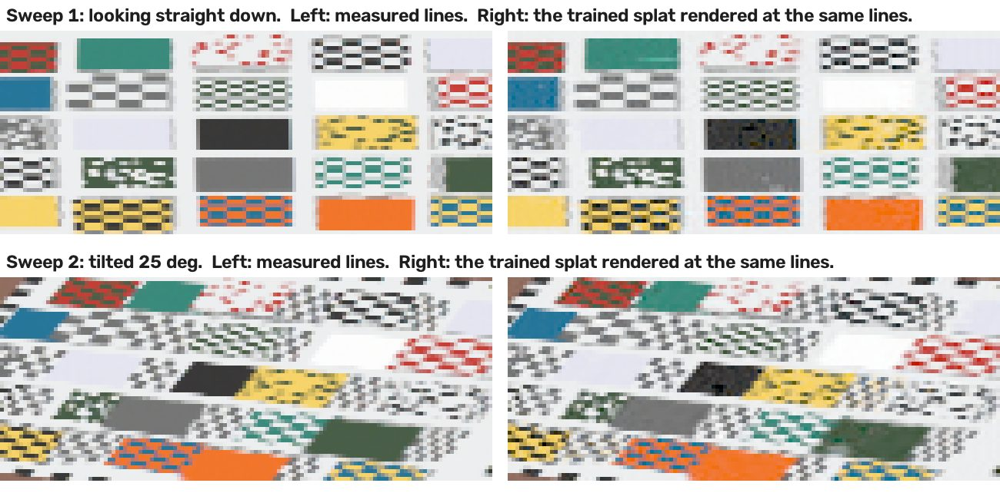</p>

*`measured_vs_trained` from Quick start A: the two sweeps as measured (left) and as the trained splat renders them along the same lines (right). They should look alike. A mirrored right side, or rows that blur into each other, point at the two first-scan problems in [Check the first real scan](#check-the-first-real-scan).*

**What a good run looks like.** The RMSE falls quickly and levels off near the noise in the lines (about 0.015 to 0.02 in reflectance on the simulator), and the previews match. On the simulator, training brings the poses from about 3.6 px to 1.7 px rms on the relief target and to 0.5 px on a flat board; 1 px is 0.16 mm on the table at 256 px.

**How long.** On TheRig's RTX 4070 SUPER a 16-sweep synthetic scene takes 10 to 16 s; on a 4-core CPU, about 1 to 2 minutes; the full simulated ring scan through first light, 6 to 10 minutes on 4 cores. On the Nano, see [splat on the Nano](#splat-on-the-nano).

| Option | Does |
|---|---|
| `--iterations N` | Steps to train (default 3000). Larger or relief-heavy scenes may want 6000 to 9000 |
| `--cpu` | Train on the CPU even with a GPU |
| `--no-poses` | Keep the recorded poses; train the scene only |
| `--gpu-adam`, `--basis 8` | Keep everything on the GPU, and use 8 spectral features through a learned basis instead of one per band, which needs less GPU memory (the modes the Nano budget compares) |
| `--init-scene <train>\scene --freeze-scene` | Refine only the poses of a new scan against a scene trained before |
| `--seed N` | Random seed |
| `--profile` | Time every GPU pass |

A build without CUDA ignores `--gpu-adam` and `--profile` and says `device the CPU, Adam on the CPU`. An unknown flag, `--basis` together with `--init-scene`, or `--freeze-scene` without `--init-scene` makes it print its usage text and stop.

**Scan for training.** More directions beat more lines: with 6 or 8 sweeps raised objects get painted onto the table and each sweep's pose bends to fit its own view, while 16 sweeps halve the pose error. The side of an object facing the arm's base is never seen from one placement; turn it and scan again.

### Export it for the viewer

`splat_export` packs the scene into one `.lsplat` file, with the wavelengths and each sweep's fan from the dataset:

```bat
build\splat\Release\splat_export.exe <dataset>\train\scene <name>.lsplat --dataset <dataset> --poses <dataset>\train\sweep_head_pose.npy --title "My scan"
```

It prints how far the packed scene renders from the original (about 2 × 10⁻⁴ in reflectance or less). First light runs the training and the export for you ([Running first light](#running-first-light)).

## Material maps

Every Gaussian carries a whole spectrum, so a trained splat can say what each part of the scene is made of, which a colour camera can't: green paint and a leaf look alike to the eye, but only the leaf has the sharp rise past 700 nm. `splat_materials` adds three maps to an exported `.lsplat` file, and the viewer shows them (**PC**):

```bat
build\splat\Release\splat_materials.exe <name>.lsplat <name>.lsplat --library my_library.csv
```

| Map | How | Use |
|---|---|---|
| **Library match** | The library spectrum at the smallest *spectral angle* (shape only, so a sheet in light shadow still matches), among those within 2× in brightness; no match if all are more than 10° off | "What is this made of?", when you have spectra of the materials |
| **Clusters** | k-means into 12 groups by spectrum, weighted by opacity; each named after the nearest library spectrum if one is close | Exploring a scene you have no spectra for |
| **Abundances** | Each Gaussian's spectrum as a mix of the library spectra, shares non-negative and summing to 1 | Edges and mixed surfaces |

**The library.** Without `--library` it uses the synthetic scene's 11 materials, which won't match real things. For the rig, measure your own: scan samples of what you'll be scanning, read each one's spectrum by clicking it in the viewer (the *Values by band* table), and write a CSV with a header row `nm,<name>,<name>,...`, one row per wavelength, and optionally a `color` row of `#rrggbb` map colours.

| Option | Default | Does |
|---|---|---|
| `--max-angle DEG` | 10 | The furthest a match may be |
| `--brightness F` | 2 | How much brighter or darker than the library spectrum a match may be |
| `--clusters K` | 12 | Clusters for k-means |
| `--endmembers clusters` | `library` | Unmix into the cluster means instead of the library |
| `--png DIR` | | Also write the maps as pictures |

The input must be a file `splat_export` wrote, not a gzipped one; the output may be the same file, as above. A file without maps still opens in the viewer, just without the **Materials** and **Abundance** views.

<p align="center">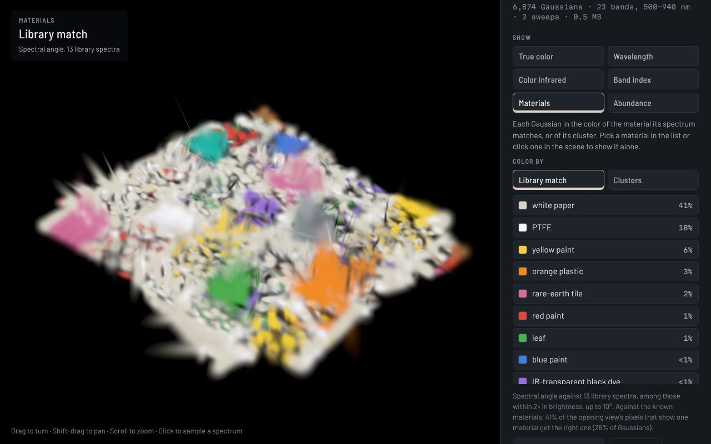</p>

*The viewer's Materials view of the Quick start A splat, matched against the simulator's 13 materials. That splat is two sweeps trained for 600 steps, so its map is rough: 41% of the opening view's pixels that show one material get the right one. A full scan does much better (below).*

**What to expect.** Seen along the scan lines, the maps come close to what the instrument allows: on the simulator's flat board 98.6% of the splat's line pixels get the right material, and on the relief target 86% from four views and 94% from sixteen. In the overview picture the relief does worse (51 to 58% of pixels), because the trained pillars are rough and a material often lands beside where it really is. Per Gaussian it's lower still: training leaves small, faint Gaussians whose spectra (some with negative reflectance) match nothing.

## Viewing a splat

The viewer is a web page in [`viewer/`](../../viewer/README.md): plain HTML, JavaScript and WebGL2, with no build step. It opens `.lsplat` files (and gzipped ones), draws them at any wavelength, and plots the spectrum of any point you click. Its tests check it against the C++ renderer.

**Open it locally** (**PC**, repo folder). Browsers won't run the page's modules from a file opened straight from disk, so it needs a server, even a local one:

```bat
python -m http.server -d viewer 8000
```

Open <http://localhost:8000>. It starts on a sample trained from 16 synthetic sweeps; `http://localhost:8000/#truth` opens that sample's ground truth. Click **Open file…**, or drop a file on the image, to open your own.

**Online:** the same page, with both samples, is at [corabeanz.github.io/linescan-hyperspectral-splatting/viewer/](https://corabeanz.github.io/linescan-hyperspectral-splatting/viewer/) once GitHub Pages is switched on (the repo's **Settings**, **Pages**, **Source: GitHub Actions**). Until then the address gives a 404. After switching it on, run the workflow once (**Actions**, **pages**, **Run workflow**); it then rebuilds and deploys the site whenever `viewer/` changes on `main`. A file you open there stays in your browser; nothing is uploaded.

<p align="center"></p>

*The Quick start A splat in colour infrared, with four sampled points. The chart shades the three bands that make up the picture's blue, green and red.*

### Moving around

| Do | To |
|---|---|
| Drag | Turn |
| Shift-drag or right-drag | Pan |
| Scroll | Zoom |
| Drag and pinch | The same on a touch screen |
| Arrow keys, shift-arrows, + and − | The same, when the image has focus |
| **Reset view** | Back to the opening view |

### What to show

| **Show** | Draws |
|---|---|
| **True color** | What your eye would see under even white light, from the CIE 1931 colour matching functions |
| **Wavelength** | One wavelength in grey, or the mean over a band up to 100 nm wide. **Sweep** runs it from one end of the spectrum to the other |
| **Color infrared** | 800 to 900 nm as red, 620 to 680 nm as green, 520 to 580 nm as blue. Plants turn red |
| **Band index** | (A − B) / (A + B) for two wavelengths, blue below zero and red above. A = 800 nm and B = 670 nm is NDVI, the usual plant-health index |
| **Materials** | Each Gaussian in the colour of the library material it matches, or with **Clusters** of its k-means cluster. Pick a material in the list, or click it in the scene, to show it alone (files with material maps only) |
| **Abundance** | How much of one material each Gaussian is, from 0 (dark violet) to 1 (yellow) (files with material maps only) |

**Exposure** brightens or darkens the picture. **Scan sweeps** draws each sweep's fan: where its lines start and where the first and last land.

### Reading spectra

**Click** the scene to sample the spectrum there, up to four points at once; each gets a numbered marker and a line on the chart. Hover the chart to read values, click it to show that wavelength, and open **Values by band** for a table you can copy. **Clear** removes the points. With material maps, each point also says which material covers most of it.

### Your own files

First light writes `splat.lsplat` in its output folder. For a splat you trained yourself, `splat_export` makes one ([Export it for the viewer](#export-it-for-the-viewer)) and `splat_materials` adds the material maps ([Material maps](#material-maps)). Each Gaussian takes 35 bytes plus one per band, so a 10,000-Gaussian splat of 46 bands is about 0.8 MB.

## Running first light

`pipeline/first_light.py` runs the whole software chain in one command, the way a real scan will go through it: convert the scan, train, export, and check the result in the viewer's own reader. On a simulated scan it first renders the scan and calibrates the simulated spectrograph, and it checks every hand-off against the simulator's truth. It exits with 0 only if every check passes. It runs on the **PC**, from the repo folder, with the environment active and `set PYTHONUTF8=1` (see [Windows notes](#windows-notes)).

| Config | Runs | Time on 4 CPU cores |
|---|---|---|
| [`sim-quick.yaml`](../../pipeline/configs/sim-quick.yaml) | Two simulated sweeps, 128 px by 23 bands, 600 steps | About 2 minutes |
| [`sim.yaml`](../../pipeline/configs/sim.yaml) (the default) | The ring plan's four sweeps of the relief target, 256 px by 46 bands, 3000 steps | 6 to 10 minutes |
| [`rig.yaml`](../../pipeline/configs/rig.yaml) | A real scan folder from the rig | Depends on the scan |

`<name>` below is the config's `name`: `sim-quick`, `sim-ring` for `sim.yaml`, and `rig`.

| Stage | Does | Writes, in `build\first_light\<name>\` |
|---|---|---|
| build | Builds `splat_train` and `splat_export` only if they're missing, so after pulling changes to `splat/` rebuild them yourself: `cmake --build build\splat --config Release` | |
| scan | Simulated only: renders the scan with `hsisim` | `scan\`, with the truth |
| calibrate | Simulated only, or if asked: `hsical calibrate` | `cal\` |
| convert | `scan_to_dataset.py` | `dataset\` |
| truth | Simulated only: the true poses and lines | `dataset\gt\` |
| train | `splat_train` | `train\`, with the previews |
| export | `splat_export` | `splat.lsplat` |
| viewer | The viewer's reader and probe, run in Node (skipped without Node) | `viewer_check.json` |

Then `report.md` lists every number the stages measured against its limit, and `logs\` keeps each stage's output.

### What the report checks

`report.md` starts with **Passed** or **Failed**, then a row per check. On the simulated scans:

| Check | A failure would mean |
|---|---|
| hsical's calibration checks | The simulated instrument no longer calibrates |
| Lines left out, values filled in | Frames were lost between the session and the dataset |
| Reflectance against the truth | The white, the darks or the band sums are off |
| Slit profile against the truth, and mirrored | Pixel 0 is at the wrong end of the slit |
| RMSE against the measured lines | The splat doesn't fit the lines |
| Pose error after training, and after over before | Pose refinement stopped working |
| The file as the viewer decodes it | The export went wrong |
| The viewer's probe against the C++ renderer | The viewer and the trainer disagree |
| How much of the opening view the splat covers | The viewer opens looking at nothing |

A real scan has no truth, so its checks are the ones it allows: how many lines made it into the dataset, how many values were filled in, how well the splat fits the measured lines, and whether the viewer reads the file. Look at `train\preview\` too: the measured lines beside the trained ones show a mirrored slit or blurred lines at once.

### First light on a real scan

1. **Copy three folders from the Nano** to the PC: the scan, the references and the spectral calibration.

   ```bat
   mkdir C:\scans
   scp -r <user>@<nano-ip>:so101_scan/scans/<scan> C:/scans/
   scp -r <user>@<nano-ip>:so101_scan/references C:/scans/
   scp -r <user>@<nano-ip>:so101_scan/hsical/cal C:/scans/
   ```

2. **Make your own config.** Copy `pipeline\configs\rig.yaml` to `my_rig.yaml` and give the converter the references, in the existing `convert:` section, with forward slashes:

   ```yaml
   convert:
     slit_bins: 256
     args: [--references, C:/scans/references]
   ```

   Put it in the file rather than on the command line: a `--set convert.args=...` that isn't valid JSON is quietly ignored.

3. **Run it:**

   ```bat
   set PYTHONUTF8=1
   python pipeline/first_light.py my_rig.yaml --set scan.path=C:/scans/<scan>
   ```

   If the convert stage asks for `/data/hsical/cal`, add `--set scan.calibration=C:/scans/cal`.

4. **Check that the references were used:** `build\first_light\rig\logs\convert.log` has a line starting `white:` and ends with `bands of reflectance`. Without the references the dataset silently comes out as radiance, and nothing in the report flags it.
5. **Open** `build\first_light\rig\splat.lsplat` in the viewer ([Viewing a splat](#viewing-a-splat)).

### Options

| Option | Does |
|---|---|
| `--set KEY=VALUE` | Overrides one config value, read as JSON where it parses: `--set train.iterations=6000`, `--set train.cpu=true`, `--set sim.scene=board`, `--set limits.pose_error_px_max=null` (drops a check) |
| `--out DIR` | Another output folder |
| `--from STAGE`, `--to STAGE` | Rerun part of the chain and reuse the rest: `--from train --set train.iterations=6000` retrains without converting again |
| `train.args`, `convert.args` | Extra flags passed straight to `splat_train` and `scan_to_dataset.py`; set them in the YAML |

CI runs `sim.yaml` every night and `sim-quick.yaml` on pull requests that touch the chain, and keeps the report, logs, previews and splat of each run.

## Head calibration

The robot model puts the head's parts where the CAD draws them, but a printed head won't match exactly: a part seated half a millimetre off, the mirror shaft a degree out of square, the horn screwed on a little turned. At 15 cm a 1° error moves the scan line 2.6 mm, about nine lines. `headcal` measures those offsets from one scan of a printed board, and writes them into the robot model that the launch file, the scans and the converter use.

It works in two steps. The pose camera finds hundreds of numbered corners on a ChArUco board in its stills, which gives its lens and the board's pose from every viewpoint. Then the line camera's sweeps of the same board are matched corner by corner against sweeps rendered from the current guess of the head, and one fit adjusts the objective, the mirror shaft and its home angle, the scan line's length and the pose camera together. It doesn't touch the arm's joint zeros (`sts_calibrate` sets those) or the wavelengths (`hsical`).

First light doesn't need it: training refines each sweep's pose anyway. The head calibration makes the poses start right, which matters more as scans get larger.

**You need:** a B01 Nano (the pose camera uses the second camera port), the Pi NoIR on the head on its own ribbon, the arm calibrated with `sts_calibrate`, the mirror homing **with its working angle already set** ([Home the mirror and set the working angle](#home-the-mirror-and-set-the-working-angle)), an `hsical` calibration installed for `line_camera`, a laser printer, foam board, a steel rule and the halogen.

### Print the board

1. **PC**, in `calibration/`:

   ```bat
   python -m headcal board headcal
   ```

   It writes `headcal\board.svg` and `board.json`: a chequerboard of 24 × 17 squares of 10 mm with a 7 mm ArUco tag in every white square, on landscape Letter paper, with a 100 mm check bar. (The top-level README and the parts list call this an AprilTag board; print the ChArUco board `headcal` writes.)

2. Print `board.svg` at 100% ("actual size", not "fit to page") on a **laser printer**. Toner stays black in the near infrared; most inkjet inks go transparent past 700 nm and the board would fade out of half the band. Measure the check bar: if it isn't 100.0 mm, fix the print settings and print again.
3. Glue the print flat onto foam board, all over. A corner lifted 0.5 mm puts a 0.5 mm error into that corner.
4. Measure 20 squares along the long side with a steel rule, as closely as you can, and give `headcal` the number. This rewrites `board.json` to the printed size:

   ```bat
   python -m headcal board headcal --span-mm 199.6
   ```

### Run the calibration scan

1. **Place the board** flat on the table with its centre 260 mm in front of `base_link`, which is 221 mm in front of the shoulder's turning axis, straight ahead ([Where things go on the table](#where-things-go-on-the-table)). A centimetre or two off, or turned up to about 20°, is fine: the calibration measures where it is. For another spot, make a new plan on the PC (`python -m headcal plan --centre 0.24 0.03 --out myplan.yaml`, in metres in `base_link`) and use it in place of the repo's plan below.
2. **Start the rig with the CAD head** (**ROS**), so the solve starts from known numbers:

   ```bash
   ros2 launch so101_scan_bringup scan_arm.launch.py camera:=v4l2 camera_calibration:=/data/hsical/cal head_calibration:=none foxglove:=true
   ```

   The log says `scanner head: the CAD numbers`. The arm is under power from here on: keep the servo power switch within reach.

3. **Home the mirror and move to the first viewpoint** (**ROS**, a second shell; keep `ros2 run so101_scan_safety arm_estop` open in a third):

   ```bash
   ros2 service call /scan_mirror/home std_srvs/srv/Trigger
   ros2 run so101_scan_sweep move_arm --plan src/linescan-hyperspectral-splatting/calibration/headcal/plans/headcal.yaml
   ```

4. **Light the board** evenly with the halogen and set the line camera's exposure so the board's white paper reads 50 to 90% of full scale on `/line_camera/preview` in Foxglove:

   ```bash
   ros2 param set /line_camera exposure_us 8000
   ```

5. **Focus the pose camera** (**Nano** host, in `calibration/`). Its lens is set for far away; turn it with the focus tool until the sharpness number peaks, then Ctrl+C:

   ```bash
   python3 -m headcal record /tmp/focus --device /dev/video1 --focus
   ```

6. **Start the recorder** on the host and leave it running for the whole scan. It sets its exposure, then keeps a still whenever the view holds still:

   ```bash
   python3 -m headcal record ~/so101_scan/pose/headcal_1 --device /dev/video1 --auto 0.7
   ```

7. **Dry-run, then scan** (**ROS**, the second shell). The plan has 22 viewpoints, from straight down to 35° tilted; at each the arm holds still while the mirror sweeps 213 lines (about 7 s).

   ```bash
   ros2 run so101_scan_sweep scan_sweep --plan src/linescan-hyperspectral-splatting/calibration/headcal/plans/headcal.yaml --dry-run
   ros2 run so101_scan_sweep scan_sweep --plan src/linescan-hyperspectral-splatting/calibration/headcal/plans/headcal.yaml
   ```

   The dry run exits with 1 if a viewpoint comes too close to the table or a sweep is out of the mirror's range. The scan writes `~/so101_scan/scans/headcal_<date-time>/`. The lowest viewpoint (`t35_a150_+0_+0_-12`) brings the head within about 20 mm of the table, so use foam board no thicker than 5 mm, keep everything else off the table, and watch that one.

8. Stop the recorder with Ctrl+C. It reports how many stills it kept, two to four per viewpoint.

<p align="center">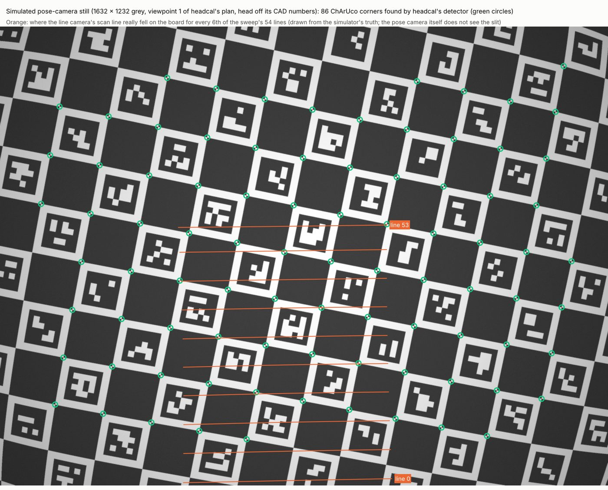</p>

*A simulated pose-camera still with the 86 corners `headcal` found circled. The orange lines show where the scan line fell on the board (the pose camera itself doesn't see it).*

> [!NOTE]
> This needs the line camera (`/dev/video0`, in the container) and the pose camera (`/dev/video1`, on the host) streaming at the same time. That hasn't been tried on the real Nano yet.

### Solve and read the report

**PC**, in `calibration/`:

```bat
scp -r <user>@<nano-ip>:so101_scan/scans/headcal_<date-time> .
scp -r <user>@<nano-ip>:so101_scan/pose/headcal_1 .
python -m headcal solve headcal_<date-time> headcal_1 --board headcal/board.json -o headcal_out
```

It writes `head_calibration.yaml`, `robot.urdf`, `pose_camera.yaml`, `calibration.json`, `report.md` and `line_corners.png` in `headcal_out\`. Warnings print as lines starting with `! `.

| In `report.md` | Good | If not |
|---|---|---|
| Pose camera corner rms | Under 0.3 px | Refocus the pose camera; check the board is flat and evenly lit |
| Line camera corners per sweep | About 8 or more | Board too dim, out of focus, or not under the scan line |
| Line camera rms along the slit (px) and across it (lines) | Under 0.3 | Look for one bad viewpoint in the Per viewpoint table and `line_corners.png` |
| Arm: where the board lands per viewpoint | About 0.5 mm | That's the arm's repeatability and joint zeros, not the head |
| What changed, per part | A millimetre or two and a degree or three | Ten millimetres or ten degrees means a part is loose or seated wrong: fix it and scan again |
| Check these | Nothing listed | It warns if the pose camera is mounted another way round than the CAD, or if `line_camera`'s `slit_reversed` setting doesn't match the build |

The report also gives the mirror's home angle as measured (for example `the mirror sits 1.386 deg from where the firmware says`). **Leave the firmware's `home_pos` alone** after this: the robot model carries the measured angle, and changing `home_pos` means calibrating again.

### Install it and use it

1. Copy it to the Nano's data folder (**PC**):

   ```bat
   scp headcal_out/head_calibration.yaml <user>@<nano-ip>:so101_scan/head_calibration.yaml
   ```

2. Launch as usual, without `head_calibration:=none`. The log says `scanner head: calibrated, from /data/head_calibration.yaml`. (`head_calibration:=none` goes back to the CAD numbers for one launch.)
3. Reconvert scans taken before the calibration with the measured head (**PC** or **Nano**, from the repo folder): the converter works each line's pose out again from the joint readings.

   ```bat
   python splat/tools/scan_to_dataset.py <scan folder> <dataset folder> --urdf calibration/headcal_out/robot.urdf
   ```

Calibrate the head again after taking it off the wrist, rerunning `sts_calibrate`, changing the mirror's `home_pos`, or knocking a camera. It's one scan.

**What to expect.** On the self-test `headcal` places the scan line to 0.17 mm (median) of the truth. Almost all of its error comes from the arm's joint readings, and a real STS3215 arm will likely do 0.3 to 0.5 mm worse. In the simulator's whole-rig test, the scan line posed from the logged joints lands 1.0 mm from the truth with the calibrated head, against 3.3 mm with the CAD head.

## The simulator

`hsisim` in [`sim/`](../../sim/README.md) is a digital twin of the whole scanner: the arm, the scan mirror, the objective and slit, the spectrograph and its camera, and the pose camera. Give it a scene with known spectra and a plan, and it writes a complete scan session in the rig's own folder format, raw frames and all, together with the truth it was made from. Every later stage can then be run and scored before the hardware exists; Quick start A and the first-light configs use it.

It's deliberately imperfect, the way the real rig will be: the spectrum shifted and stretched on the sensor, smile and keystone from the optics model, lens blur, the NoIR colour mosaic, noise, hot pixels and 10-bit clipping; servo calibration offsets, whole encoder ticks and arm flex in the logged poses; the mirror's homing error; and the camera's rolling shutter and frame lock, run with the rig's own timing code.

**On the PC**, from `sim/`, with the environment active:

```bat
python -m hsisim selftest
python -m hsisim scan sim_out --plan ring
python -m hsisim preview sim_out
```

The self-test scans two short sweeps, calibrates the simulated instrument with `hsical`, turns the sweeps into reflectance and checks them against the truth (about 35 s). `scan` writes a whole session: four viewpoints of 107 lines in under two minutes. `preview` draws pictures of it in `sim_out\preview\`.

A session holds what the rig would write (`lines.csv`, `scan.json`, `robot.urdf`, `plan.yaml`, `frames/`, `reference/` with a dark and a white), plus a full `calibration/` lamp session of the same simulated instrument, and `truth/`. Calibrate it and convert it as you would a real scan:

```bat
cd ..\calibration
python -m hsical calibrate ../sim/sim_out/calibration -o ../sim/sim_out/cal
cd ..
python splat/tools/scan_to_dataset.py sim/sim_out sim_ds --calibration sim/sim_out/cal
```

| Option | Does |
|---|---|
| `--plan ring` | The plan: `ring`, `headcal`, or any plan file from `make_plan`. `--views down,tilt25_az90` keeps only some viewpoints |
| `--scene relief` | `relief` (the default: the 60 mm plate with 25 painted pillars), `board` (flat), `white` (PTFE), `tagboard` (the head calibration's board) |
| `--lighting uniform` | Or `lamp`: a halogen with fall-off and shadows |
| `--binning 4` | 2, or 1 for the full sensor (much slower and bigger) |
| `--seed 7` | The flaws, errors and noise all follow it |
| `--errors 0` | Perfect poses; `2` for twice the default errors |
| `--slit-reversed` | The camera mounted the other way along the slit |
| `--stamp-error-us 15000` | The camera's timestamps 15 ms late, to see what a wrong `stamp_offset_us` does |
| `--pose-camera`, `--head-errors 1` | Also render the pose camera's stills, and build the head off its CAD numbers as a hand-built one would be: a head calibration scan to solve |

`python -m hsisim evaluate sim_out sim_out/cal` turns every sweep into reflectance and compares it with the truth; `python -m hsisim handeye` runs a whole simulated head calibration and compares the result with the true head (about five minutes). On the ring plan the reflectance comes back with a median error of 0.00% and 1.6% rms, and the rare-earth tile's absorption bands within 0.04 nm.

What it leaves out: shiny surfaces, light bouncing between surfaces and fluorescence; stray light and ghosts; the arm moving during a sweep; and any drift between calibration and scan. A real scan will be worse in those ways.

## Changing the design

Every number the head is built from lives in one file, [`cad/rig/params.py`](../../cad/rig/params.py), one row per value with a source tag (`listing`, `measured`, `est` and so on). The STLs, the optics check, the calibration kit's design map and the robot model all follow from it, and CI checks that each is current. This is the routine after the measurements, or after any change to a part.

**You need** on the PC: FreeCAD 1.0 or newer (tested with 1.1.3; on Windows `freecadcmd` is `FreeCADCmd.exe` in FreeCAD's `bin` folder), and `pip install "optiland==0.6.2"` in the repo's environment.

1. **Edit the numbers.** In `cad/rig/params.py`, change each measured value in its `p(...)` row and its tag from `est` to `measured`, for example `p("coll_bfl", 6.0, "mm", ..., "est")` becomes your back focus, `"measured"`. Editing the Params sheet in the FreeCAD window moves the model but doesn't update the STLs.
2. **Get the arm's meshes** (once; 17 MB, each file checked by SHA-256):

   ```bat
   python cad/vendor/so101/fetch_assets.py
   ```

3. **Rebuild** (about 2 minutes). It rebuilds the model, checks clashes, the mirror's full turn, the wrist clearance and the servo load, and rewrites `cad/stl/`, `cad/step/hsi_head.step` and `cad/build_report.json`.

   ```bat
   freecadcmd cad/build_rig.py
   ```

   Check `cad/build_report.json`: `interference_mm3` should be `[]`, and every value in `rotor_full_turn_min_gap_mm` above 0. With the numbers on main they are the lid 0.5, the housing 0.94, the hall sensor 1.1, the hall board 1.26, the filter cap 1.41 and the objective 5.86 mm. Watch the filter cap's gap after changing the objective's length or back focus. FreeCAD 1.1.3 sometimes crashes on exit *after* writing everything; check the files' times rather than the exit code.

4. **Trace the optics as built** (about 7 s). It writes `cad/optics_as_built.txt`: resolution, where the spectrum and the line land on the sensor, and how much light reaches it.

   ```bat
   python cad/optics_check.py
   ```

   With main's numbers: 4.1 nm, spectrum 3.27 mm long, line 2.56 mm, and 56% / 99% / 55% of the light at the line centre at 500 / 750 / 1000 nm.

5. **Refresh the calibration kit's design map**, which gives `hsical` its first guess of which column sees which wavelength:

   ```bat
   python calibration/tools/export_optiland_map.py
   ```

6. **Export the head into the robot model**, so the arm's model and its safety checks use the new geometry (about 1 s):

   ```bat
   freecadcmd -c "exec(open('ros2/so101_scan_description/scripts/export_head_from_cad.py').read())"
   ```

7. **Fix the collision box by hand.** The export doesn't write the box the planner checks against ([`scan_head.xacro`](../../ros2/so101_scan_description/urdf/scan_head.xacro), lines 119 to 122). Make it enclose the whole head, camera end included; see [Safety with the head on](#safety-with-the-head-on).
8. **If you changed the optics model** itself (for example `d_cam=5.0` in layout E for an f/2.4 camera lens), also rerun `python optics/spectrograph_model.py`, which rewrites `optics/model_output/`.

Then commit everything the steps changed. If a CI workflow fails afterwards, it names the file that's out of date:

| Workflow fails | Usually because | Rerun |
|---|---|---|
| cad | The STLs or the report don't match `params.py` | `freecadcmd cad/build_rig.py` |
| optics | `results.txt`, `cad/optics_as_built.txt` or the design map are stale | steps 4, 5 and 8 |
| ros2 (description tests) | `scan_head_params.xacro` or the head meshes don't match `build_report.json` | step 6 |

### The NEMA 17 option

`set RIG_MOTOR=17HM08` before step 3 builds the head for a NEMA 17 pancake stepper instead: a 280 g head and the shoulder at 94% of its stall torque. It changes only the lid, the mirror clamp and the motor.

### The boards

The KiCad 10 projects are generated from scripts, and checked the way CI checks them:

```bat
python pcb/tools/fab.py --check-only
python pcb/tools/fab.py
"%LOCALAPPDATA%\Programs\KiCad\10.0\bin\python.exe" pcb\tools\build_boards.py
```

The first runs the electrical and design-rule checks (warnings count as failures). The second also refreshes the JLCPCB files, the schematic PDFs and the renders. Both need `kicad-cli` from KiCad 10 on the PATH (or in `KICAD_CLI`). The third regenerates both projects from `pcb/tools/boards.py` and `library.py` with KiCad's own Python. It overwrites the projects, so use it only after changing those scripts, never after editing a board by hand.

# Appendices

## Everyday commands

The commands you'll type most, by where they run. `<plans>` is `src/linescan-hyperspectral-splatting/ros2/so101_scan_sweep/plans`.

**A scanning session**

| Where | Command | Does |
|---|---|---|
| Nano | `jetson/ros.sh` | A ROS 2 shell (open three) |
| ROS | `ros2 launch so101_scan_bringup scan_arm.launch.py camera:=v4l2 camera_calibration:=/data/hsical/cal foxglove:=true` | The arm, the mirror and the camera |
| ROS | `ros2 run so101_scan_safety arm_estop` | The e-stop: Enter stops, r resets, l limp, q quits |
| ROS | `ros2 service call /scan_mirror/home std_srvs/srv/Trigger` | Home the mirror |
| ROS | `ros2 param set /line_camera exposure_us 8000` | Set the exposure |
| ROS | `ros2 run so101_scan_camera capture_reference white` (then `dark`) | The white and dark references |
| ROS | `ros2 run so101_scan_sweep make_plan --object 0.24 0 --size 0.06 0.06 0.012 --clearance 0.025 --name relief --out /data/plans/relief.yaml` | A coverage plan |
| ROS | `ros2 run so101_scan_safety check_plan --plan /data/plans/relief.yaml` | Check it against the soft limits |
| ROS | `ros2 run so101_scan_sweep scan_sweep --plan /data/plans/relief.yaml --dry-run --clearance 0.025` | Play it without moving |
| ROS | `ros2 run so101_scan_sweep scan_sweep --plan /data/plans/relief.yaml` | Scan |
| ROS | `ros2 run so101_scan_sweep move_arm --plan <plans>/one_view.yaml` | Move to a plan's first viewpoint |
| ROS | `ros2 run so101_scan_camera scan_to_dataset /data/scans/<scan> /data/datasets/<name>` | Make a dataset on the Nano |

**On the PC**

| Command | Does |
|---|---|
| `.venv\Scripts\activate` | The repo's Python environment, in every new prompt |
| `scp -r <user>@<nano-ip>:so101_scan/scans/<scan> .` | Copy a scan (and `so101_scan/references`, `so101_scan/hsical/cal`) |
| `python splat/tools/scan_to_dataset.py <scan> <dataset> --references references` | Make a dataset |
| `build\splat\Release\splat_train.exe <dataset> <dataset>\train` | Train |
| `build\splat\Release\splat_export.exe <dataset>\train\scene out.lsplat --dataset <dataset> --poses <dataset>\train\sweep_head_pose.npy` | Export for the viewer |
| `set PYTHONUTF8=1` then `python pipeline/first_light.py my_rig.yaml --set scan.path=C:/scans/<scan>` | Convert, train, export and check in one go |
| `python -m http.server -d viewer 8000` | The viewer at <http://localhost:8000> |
| `python -m hsical inspect <session>`, `calibrate <session> -o cal`, `check cal checks/cfl` | Spectral calibration, from `calibration/` |
| `python -m headcal solve <scan> <pose> --board headcal/board.json -o headcal_out` | Head calibration, from `calibration/` |

**Calibration captures on the Nano** (from `calibration/`)

| Command | Does |
|---|---|
| `python3 -m hsical probe` | The camera's modes and controls |
| `python3 -m hsical focus --exposure-ms 20` | Live line width for focusing |
| `python3 -m hsical plan ~/sessions/<name> --width 1640 --height 1232` | A guided calibration session |
| `python3 -m headcal record ~/so101_scan/pose/<name> --device /dev/video1 --auto 0.7` | The pose camera's stills during a head calibration scan |

**The mirror by hand** (in the serial monitor)

| Line | Does |
|---|---|
| `INFO`, `STATUS`, `DRV` | Versions; state and position; the driver live |
| `ENABLE`, `DISABLE` | Motor on, off |
| `HOME` | Find the hall window and park at the working angle |
| `MOVE pos=0`, `MOVE rel=32` | Go to a position; step by an amount |
| `SCAN lines=20 step=8 period=100000` | A test sweep |
| `CFG key=value`, `SAVE` | Change a setting; keep it |

## Troubleshooting

Find the message or the symptom, then the fix. Messages are quoted as the tools print them.

### The Nano and Docker

| Symptom | Cause | Fix |
|---|---|---|
| `unknown or invalid runtime name: nvidia`, or no CUDA in the container | Docker's NVIDIA runtime is missing or didn't mount CUDA | Check `/usr/local/cuda/bin/nvcc --version` on the Nano. If it's missing: `sudo apt-get update && sudo apt-get install nvidia-jetpack` |
| `nano_setup.sh` says `Docker or its NVIDIA runtime is missing`, but `sudo docker info \| grep Runtimes` lists nvidia | A false alarm in the script | Run it again; if it repeats, do its steps by hand ([Set it up and build everything](#set-it-up-and-build-everything)) |
| `The GPU isn't visible in the container, so the CUDA tests were skipped.` | The container can't open the GPU's device nodes | Check that `/dev/nvhost-ctrl` and `/dev/nvmap` exist |
| `cc1plus: fatal error: Killed`, or nvcc dies during a build | Out of memory: 4 GB shared with the GPU | `LINESPLAT_JOBS=1 jetson/splat.sh build`, and check `free -h` shows the swap |
| `apt-get update` fails while building the ROS 2 image | The Nano's old Docker can't build Ubuntu 22.04 images the plain way | `SO101_BUILD_WITH=buildkit jetson/ros.sh image`; on the Nano never build with `ros2/docker/run.sh` |
| `colcon build` fails with `existing path cannot be removed` | A symlink build over an earlier plain one | `sudo rm -rf ~/so101_ws/build ~/so101_ws/install ~/so101_ws/log`, then build again |
| `Could not download the SO-101 meshes` | No internet during the first build | `python3 cad/vendor/so101/fetch_assets.py`, then build again |
| `rviz2` or `joint_state_publisher_gui` not found | The image has neither | Use Foxglove |
| Permission denied deleting files in `~/so101_scan` or `~/so101_ws` | The ROS 2 container writes as root | `sudo` on the host |
| `/dev/so101` or `/dev/scan_mirror` is missing | The device's USB id isn't in the rules | [USB names for the arm and the mirror](#usb-names-for-the-arm-and-the-mirror) |

### The arm

| Symptom | Cause | Fix |
|---|---|---|
| `No servos answered on /dev/so101 at 1000000 baud. Is the servo power on?` | Servo power off, wrong port, or a launch holds the port | Switch the servo supply on, check `ls -l /dev/so101`, stop any launch |
| `missing: <joint> (id <n>)` | A servo isn't answering | Check the bus cables to that servo and its id |
| `No calibration file at /data/calibration.yaml` | The real arm needs a calibration | `sts_calibrate`, or `use_mock_hardware:=true` |
| `Not switching the motors on, outside the calibrated range: ...` | A joint is more than about 5° outside its range | Recalibrate that joint, or launch with `torque:=false` and move it into range by hand |
| A joint turns the wrong way in Foxglove | Its sign is wrong | `sts_calibrate --port /dev/so101 --joints <name>` |
| `the arm's soft limits would stop it short: ...` | A viewpoint or a move breaks the table, base or gravity limit | `check_plan --plan <file>` shows the margins. Move the object closer to the base, or delete the failing viewpoints |
| `the arm stopped: ...` | The driver holds the arm after an e-stop or a fault | Remove the cause (let a servo cool, free a joint), then `arm_estop --reset` |
| `arm_estop` says `no answer from /arm_safety/estop` | No driver is running, or mock hardware | Start the launch with the real arm or the fake bus |
| The dry run says `arm_controller isn't running` | The launch has `torque:=false` | Relaunch without it |
| The shoulder strains with the arm stretched out | The head needs 75% of its stall torque level | Keep the arm folded; don't park it stretched out |

### The mirror and the ESP32

| Symptom | Cause | Fix |
|---|---|---|
| The upload stops at `Connecting...` | The ESP32 didn't enter its bootloader | Hold **BOOT** while it says `Connecting...`; check the cable carries data and the port is right |
| No COM port appears | A charge-only cable, or no driver for the USB chip | Another cable; on Windows install the CP210x or CH340/CH9102 driver |
| The ESP32 restarts whenever a terminal opens the port | The program drives DTR or RTS | Use `pio device monitor -e esp32dev` or `mirrorctl.py` |
| A few garbage characters after a reset | The boot ROM prints at another baud rate | Ignore them |
| `pyserial is missing: pip install pyserial` | `mirrorctl.py` needs it | `pip install pyserial` in the environment you run it from |
| `Could not open port` or busy | The monitor, another `mirrorctl` or the ROS bridge holds it | Close it or stop the launch |
| `ERR ENABLE code=driver msg=TMC2209 did not answer on UART: check 12 V, VIO and the PDN_UART wire ...` | 12 V off, no 3.3 V on VIO, the module the wrong way round, or the UART on the wrong pin (on the V1.3 "PDN_UART" is the pin printed RX) | 12 V on, 3.3 V at VIO, orientation, the RX wire; on the controller board JP1 bridged 1-2 |
| `STATUS` says `drv=noresp` but `DRV` answers | The check ran at boot, before the 12 V | `ENABLE` (it checks again) or `REBOOT`. Power the 12 V first next time |
| `EV FAULT code=drv_reset` | The driver lost its 12 V and went back to its power-up settings | Restore the 12 V, then `ENABLE` |
| `EV FAULT code=drv_noresp` | The driver stopped answering on its UART while enabled, for example the 12 V went off | Restore the 12 V, check the RX wire, `ENABLE` |
| `EV FAULT code=drv_err` | The driver shut its outputs off: overheating or a short | `DRV` shows `ot`, `s2g` or `s2vs`; fix the cause, `ENABLE` |
| `mirrorctl` stops with `error: no reply to: <command>` | Nothing answered in 3 s: the wrong port, no firmware, or a command sent right after `REBOOT` | Check the port and that `INFO` answers in the monitor; after `REBOOT`, start a new run |
| `ERR MOVE code=disabled ...` (or `HOME`, `SCAN`) | The motor is off | `ENABLE` first |
| `EV HOME_FAILED reason=not_found` | No magnet seen: wiring, or the wrong face toward the sensor | `STATUS` with the magnet held at the sensor should say `hall=1`; flip the magnet. Bring the mirror back with `MOVE pos=0` |
| `HOME_FAILED reason=stuck`, `too_wide`, `lost`, `timeout` | See [Mirror serial protocol](#mirror-serial-protocol) | |
| `HOME` fails on the bare shaft | Nothing carries the magnet past the sensor | Expected until the clamp and magnet are on |
| The mirror turns the wrong way, or sweeps run backwards | A coil reversed | Launch stopped: `CFG dir_inv=1`, `SAVE`, `ENABLE`, `HOME` |
| The motor buzzes but doesn't turn | Coil wires mixed between pin pairs | 12 V off, wait for the green LED to go dark, find the pairs (about 24 Ω within a coil), one pair on pins 1-2, the other on 3-4 |
| The red STATUS LED (or the GPIO 2 LED) blinks and `STATUS` shows `state=fault` | The driver reported a fault | Read `EV FAULT code=` ([Mirror serial protocol](#mirror-serial-protocol)), fix it, `ENABLE` |
| `HOME` gives a different `width` or `shift` each time, or fails now and then | Motor noise on the hall line | Run the hall cable apart from the motor's; on the controller board, fit C3 (1 nF), which is left off |
| `EV LINE ... ready=-1` | The mirror was still moving at the next line | A longer period, a smaller step, or faster `vmax`/`accel` |
| `ERR SCAN code=range msg=sweep speed ...` | A sweep faster than `vstart` | Smaller step or longer period |
| `EV WARN code=events_dropped` | The host reads too slowly | Close other programs; `mirrorctl -q` for long scans |
| `mirrorctl --sync` fails on the Nano: `no attribute 'monotonic_ns'` | The Nano's Python 3.6 is too old | Run it in the ROS container: `jetson/ros.sh python3 /ws/src/linescan-hyperspectral-splatting/firmware/tools/mirrorctl.py ...` |
| `pio test -e native` fails on Windows | No gcc on the PATH | Install MSYS2's `mingw-w64-ucrt-x86_64-gcc`, or rely on CI |
| `ERR CFG code=busy` or `ERR SAVE code=busy` | The mirror is moving | Wait, or `STOP` |

### The camera and the spectral calibration

| Symptom | Cause | Fix |
|---|---|---|
| `v4l2-ctl not found` | v4l-utils isn't installed | `sudo apt install v4l-utils python3-numpy` on the Nano |
| `no camera back end found: needs v4l2-ctl and /dev/video0 ...` | No camera seen, or the command ran in the ROS container | Run `hsical` on the Nano host; check the ribbon and `/dev/video0` |
| The probe shows other control names | The driver names them differently | `--ctrl` on every capture command |
| A V4L2 error about another size or format | The mode isn't offered, or it's the wrong device | `v4l2-ctl -d /dev/video0 --list-formats-ext`; set `device`, `width`, `height` in a copied camera config |
| `hsical focus` never gets below a broad, high width | The collimator isn't one focal length from the slit: the LN016's back focus differs from what the slit block assumes, or the lens isn't fully into its holder | Measure the back focus, rebuild and reprint the slit block |
| About 5.4 nm resolution and the slit's ends missing | The field lens is flat side toward the slit | Turn it curved side toward the blades |
| 500 or 1000 nm falls off the sensor | The camera tilt is off (each degree moves the band about 33 nm), or the board is turned 90° | Keep the tilt within −0.5 to +1° of 22°; the sensor's long side across the slit |
| Faint ghost copies of lamp lines | A rear-surface mirror, or the mirror glued coated face down | Front-surface sheet, coated face out |
| Black parts look grey to the NoIR camera | The filament isn't black in near infrared | Another filament, or flocking inside |
| A pink or blue-green tint in the back of a Commonlands lens | The IR-cut version came | Send it back |
| A report check fails | See the table in [Read the report](#read-the-report) | |
| The lamp plot's ticks sit beside the peaks | The line pattern matched the wrong way | A `session.json` hint with the green mercury line's column |
| `the calibration in ... is for 3264x2464 frames, and the camera is set to 1640x1232` | The session was captured at full size | Capture again with `--width 1640 --height 1232` |
| `hsical check` exits 1: `... take them in the same sensor mode` | The check frames and the calibration differ in size | Same `--width` and `--height` as the session |
| `hsical check` exits 2 | The instrument moved | A new calibration session before scanning |
| `line_camera` warns `no calibration: lines can't be binned ...` | No calibration given | `camera_calibration:=/data/hsical/cal` |
| Magenta stripes in the waterfalls | Saturated pixels | Lower `exposure_us`, then retake the white and dark |
| `/line_camera/capture_reference isn't there: is line_camera running?` | The launch has no camera | Relaunch with `camera:=v4l2` |

### Scans and datasets

| Symptom | Cause | Fix |
|---|---|---|
| The dry run says `the mirror bridge can't reach the mirror ESP32` | No ESP32 on `/dev/scan_mirror` | Plug it in (the bridge keeps trying), or `mirror:=fake` |
| `settled = 0` on some lines | The mirror was still moving as the next line came | A longer `sweep.line_period_s` |
| The dataset comes out mirrored along the slit | Pixel 0 is the head's +X end | `slit_reversed: true` ([Check the first real scan](#check-the-first-real-scan)) |
| Lines blur into their neighbours | The frame times aren't at the start of read-out | Change `stamp_offset_us` and scan again |
| `... has no frames/camera.json: line_camera wasn't recording during this scan` | The scan ran without the camera | Scan again with `camera:=v4l2`; put `camera: {record: required}` in the plan |
| The dataset on the PC says `of radiance` | The white is in the Nano's `references/`, which the PC can't see | Copy it and pass `--references` |
| `<out> isn't empty and isn't a dataset; give another folder` | The output folder holds other files | An empty folder, or `--force` over an old dataset |

### The head calibration

| Symptom | Cause | Fix |
|---|---|---|
| The check bar isn't 100.0 mm | The printer scaled the page | Print at 100% ("actual size") |
| The board fades in the near-infrared bands | Inkjet ink | A laser printer |
| Fewer than about 8 line-camera corners per sweep | The board is dim, out of focus, or not under the scan line | Light it to 50 to 90%, check focus and the board's spot |
| "Check these" names one viewpoint that doesn't fit | The arm slipped or a servo misread there | Check the arm; scan again |
| "Check these" says the pose camera is mounted another way round | It's fitted rotated | Refit it as the CAD has it, or accept the warning |
| "What changed" shows 10 mm or 10° | A part is loose or seated wrong | Reseat it and scan again |
| `No head calibration at ...` | The file isn't where the launch looks | Copy it to `~/so101_scan/head_calibration.yaml`, or `head_calibration:=none` |

### Training, the viewer and first light

| Symptom | Cause | Fix |
|---|---|---|
| `splat_train` prints only its usage text | An unknown flag or missing value, `--basis` with `--init-scene`, or `--freeze-scene` without `--init-scene` | Check the flags against the usage text |
| `device the CPU, Adam on the CPU` although you passed `--gpu-adam` | The build has no CUDA, or no GPU is visible | Install the CUDA toolkit and configure a new build folder without `-DLINESPLAT_CUDA=OFF` ([Build the splat tools](#build-the-splat-tools)) |
| The viewer says `Browsers block loading files from a page opened straight from disk...` | `index.html` was opened as a file | Serve it: `python -m http.server -d viewer 8000`, then <http://localhost:8000> |
| The viewer says it needs WebGL2, or `The graphics card dropped this page. Reload to continue.` | No WebGL2, or the GPU dropped the page | A current Chrome, Edge, Firefox or Safari with hardware acceleration on; reload |
| No **Materials** or **Abundance** buttons | The file has no material maps | `splat_materials <file> <file> --library <csv>`, then open it again |
| The Pages address gives a 404 | Pages is off | **Settings**, **Pages**, **Source: GitHub Actions**; then **Actions**, **pages**, **Run workflow** |
| `source is scan but scan.path isn't set` | `rig.yaml` ran without a scan folder | `--set scan.path=C:/scans/<scan>` |
| `<folder> has no lines.csv` (or `scan.json`, `frames/camera.json`) | `scan.path` is the wrong folder, or the camera didn't record | Point it at the scan's own folder, the one with `lines.csv` and `frames\` |
| The report says **Failed** on the RMSE | Too few steps for the data, or a real fault | `--from train --set train.iterations=6000`; if it still fails, read `logs\train.log` and `train\preview\` |
| The report has no viewer rows | Node isn't installed, so the stage was skipped | Install Node 18 or newer, then `--from viewer` |
| First light uses an old trainer after you pulled | It only builds the tools when they're missing | `cmake --build build\splat --config Release` |
| `ModuleNotFoundError` in the scan or calibrate stage | The environment isn't active | `.venv\Scripts\activate`, then run it again |
| `hsisim preview`, `--pose-camera` or `--head-errors` fails | OpenCV or matplotlib is missing | `pip install -r sim/requirements.txt` |

### The CAD and CI

| Symptom | Cause | Fix |
|---|---|---|
| `freecadcmd cad/build_rig.py` crashes on exit (`SIGSEGV` ... `closeAllDocuments`) | FreeCAD 1.1.3 crashes while closing, after writing | Check the files' times; they're usually all written |
| The STLs don't change after editing the Params sheet in FreeCAD | The sheet moves the model but doesn't export | Edit `cad/rig/params.py` and rebuild |
| `SO-101 meshes missing or changed upstream` | Not downloaded, or an upstream file changed | `python cad/vendor/so101/fetch_assets.py` |
| A CI workflow fails after a CAD change | A generated file is stale | The table in [Changing the design](#changing-the-design) |

## Mirror serial protocol

The full specification is [`firmware/PROTOCOL.md`](../../firmware/PROTOCOL.md). This is what you need to drive the mirror by hand.

**The link:** USB serial at 921600 baud, plain text, one message per line. A command is `VERB key=value key=value ...`, optionally ending in `id=<anything>`, which the reply repeats. Every command gets exactly one reply, `OK VERB ...` or `ERR VERB code=<code> msg=<text>`. Anything the mirror does later arrives as an event, `EV NAME ...`, and a reply always comes before the events its command causes. Ignore lines that don't start with `OK`, `ERR` or `EV`.

**Units:** positions are microsteps (6400 per turn; one is 0.056° of mirror and 0.11° of view). Position 0 is wherever the mirror was at power-up until `HOME` runs, and the working angle after. Times are the ESP32's clock in microseconds since boot.

**`mirrorctl.py`** (in `firmware/tools/`, needs pyserial) sends each argument as one command on one connection and, for `MOVE`, `HOME`, `SCAN` and `STOP`, waits for the event that ends it. It exits non-zero if a command fails. `--monitor` prints everything the ESP32 sends until Ctrl+C, `--csv FILE` saves the `EV LINE` events, `-q` hides them, and `--sync` measures the clock offset (needs Python 3.7 or newer, so on the Nano run it in the container). The ESP32 keeps its state between runs: a motor you `ENABLE` stays powered until `DISABLE`.

| Command | Does |
|---|---|
| `INFO` | Firmware and protocol versions, microstepping and timer tick |
| `PING` | The ESP32's time now |
| `STATUS` | `state` (disabled, idle, moving, stopping, homing, scanning, fault), `pos`, `homed`, `hall`, `drv` (the driver check made at boot or the last `ENABLE`), `fault` and more |
| `ENABLE` | Writes every setting to the driver, checks it took them, clears a fault and powers the motor. `force=1` skips the driver check (bench test only) |
| `DISABLE` | Cuts the motor current at once; stops a move, a scan or homing; clears `homed` |
| `HOME` | Finds the middle of the hall window, calls it `home_pos` and moves to `home_park`. Needs `ENABLE` first. Gives up after 60 s |
| `MOVE pos=<p>` or `MOVE rel=<d>` | Moves within the soft limits; `v=` and `a=` override speed and acceleration |
| `STOP` | Decelerates to a stop; always ends in `EV STOPPED` |
| `SCAN lines=<n> period=<µs> [mode=stare\|sweep] [start=<p>] [step=<d>]` | Runs lines on a clock: line n is due at t0 + n × period. *Stare* steps and settles for each line; *sweep* turns steadily at step/period (not faster than `vstart`) |
| `NUDGE dt=<µs>`, `PERIOD us=<µs>` | Shift or retime a running scan (the ROS bridge uses these to lock sweeps to the camera's frames) |
| `ZERO [pos=<p>]` | Renumber the current position without moving; clears `homed` |
| `CFG`, `CFG key=value ...` | List or change settings (RAM only until `SAVE`) |
| `SAVE`, `DEFAULTS` | Write the settings to flash; restore the factory settings (then `SAVE` to keep them) |
| `DRV` | Read the driver live: `ver=0x21` for a TMC2209, `enn=1` when the motor is off, fault flags |
| `REBOOT`, `HELP` | Restart the ESP32; list the commands |

| Event | When |
|---|---|
| `EV BOOT fw= proto= reset= drv=` | After every start; the motor is off. `reset` says why it started: `poweron`, `external` (the EN button), `software`, `panic`, `brownout`, a watchdog and so on |
| `EV LINE n= t= pos= [ready=]` | A scan line. `ready=-1` means the mirror hadn't settled by the next tick |
| `EV SCAN_DONE lines= aborted=` | A scan ended (`aborted=1` after `STOP`, `DISABLE` or a fault) |
| `EV MOVED pos=`, `EV STOPPED pos=` | A move arrived and settled; a stop finished |
| `EV HOMED pos= width= shift=` | Homing worked. `width` is the hall window in microsteps |
| `EV HOME_FAILED reason=` | See the table below |
| `EV HALL on=0\|1` | The sensor changed, at any time, even with the motor off |
| `EV FAULT code=` | The driver reported a problem; the motor is off until `ENABLE`. Codes: `drv_ot` (overheated), `drv_short`, `drv_uv` (12 V too low), `drv_reset` (lost its 12 V), `drv_err`, `drv_noresp` |
| `EV WARN code=` | `drv_otpw` (getting hot) or `events_dropped` (the host reads too slowly) |

| `HOME_FAILED` reason | Means | Do |
|---|---|---|
| `not_found` | No magnet within the search range | Check `STATUS hall=1` with the magnet held at the sensor; check the wiring; flip the magnet. The mirror is left at −7200: bring it back with `MOVE pos=0` |
| `stuck` | The sensor stayed on while moving off it | Check for OUT shorted to GND; `hall_high` must be 0 for an A3144 |
| `too_wide` | The window is wider than `home_width` | Check the magnet sits in its tab |
| `lost`, `timeout` | The slow pass missed the window, or homing took over 60 s | Check for a loose magnet or a noisy hall line (fit C3, 1 nF, on the board) |
| `stopped`, `disabled`, `fault` | `STOP`, `DISABLE` or a driver fault interrupted it | `ENABLE`, then `HOME` again |

| Error code | Means |
|---|---|
| `syntax`, `unknown_cmd`, `bad_arg` | Not `VERB key=value`, no such verb, or an unknown key or bad value |
| `range` | Outside the soft limits, or a sweep faster than `vstart` |
| `disabled` | The motor is off: `ENABLE` first |
| `busy` | Not while moving, homing or scanning |
| `no_scan` | `NUDGE` or `PERIOD` with no scan running |
| `driver` | The TMC2209 didn't answer: check the 12 V, VIO and the RX wire |
| `flash` | The settings couldn't be saved |

**Settings** (`CFG key=value`, then `SAVE`):

| Key | Default | Means |
|---|---|---|
| `usteps` | 32 | Microsteps per full step |
| `irun`, `ihold` | 200, 50 | Motor current in mA, and the standstill current between scans in % of it |
| `stealth` | 1 | Quiet StealthChop (1) or SpreadCycle (0) |
| `dir_inv` | 0 | Flip the direction |
| `vmax`, `vstart`, `accel` | 3200, 1600, 20000 | Move speed, start/stop speed (also the top sweep speed) in microsteps/s, and acceleration |
| `settle` | 3000 | µs of stillness before a move or stare line counts as done. Raise it if stare lines look smeared |
| `min`, `max` | −3200, 3200 | Soft limits (half a turn each way) |
| `home_pos`, `home_park` | −711, 0 | The number given to the middle of the hall window, and where homing leaves the mirror |
| `home_fast`, `home_slow`, `home_range`, `home_clear`, `home_width` | 1600, 100, 7200, 160, 1600 | Homing speeds and distances in microsteps |
| `hall_high`, `debounce` | 0, 4 | Sensor polarity (0 for the A3144) and how many 50 µs readings a change must hold |
| `trig_us`, `scan_hold` | 100, 1 | TRIG pulse length; full current at standstill during scans |

`DISABLE`, a fault, `ZERO`, `DEFAULTS` and changes to `usteps`, `dir_inv` or `home_pos` all clear `homed`: home again after them. The ROS bridge reads the microstepping from `INFO` and leaves everything else to the firmware, so set these here.

## Glossary

| Term | Means here |
|---|---|
| **Band** | One wavelength slice of a spectrum. Datasets and splats use 46 bands, 10 nm wide, centred from 500 to 950 nm |
| **`base_link`** | The arm's own frame: +x ahead, +y to its left, +z up, origin 38.8 mm behind the shoulder's turning axis. Plan positions are in it, in metres |
| **Binning** | Averaging a raw frame's pixels into a grid of slit positions by wavelengths with the spectral calibration. `line_camera` does it for every line, so raw frames needn't be kept |
| **CIR (colour infrared)** | A false-colour view with near infrared as red, red as green and green as blue. Healthy leaves glow red |
| **Collimator** | The lens that makes the light from the slit parallel before the grating: the LN016, mounted backwards |
| **Dark** | A frame with the lens capped, at the same exposure and gain as the frames it's subtracted from |
| **Dry run** | `scan_sweep --dry-run`: plays a plan on the running stack without moving anything, and checks it |
| **Field lens** | The small lens right behind the slit that steers light from the slit's ends into the camera lens |
| **Frame lock** | The mirror bridge timing every mirror step to fall between two camera exposures |
| **Gaussian splat** | A scene made of many small, soft, coloured blobs (Gaussians), fitted to the images until rendering them reproduces what was measured. Here each Gaussian carries a whole spectrum |
| **Grating** | The film with 500 grooves per mm that spreads light into its wavelengths |
| **Hall sensor** | The A3144, which switches when the magnet in the mirror clamp passes it: the mirror's home mark |
| **`headcal`** | The head calibration: where the head's cameras and mirror really sit, measured from one scan of a printed board |
| **`home_pos`** | The firmware setting that names the middle of the hall window; set once so position 0 is the working angle |
| **`hsical`** | The spectral calibration kit: which wavelength and slit point each pixel sees |
| **Keystone** | The slit's image being longer at one end of the band than the other |
| **Line (scan line)** | One frame's worth of data: a spectrum at every point along the slit |
| **Line camera** | The spectrograph's camera (the B0152); also the ROS node `line_camera` that reads it |
| **`.lsplat`** | The file the viewer opens: a trained splat packed by `splat_export` |
| **Microstep** | 1/32 of the stepper's 1.8° full step: 6400 a turn, 0.056° of mirror, 0.11° of view |
| **Plan** | A YAML list of viewpoints and sweep settings for `scan_sweep` |
| **Pose camera** | The Pi NoIR v2 on the head's +Y face, used by the head calibration |
| **Pushbroom** | Imaging one line at a time and building the picture by moving the line across the scene |
| **Reflectance** | The fraction of light a surface reflects at each wavelength: the scene's own property, independent of the lamp |
| **Second order** | A grating also sends light to twice its angle, so 400 nm lands where 800 nm does. The GG-495 filter blocks light below 495 nm to stop it |
| **Smile** | Each lamp line bowing into an arc along the slit |
| **Soft limits** | The driver's checks that hold the arm back from the table, the base and too much gravity load |
| **Sweep** | One pass of the mirror at one viewpoint: 107 lines in the shipped plans |
| **Viewpoint** | One pose of the arm in a plan, where it holds still while the mirror sweeps |
| **White** | A frame of the PTFE sheet under the scan's lamp, used to turn counts into reflectance |

## What isn't tested yet

Everything in this manual was checked against the code, and the software was run on the simulator, the fake servo bus, the simulated mirror and in CI. None of it has run on the real parts. These are the things only the real rig can settle, so watch them on the first runs.

**Decided by the first measurements** ([Measure before you print](#measure-before-you-print))

- The lens and board sizes the head is drawn around, above all the LN016's back focus (6.0 mm assumed; a sibling lens lists 5.2, and below about 5.5 the slit block needs a design change).
- The grating's pitch (500 lines/mm assumed), which sets the camera's 22° tilt.
- The CIL122's aperture, f/2.0 or f/2.4. It changes only the light estimate (56% / 99% / 55% of the light at the line centre at 500 / 750 / 1000 nm at f/2.0; 44% / 78% / 41% at f/2.4).
- The objective's length: each millimetre longer than estimated takes a millimetre off the filter cap's 1.41 mm gap to the turning mirror.

**Unconfirmed parts**

- Whether the Nano is a B01 (two camera ports, needed for the head calibration) or an A02, and which JetPack 4.6.x is on its card.
- The ESP32 board (the controller board expects a 38-pin DevKitC with a WROOM-32 module) and its USB chip.
- The TMC2209 version (the wiring and the board expect the BTT V1.3).
- The USB ids in the udev rules.

**Only the hardware will tell**

- Real resolution: 4.1 nm with ideal lenses; real M12 lenses will likely give 5 to 8 nm.
- The head's real mass (187 g in the model) and so the servo loads, which use the STS3215's 6 V stall torque while the arm runs on 5 V.
- Every arm safety threshold, and how still the arm holds during a sweep (`arm_motion_max_rad`).
- The hall window's real width, the mirror's settle time (3 ms assumed) and its microstep accuracy.
- The camera inside the ROS container: its control names, the raw bit shift, frame lock with its real clock, and whether the Nano keeps up at 30 fps.
- `slit_reversed` and `stamp_offset_us`, from the first real scan.
- Both cameras streaming at once on a B01.
- Training time and memory on the Nano ([`splat/docs/nano_budget.md`](../../splat/docs/nano_budget.md)'s measured columns are empty).
- How well `hsical` and `headcal` do on real frames. On the simulator `headcal` places the scan line to 1.0 mm from the logged arm; a real arm will likely do somewhat worse.

**Known problems, being fixed**

- The head's collision box is 12.5 mm short at the camera end: use `--clearance 0.025` on new plans ([Safety with the head on](#safety-with-the-head-on)).
- `move_arm`'s own joint-limit check never runs; the driver's limits still apply.
- Several module READMEs have steps this manual corrects (the TMC2209 V1.3 pin names, the calibration size, the bench filter, `jetson/ros.sh` on the Nano, `--references` on the PC and more). Where they disagree, follow this manual.

**Not designed yet:** cable clips and the slack to leave at the wrist; an STL for the relief target; using the pose camera for ordinary scans.
